# Minigolf · Tasarım belgesi

> **TASLAK.** Bu belge oyunun tek kaynağıdır. "Karar (Kemal, tarih)" yazanlar Kemal'in verdiği
> kararlardır; "Öneri" yazan her şey seçenektir, Kemal onaylamadı. Karar değişirse önce bu belge,
> sonra kod değişir. Ad, slogan, kurgu metni yok.

**Proje:** Minigolf (Kems Company). Çalışma adı: depo "minigolf", KKM'de "Mini Golf Duzada"
(Kemal'in yazdığı hâliyle; oyun içinde ve belgelerde yazım Düzada). Yayın adı: [Kemal].
**Depo:** `hkemal94/minigolf` · **Yol haritası:** `docs/yol-haritasi.md` · **Delik şeması:**
`docs/plan/stadyum-delik-plani.svg` (öneri; önizlemesi `docs/plan/plan-onizleme.png`, 4. bölümde).
**Ekran maketleri:** `docs/ekranlar/` (öneri; 11. bölüm).
**Yazan:** Oyun Tasarımcısı (Kems Ajans). Fikir belgesi 15 Kasım 2026; bu sürüm 16 Kasım 2026.
Onay Kemal'in.

**Okuma kuralı:** "[Kemal]" Kemal'in dolduracağı boş alandır. Delik ölçüsü, vuruş sınırı, süre, hız,
fiyat, reklam sıklığı gibi sayılar yazılmaz ("veri yok"). Denemek için konan onaysız değer "DENEME"
diye işaretlenir; bulunduğu yer web denemesidir, onaylayan Kemal'dir.

**Kaynaklar:** Kems Ajans `oneriler/minigolf-fikir-belgesi-15-11-2026.md` (Kemal'in 15 ve 16 Kasım
cevapları işli), Kemal'in 16 Kasım Stadyum soru turu cevapları ve plan üzerine verdiği 8 cevap (16 Kasım, kesin). Düzada bilgisi yalnız KKM'deki
`docs/03-duzada-kunyesi.md`'den. Stat kompleksinin yerleşimi Kemal'in beğendiği 3B Dirlik Stadı
modelinden (Kems Ajans `assetler/3b/binalar/dirlik-stadi.glb`, önizleme `dirlik-stadi-onizleme.jpg`).

**İlham:**
- 3B modelin önizlemesinden: bütün yerleşim alındı (saha, iki tribün, taş duvar, duvar içi toprak
  yol, ışık direkleri, kulüp binası, bayrak direği). Deliklerin yeri buna göre.
- Vikideki suluboya çizimden (KKM `public/viki/cizim-dirlik-stadi.jpg`): statın zeytinlik içinde,
  yukarıda durduğu ve denizin yalnız ufukta göründüğü hava alındı. Çizimde iki tribün aynı kenarda;
  plan 3B modele göre yapıldı, çizime göre değil.
- `assetler/ilham/stadyum/stadyum-01.jpg`'den: sahayı saran toprak yol ve sahanın kenarındaki alçak
  taş yapı fikri alındı (tribün altındaki soyunma odası fikri buradan; yeri Kemal'in 16 Kasım kararı). Görseldeki plaj ve birahane bu
  turda yok.
- Pinterest ve Behance'e bakılmadı. Bu belge oynanış ve yerleşim belgesi; görsel dil İllüstratör'ün işi (5. bölüm).

## Kararların geçmişi

En yeni üstte.

- **19 Kasım (Kemal, oynanabilir prototip, PR #12 ve #13 cevapları; kesin):**
  1. **Par ve yıldız şimdiki gibi:** par delik 1 → 2, delik 3 → 3, delik 7 → 4; par ya da altı 3 yıldız, par + 1
     vuruş 2 yıldız, daha fazlası 1 yıldız. Artık DENEME değil (3.3, 6.4).
  2. **Rozetler:** üçü kalır (tek vuruşta delik, par altı, cezasız bitirme). Adları sonra: [Kemal] (8. bölüm, 7. bölüm).
  3. **Sahada gezen insanlar:** "bir müddet gerek yok". Uzaktaki insanlar kapalı; kod duruyor, ileride dönülür
     (`ORTAM.insanlarAcik`). Kuşlar ve esinti aynen kalır (6.4).
  4. **Engel şeffaflığı:** şeffaflaşan yerin opaklığı 0,25 böyle kalır. Topun halkasının rengi ayar menüsünden
     seçilir: krem, lacivert, kiremit; başta krem; seçim telefonda hatırlanır (6.4).
  5. **Kameranın başlangıç yakınlığı** şimdiki gibi (200, maketteki uzaklık).
  6. **Bırakmadan cezasız iptal:** nişan alırken parmak topun üstüne geri getirilip bırakılırsa atış olmaz; vuruş da
     ceza da sayılmaz. Çekerken güç çubuğunun altında kısa ipucu yazar (2. bölüm, 7. bölüm).
  7. **Oyun normal modla başlar:** kolay mod ilk açılışta kapalı; ayar menüsünden açılır, seçim telefonda hatırlanır
     (2. bölüm).
  8. **Delik için de aynı pencere:** delik ve bayrağı kameradan bakınca bir engelin arkasında kalınca deliğin çevresinde de
     aynı yumuşak pencere açılır (aynı saydamlık, süre, halka rengi); top ve delik birlikte gizliyse iki pencere birden (6.4).
- **19 Kasım (Kemal, oynanabilir prototip, görünüş isteği):** top bir duvarın, tribünün, binanın, kenarın arkasında
  kalınca aradaki engel yumuşakça şeffaflaşsın; kamera biraz daha uzaklaşabilsin, çevre daha çok görünsün (uzaklaşınca saha
  dışındaki boşluk görünebilir; gökyüzü ve ada ayrı adım). Uygulama: 6.4 "Engel şeffaflığı ve kamera" (öneri; değerler DENEME).
- **19 Kasım (Kemal, maket kadrajı; kesin):** ana ekran, tur seçimi ve tur sonu maketlerinde stat görüntüsünün kadrajı,
  köşedeki kulüp binası tam görünecek biçimde kaydırılır. Kayma ve uzaklık DENEME (`src/maket/Maket.tsx`).
- **19 Kasım (Kemal, doku kaynağı; kesin):** dokulu gerçekçi görünüşün dokuları yalnız Poly Haven ve ambientCG'den
  (ikisi de CC0); her doku `docs/lisanslar.md`'ye yazılır. Top gerçek, gamzeli golf topu; kale filesi gerçek ağ; delik
  bayrağı donuk durmaz, hafif rüzgârda oynar (büyük kutlama dalgası ayrı adım). Uygulama: 6.4 "Görünüş" (öneri).
- **19 Kasım (Kemal, dışarıdan gelen minigolf raporu belgeyle karşılaştırıldı; kesin):**
  1. **Geri al cezalı:** geri alınan ya da iptal edilen vuruş **+1 vuruş** sayılır (2. bölüm). 16 Kasım'daki "denemeden
     sonra" notunun yerine geçer.
  2. **Tur yapısı aynı kalır:** her lokasyon ayrı 18 delikli tur; ilk tur yalnız stat kompleksi. Liman, iskele, meydan,
     sahil yolu ve zeytinliği bağlayan tek bir "Düzada Turu" kullanılmaz (3.1).
  3. **Nişan yardımı:** yön oku + güç çubuğunda çentikler (25 / 50 / 75) + topun duracağı tahmini yer yalnız **kolay
     modda**. Kolay modun açık ya da kapalı başlaması DENEME. Falso için aşağıda 8. madde.
  4. **Dışarı çıkan top cezalı:** oyun alanından çıkan top (saha dışı, taç çizgisinin ötesi, su, ör. duşlardaki su
     tuzağı) **+1 ceza vuruşu** alır ve son vuruş yerine döner (2. bölüm). "Ek ceza yok" önerisinin yerine geçer.
  5. **Par ve yıldız:** her deliğin hedef vuruş sayısı (par) ve yıldızı olur; değerler DENEME, Kemal oynadıktan sonra
     onaylar (3.3). Top düşünce kısa kutlama (bayrak dalgalanır); maçsız gün ortamı (rüzgâr, kuşlar, uzakta birkaç
     kişi); görsel dil **dokulu gerçekçi** (5.2). Sesler sonra.
  6. **Yüzey tablosu sonraki turlar için** (stat turu için değil): kısa çim, uzun çim, taş ve kaldırım, ahşap, kum,
     deniz; değerler DENEME, veri yok (3.2).
  7. Açık soru: vuruştan önce cezasız iptal (7. bölüm). Raporun öbür önerileri havuzda (6.5).
  8. **Falso (spin): evet, sade.** Tek elle oynanır, kapsamlı olmaz ("inanılmaz kapsamlı olmasın"). Falso seçilince nişan
     oku ona göre kıvrılır ya da değişir, top da ona göre gider. Falsonun miktarı ve nasıl seçildiği DENEME (2. bölüm).
  9. **Dokunmatik titreşim: evet.** Seslerle birlikte, sonra gelir (5.1).
  10. **Rozetler: evet, küçük.** Delik listesinde küçük simgeler: tek vuruşta delik, geri almadan bitirme ve benzerleri.
      Pul koleksiyonunun yerine geçmez (8. bölüm).
- **19 Kasım (Kemal, PR #6'nın soruları; kesin):**
  1. **2. delik, taç:** uç duvarsız kalır, sınır taç çizgisinin kendisi (seçenek A; 7. bölüm).
  2. **8. delik, köprü:** kenarsız ve korkuluksuz düz beton, **en 0,6 m**. En artık Kemal'in değeri, DENEME değil.
  3. **2. delik, sulama başlığı:** daha büyük, futbol sahası tipi bir başlık; gerçek ölçüsünde ve **üç tane**. Seçilen
     ürün Rain Bird 11000 serisi rotor (kaynak 4.8 tablosunda). Yerleri DENEME.
  4. **Zorluk:** bazı delikler fazla kolay görünüyor; 1, 2, 4, 5, 6, 8, 9 gözden geçirilsin, kolay görünenler biraz
     zorlaşsın (gerçekçi, yere uygun; hareketli engel yok). Nefes delikleri görece kolay kalabilir. Yeni değerler
     DENEME (4.4, 4.8).
  5. **9. delik:** duvar dibindeki taş sırası yerine **saha kenarı bankları** (gerçek stat bankı gibi; ölçüleri
     DENEME). Köprünün iki ayağı kalır.
- **19 Kasım (Kemal; kesin):**
  1. **Huni, sulama başlığı ve baraj mankeni kalsın, gerçeğe yakın modellensin** (1, 2 ve 5. delik). Biçim ve
     ölçü gerçek eşyadan; ölçüler kaynağıyla, kaynağı olmayan DENEME (4.8). Yerleri hâlâ DENEME.
  2. **Stat modeli düzeltildi:** sahanın çimi çevre çimle aynı düzeyde, orta yuvarlak sürekli çizgi; köşe ve
     penaltı yayları, penaltı ve orta noktaları, köşe bayrakları modelde. Makette bunlar artık kodla çizilmez.
  3. Açık soru (Kemal sordu): 2. delikte taç çizgisi duvarsız sınır mı olacak? Üç seçenek çizildi (7. bölüm).
- **19 Kasım (Kemal, kulüp binası; kesin):** kulüp binası açık tribün tarafındaki köşeye taşındı (B ucu;
  modelde x 95–102, z -62 … -50); saha yüzünde 2 m direkli bir sundurma var, taş duvarda sokağa açılan bir kapı
  var. 10. delik ~~kulüp binasının önünde ve saçağının altında~~ **kulüp binasının sundurmasının altında**
  (4.5). Model Kems-Ajans #182 ile güncellendi (`docs/lisanslar.md`).
- **18–19 Kasım (Kemal, Dirlik Stadı kompleksi; kesin):** köprü açık tribünün kulüp binası ucunda (tribünün
  arkasından taş duvara); kulüp binasının girişi iki tarafta; tünel kapalı tribünün ortasında. 8. delik bu
  köprünün üstünde (4.8).

- **18 Kasım (Kemal, örneklerin ikinci hâline bakınca; kesin):**
  1. Deliğin yeri: kenarda ok ve uzaklık, köşede küçük plan (maketteki gibi).
  2. Kamera: maketteki uzaklık (delik ekranında yaklaşık 1,8 m, atışta yaklaşık 1 m yer görünür); ayrıca
     oyuncu **iki parmakla yakınlaştırıp uzaklaştırabilir ve açıyı çevirebilir**.
  3. **Delik çapı 10,8 cm.**
  4. **Bu dil 18 deliğe yayılır.** Kalan 15 delik aynı dille adım adım, ayrı PR'larda gelir (4.9).
- **18 Kasım (Kemal, örnek deliklere bakınca; kesin):**
  1. Dil 18 deliğe **henüz yayılmaz** ("duşlarda falan top ve delik yine çok büyük"). Yalnız üç örnek
     delik düzeltilir; Kemal yeniden bakar. (Aynı gün ikinci bakışta yayılma kararı çıktı; üstteki madde.)
  2. **Top ve delik gerçek ölçüde**; 4 kat büyütme kalktı. **Kamera topu yakından izler**; delik tek
     ekrana sığmazsa kamera kayar ya da yaklaşır, deliğin yeri işaretle gösterilir (4.8). Bu, 15 Kasım'daki
     "her delik tek ekranda" kararının yerine geçer (2. bölüm).
  3. **Pist kenarı kiremit** (ince bordür).
  4. Tribünde oturma tahtası yerine **tek tek tribün koltukları**; koltuklar engel olarak kullanılır.
     Model dosyasına dokunulmaz; koltuklar kodla çizilir.
- **18 Kasım (Kemal, maketlere bakınca; kesin):**
  1. **Ölçek:** pistler gerçek boyutlarda olur; gerçek minigolf pisti ölçüsünde ve statla oranlı (kale,
     penaltı noktası, tribün basamağı yanında doğru büyüklükte). Eski maketteki pist sahaya göre çok büyüktü.
  2. **Özgün delik:** her delik daha zorlu ve o yere özgü; jenerik düz pist yok. Yerin şekli, eğimi ve
     eşyası deliğin bulmacasını kurar.
  3. **Zemin:** pistin zemini mekânın kendi zeminidir (sahada çim, tribünde beton basamak, tünelde beton
     ya da zift, soyunma odası ve duşlarda karo, kulüp binasında ahşap ya da karo, yolda taş). Ayrı halı
     pist görünmez; sınır ince bir kenarla (yükseltilmiş ince bordür) belli olur.
  4. **Sıra:** önce 2–3 delik bu dille örnek çizilir; Kemal onaylayınca 18'e yayılır. Örnekler: 4.8.
     Öbür 15 delik (4.5) eski dildedir, **yeniden çizilecek**.

- **16 Kasım (Kemal'in plan cevapları, kesin):**
  1. Tünel ve soyunma odası (duşlarıyla) kapalı tribünün altında; tünel oradan sahaya açılır.
     Modelde yok, eklenecek; yeri karar (4.2, 4.5).
  2. Köşedeki kiremit çatılı yapı **kulüp binası**dır (Dirlik Spor Kulübü'nün binası; ad yok).
     10. delik ~~kulüp binasının önünde ve saçağının altında~~ **kulüp binasının sundurmasının altında**
     (Kemal, 19 Kasım; 4.2, 4.5).
  3. 3B Dirlik Stadı modeli oyunda kullanılır (Kems Ajans yaptı; `docs/lisanslar.md`).
  4. Tribün sıraları, köprü, duşlar engel olarak kullanılır (3.2).
  5. Tur orta yuvarlakta başlar ve orada biter (4.3).
  6. Geri alınan vuruşun sayıdan düşüp düşmeyeceği denemeden sonra; o zamana kadar DENEME (2. bölüm).
  7. Oyuncu görünmez; ekranda yalnız top ve pist (1.3).
  8. Stadyum turu şimdilik **Ocak 2027**'nin ayın turu. İleride Ocak'a başka bir şey alınırsa Mart'a
     kayabilir (9. bölüm).
- **16 Kasım (Kemal: "ekranları önden görmek istiyorum"):** oyun yapılmadan önce ekranların maketi
  hazırlanır. Maketler öneridir, oynanış değildir (11. bölüm).
- **16 Kasım (Stadyum soru turu, kesin):** Turlar lokasyona göre, her tur 18 delik. İlk tur yalnız
  stat kompleksi. Her statta olan genel eşya ve bölümler kullanılabilir, ad yok. Pist gerçek
  minigolf pisti. Bütün engel türleri var, hareketliler en son. Zorluk dalgalı. Tur süresi, ortam ve
  görsel dil önerilenle. "Top dışarı kaçarsa" açık, DENEME.
- **16 Kasım:** Bütün ada değil; önce basit bir yer (Stadyum). Plan çizilir, delik delik denenir.
  Imperial'deki uzun tur sonra. Ayın görevi: ayın turunu bitirmek; takvim ayı; geçen ayın turu
  sonradan bitirilebilir.
- **19 Kasım (öneri; Kemal telefonda deneyecek):** ilk oynanabilir prototip, üç delik (3, 1, 7). Fizik yaklaşımı
  seçildi; bütün değerler DENEME (6.4).
- **15 Kasım:** Fikir belgesinin 7 sorusu cevaplandı (kamera, ekran yönü, Düzada bağı, vuruş
  sınırı, delikler, yardımcılar, para modeli). Ödül: ortak pul koleksiyonu.

## 1. Öz ve oyuncu

### 1.1 Oyun bir cümlede

Düzada'nın yerlerine kurulmuş gerçek minigolf pistlerinde, topu tek parmakla çekip bırakarak deliğe
sokulan, sakin bir telefon minigolf oyunu; dışarı çıkan top ve geri al bir vuruş ceza alır.

**Karar (Kemal, 15 Kasım):** telefon önce, dikey, tek elle. Web deneme sürümü önce, telefon
uygulaması sonra.

### 1.2 Ruhu

**Karar (Kemal, 15 Kasım):** turlar Düzada'nın yerlerinde geçer; oyuncu bir yerin farklı
bölümlerinde adım adım ilerler, sanki oralara gerçek minigolf parkurları kurulmuş gibi.

**Öneri:**
- ~~Sakin ve cezasız: süre yok, kaybetme yok, "oyun bitti" yok. Vuruş yalnız sayılır.~~ **Karar (Kemal, 19 Kasım):**
  sakin: süre sınırı yok, kaybetme yok, "oyun bitti" yok. Ceza vuruşu yalnız iki yerde: dışarı çıkan top ve geri al
  (2. bölüm).
- Her delik küçük bir bulmaca: açıyı ve gücü oyuncu kendi hızında dener.
- Ödülün yarısı yerin kendisi: oyuncu adanın bir köşesini maket gibi gezer. Delik ne kadar yerin
  eşyasıyla kurulursa o kadar "Düzada"dır.
- Ekran dolu ve kompakt: boş delik kalmaz, ekrana yayılmaz (öbür oyunlardan taşınan tercih).

### 1.3 Oyuncu

**Karar (Kemal, 16 Kasım)**: oyuncu görünmez; ekranda yalnız top ve pist (yer, pistin çevresinde dekor). Oyuncunun bir
karakteri, adı, yüzü yok.

## 2. Oynanış: kamera ve kontrol

**Karar (Kemal, 15 Kasım):**
- Kamera eğik yukarıdan 3B (izometrik); ~~her delik tek ekranda~~. **Karar (Kemal, 18 Kasım):** top ve
  delik gerçek ölçüde olduğu için kamera topu yakından izler; delik tek ekrana sığmazsa kamera kayar ya
  da yaklaşır, deliğin yeri işaretle gösterilir (4.8). Oyuncu iki parmakla yakınlaştırıp uzaklaştırabilir
  ve açıyı çevirebilir.
- Ekran **dikey**, oyun **tek elle** oynanır.
- Yardımcılar: **nişan çizgisi**, **geri al vuruş**, **kaldığı yerden devam**.
- Delik başına vuruş sınırı: sonra; web denemesinden sonra Kemal karar verir.

**Karar (Kemal, 19 Kasım):**
- **Nişan yardımı:** yön oku + güç çubuğunda çentikler (25 / 50 / 75) + topun duracağı tahmini yer **yalnız kolay
  modda**. ~~Kolay modun açık ya da kapalı başlaması DENEME.~~ **Karar (Kemal, 19 Kasım, prototipten sonra):** oyun
  normal modla başlar; kolay mod ayar menüsünden açılır, seçim telefonda hatırlanır.
- **Bırakmadan iptal cezasız** (Kemal, 19 Kasım): nişan alırken parmak topun üstüne geri getirilip bırakılırsa atış
  olmaz; vuruş da ceza da sayılmaz. Çekerken güç çubuğunun altında "Vazgeçmek için parmağını topa geri getir, bırak"
  yazar; parmak topa dönünce güç yazısı "Bırak: iptal" olur. (Geri al cezası atış yapıldıktan sonrası içindir.)
- ~~Falso (spin) eklenirse etkisini gösteren bir nişan çizgisi gerekebilir; falso yalnız öneridir ve o çizgiyle
  birlikte düşünülür (6.5).~~
- **Falso (spin): evet, sade.** Tek elle oynanır, kapsamlı olmaz ("inanılmaz kapsamlı olmasın"). Falso seçilince nişan
  oku ona göre kıvrılır ya da değişir; top da ona göre gider. Falsonun miktarı ve nasıl seçildiği DENEME.
- **Geri al cezalı:** geri alınan vuruş **+1 vuruş** sayılır.
- **Dışarı çıkan top cezalı:** oyun alanından çıkan top (saha dışı, taç çizgisinin ötesi, su; ör. duşlardaki su
  tuzağı) **+1 ceza vuruşu** alır ve son vuruş yerine döner.

**Öneri:**
- **Çek-bırak vuruş:** oyuncu topa dokunur, başparmağını geri çeker (ne kadar çekerse o kadar
  güçlü), bırakınca top atılır. Çekerken topun önünde ince bir nişan çizgisi çıkar. Güç-çekme oranı DENEME.
- Nişan çizgisi yalnız yönü gösterir; sekmeyi gösterip göstermeyeceği DENEME (yardımın boyu Kemal'in).
- **Geri al:** son vuruştan önceki yere döner. ~~Vuruş sayısından düşüp düşmeyeceği: DENEME; **Karar (Kemal, 16 Kasım)**,
  karar denemeden sonra.~~ **Karar (Kemal, 19 Kasım):** +1 vuruş (yukarıda).
- **Vuruştan önce iptal:** çekerken parmak topa geri getirilip bırakılırsa vuruş olmaz, sayılmaz. ~~Açık soru (7. bölüm).~~
  Karar (Kemal, 19 Kasım): cezasız (yukarıda).
- **Kaldığı yerden devam:** oyun kapanınca tur ve delik hatırlanır; açılınca aynı delikte, aynı vuruş sayısıyla.
- **Kamera:** **Karar (Kemal, 18 Kasım):** topu yakından izler; iki parmakla yakınlaştırma, uzaklaştırma
  ve açıyı çevirme var (tek elle oynamak için gerekmez, isteğe bağlı). Sınırları (en yakın, en uzak) DENEME.
  19 Kasım (Kemal): en uzak hâl daha uzak; top bir engelin arkasında kalınca engel topun çevresinde şeffaflaşır (6.4).
- ~~**Top dışarı kaçarsa** (pistten, köprüden, suya): vuruştan önceki yere döner, o vuruş sayılır, ek ceza yok.
  Durum: açık, DENEME (Kemal, 16 Kasım).~~ **Karar (Kemal, 19 Kasım):** +1 ceza vuruşu, son vuruş yerine döner (yukarıda).
- **Delik sonu:** kısa sonuç (vuruş sayısı), "sonraki delik" ve "yeniden". **Karar (Kemal, 19 Kasım):** top deliğe
  düşünce kısa bir kutlama (bayrak dalgalanır); par ve yıldız 3.3'te.
- **Tur sonu:** 18 deliğin vuruşları; "kaybettin" yok.

## 3. Turlar, delikler, engeller, zorluk

### 3.1 Tur ve delik düzeni

**Karar (Kemal, 16 Kasım):**
- Turlar mahalleye göre değil **lokasyona** göre. Her lokasyon bir tur, **her tur 18 delik**. Aynı
  mahallede başka bir lokasyon ayrı bir 18 delikli tur olabilir.
- **İlk tur yalnız stat kompleksi** (Dirlik Stadı). Birahane, plaj, zeytinlik, sokak bu turda yok.
  **Karar (Kemal, 16 Kasım)**: statın köşesindeki kiremit çatılı yapı kulüp binasıdır; tur ~~yalnız önünden ve saçağının
  altından geçer~~ yalnız **sundurmasının altından** geçer (10. delik; Kemal, 19 Kasım), içine girmez.
- Pist gerçek bir minigolf pistidir; yerin eşyası pistin çevresinde ve engel olarak durur.
  **Karar (Kemal, 18 Kasım):** pist gerçek boyutlardadır ve zemini yerin kendi zeminidir; ayrı halı
  yok, sınır ince bordür (4.8).
- Künyede ayrıca yazmayan ama **her statta olan genel eşya ve bölümler** kullanılabilir (kale, köşe
  bayrağı, tünel, soyunma odası, tribün sıraları gibi). Ad yok.
- Ortam: maç olmayan, sakin bir gün. **Karar (Kemal, 19 Kasım):** maçsız günün ortamı görünür: rüzgâr, kuşlar, uzakta
  birkaç kişi (ad ve hikâye yok). **Karar (Kemal, 19 Kasım, sonra):** insanlar bir müddet yok (kod duruyor, ileride
  dönülür); rüzgâr ve kuşlar kalır (6.4).
- **Karar (Kemal, 19 Kasım):** tur yapısı aynı kalır. Liman, iskele, meydan, sahil yolu ve zeytinliği bağlayan tek
  bir "Düzada Turu" kullanılmaz.
- Imperial'deki uzun tur sonra; otelin planları (The Imperial Kemskoy deposu ve künye; otel 1954
  yapımı) kullanılır, plan dışı yer uydurulmaz.

**Öneri:**
- **Tur süresi:** 18 kısa delik; her delik tek ekranda biter. Turun toplam süresi DENEME. Tek oturuşta
  bitebilsin; yarıda bırakılırsa kaldığı yerden devam.
- **Tur başında ve sonunda** turun kuşbakışı planı görünür (18 deliğin yeri; Stadyum için şemadaki gibi).
- **Sonraki tur adayları** (yalnız künyede adı ya da tarifi geçen yerler; her biri ayrı 18 delik):
  Deniz Feneri ve Fener Burnu; Liman ve mendirek; Dondurmacı Kızlar; The Imperial Kemsköy ve Sahil
  Merdiveni (uzun tur); Kemsköy Caddesi; Sade Meyhane; Merkez Meydanı; Küçükçetmi Çiftliği; Kuzey Plajı
  ve Taraftar Birahanesi; Ada Tepesi (antik duvarlar Kemal'e sorulmadan kullanılmaz); Sahil Yolu.
  Kullanılmaması önerilen: ibadet ve mezar yerleri. Sırası [Kemal].
- Her yerin planından önce künyede ve vikide yeri, rakımı, çevresi yeniden okunur; varsa ortak 3B model temel alınır.

### 3.2 Engeller

**Karar (Kemal, 16 Kasım):** engellerin hepsi var: yerin eşyaları; klasik engeller (tünel, rampa,
köprü); su ve kum tuzakları; hareketli engeller. **Hareketli engeller en son deliklerde.**

**Karar (Kemal, 16 Kasım)**: tribün sıraları, köprü ve duşlar engel olarak kullanılır; statın genel eşyası yalnız
çevrede durmaz, engel de olur.

**Öneri:**
- **Yerin eşyası önce gelir.** Bir delikte engel gerekiyorsa önce o yerde zaten olan şeye bakılır
  (direk, sıra, basamak, duvar); klasik engel ancak yerin eşyası yetmezse.
- **Bir delik, bir yeni şey.** Yeni engel türü bir delikte tek başına tanıtılır; sonraki deliklerde
  öncekilerle karışır.
- **Klasik engeller yerin kılığına girer:** rampa tribün önünde, köprü koridorun üstünde, tünel oyuncu
  tünelinde. Yel değirmeni gibi yere yabancı süs yok.
- **Su ve kum:** kum topu yavaşlatır; su "dışarı kaçma" sayılır (2. bölüm, DENEME).
- **Hareketli engeller** (açılıp kapanan kapı, kayan blok, dönen kol): yavaş, düzenli, tahmin
  edilir; oyuncu bekleyip zamanlayabilir. Hızlar DENEME.
- Engeller basit biçimli: top ayaklara, ince parçalara takılmaz.

**Karar (Kemal, 19 Kasım): yüzey tablosu sonraki turlar için** (stat turu için değil; stat turunda zemin 4.8'deki gibi).
Değerler DENEME, veri yok.

| Yüzey | Nasıl davranır (öneri) |
|---|---|
| Kısa çim | Top rahat yuvarlanır; temel yüzey. |
| Uzun çim | Topu belirgin yavaşlatır. |
| Taş ve kaldırım | Hızlı; düşen top daha çok seker. |
| Ahşap | Hızlı ve düz; düşen top seker. |
| Kum | Topu çok yavaşlatır, az seker. |
| Deniz | Dışarı sayılır (+1 ceza vuruşu, 2. bölüm). |

### 3.3 Zorluk eğrisi

**Karar (Kemal, 16 Kasım):** zorluk delikten deliğe ve turdan tura **değişken**; düz artmaz.

**Öneri:**
- **Dalga:** iki-üç delik zorlaşır, ardından bir **nefes deliği** gelir (kısa, kolay, yeni şey
  öğretmez; tek vuruşla bitme sevinci). Turun sonu en zor; final turun başladığı yere döner.
- **Zorluğu artıranlar:** dar geçit, sekme gereği, eğim ve basamak, tuzak, birden çok engel,
  zamanlama. Zorluğu azaltanlar: geniş pist, kısa mesafe, tek engel.
- **Turdan tura:** her tur kendi dalgasını taşır; ikinci tur birincinin sonundan başlamaz. Bir tur
  baştan sona "daha kolay" ya da "daha zor" olabilir (ör. Stadyum yumuşak bir ilk tur, Imperial uzun
  ve zor bir tur). Turların zorluk sırası [Kemal].
- Zorluk kelimeyle yazılır (en kolay, kolay, orta, zor, en zor); ~~"par" ya da sayı yok, denemeden sonra Kemal.~~
  **Karar (Kemal, 19 Kasım):** her deliğin hedef vuruş sayısı (par) ve yıldızı olur. ~~Değerler DENEME; Kemal oynadıktan
  sonra onaylar.~~ **Karar (Kemal, 19 Kasım, prototipi oynadıktan sonra):** değerler şimdiki gibi: kolay 2, orta 3,
  zor 4 (delik 1 → 2, delik 3 → 3, delik 7 → 4); par ya da altı 3 yıldız, par + 1 iki yıldız, daha fazlası 1 yıldız
  (6.4 "Par, yıldız, kutlama, ortam"). Kalan 15 deliğin par'ı o delikler çizilince Kemal'e sorulur.
- Stadyum turunun dalgası 4.4'te.

## 4. Stadyum turu (Dirlik Stadı, 18 delik)

### 4.1 Yer (künye)

- **Dirlik Stadı:** künye "Ada hayatı · 2" (iki tribünlü), "Ada hayatı · 3" (1980'ler; devlet yaptı,
  eski toprak sahanın yerine). Yukarıda, denize yakın değil; deniz en çok ufukta görünür (Kems Ajans
  ortak kuralları, "Dirlik Stadı'nın yeri"). Haritada `bina_stad_tribun`.
- **Stadyum Mahallesi:** künye "Mahalleler", "Ada hayatı · 4". Bu turda yalnız statın içi.
- Bu turda deniz, kıyı ve plaj yok. Deniz yalnız arka planda, ufukta.

### Delik şeması (4. bölümün eki)

Kuşbakışı düzen ve 18 deliğin kartları (öneri, ölçeksiz; ad ve sayı yok). **18 Kasım:** 3, 7 ve 14
yeni dille örnek çizildi, ardından adım 1'de 1, 2, 4 ve 5; **19 Kasım:** adım 2'de 6, 8 ve 9 (4.8, 4.9). Onu
şemada kiremit çerçeveyle işaretli, gerçek ölçüleri yanlarında. Kalan 8 kart eski dildedir, "yeniden çizilecek" diye işaretli. Asıl dosya
`plan/stadyum-delik-plani.svg`, aşağıdaki önizlemesi `plan/plan-onizleme.png`.

### 4.2 Temel: 3B model

**Öneri:** tur, Kemal'in beğendiği 3B Dirlik Stadı modelinin üstüne kurulur; delikler modelin gerçek
parçalarına oturur. Modelin önizlemesinde görülenler:

- **Çim saha:** dikdörtgen; orta yuvarlak, orta çizgi, iki ceza sahası, iki kale.
- **Kapalı tribün:** bir uzun kenarda, kiremit renkli çatılı; altında kapalı bir hacim (tribün altı),
  çatıyı taşıyan direkler.
- **Açık tribün:** karşı uzun kenarda, çatısız, birkaç sıra.
- **Taş duvar:** bütün kompleksi saran alçak duvar.
- **Duvar içi toprak yol:** duvarla saha arasında, sahayı saran koridor.
- **Işık direkleri:** önizlemede iki çapraz köşede görünüyor (öbür iki köşe önizlemede yok ya da görünmüyor).
- **Kulüp binası:** sahanın bir kısa ucunda (B ucu), ~~açık tribün tarafına yakın~~ **açık tribün
  tarafındaki köşede** (Kemal, 19 Kasım; modelde x 95–102, z -62 … -50), kiremit çatılı küçük yapı. Saha
  yüzünde 2 m direkli sundurma; taş duvarda sokağa açılan kapı.
  **Karar (Kemal, 16 Kasım)**: Dirlik Spor Kulübü'nün binası; ad yok.
- **Bayrak direği:** kompleksin bir köşesinde, duvarın dibinde.
- **Ağaçlar:** duvarın dışında, bir kısa uçta (dekor; pist yok).

Bu belgede uçlar şöyle anılır: **A ucu** = duvar dışında ağaçların olduğu kısa uç; **B ucu** = köşe
binasının olduğu kısa uç. Kapalı tribün A ucuna yakın durur; açık tribün ortaya ve B ucuna yakın.
Kanonda yön (kuzey, güney) yok; ad yok.

**Modelde olmayanlar (eklenecek):**
- **Soyunma odası (duşlarıyla):** **Karar (Kemal, 16 Kasım)**: kapalı tribünün altındaki kapalı hacmin içinde.
- **Oyuncu tüneli:** **Karar (Kemal, 16 Kasım)**: soyunma odasından, kapalı tribünün altından sahaya açılır. Ağzının
  tam yeri öneri: kapalı tribünün ortasına yakın, saha kenarında (şemadaki gibi).
- **Saha eşyası:** köşe bayrakları ve penaltı noktası önizlemede seçilmiyor; her sahada olan eşya
  olarak eklenir.
- Model: **Karar (Kemal, 16 Kasım)**: oyunda kullanılır; kaynağı `docs/lisanslar.md`'de (Kems Ajans yaptı).

### 4.3 Turun akışı

**Karar (Kemal, 16 Kasım)**: tur orta yuvarlakta başlar ve orada biter.

**Öneri** (aradaki yol): tur orta yuvarlaktan A ucunu dolaşır, açık tribüne çıkar, duvar içi koridordan B
ucuna geçer, kapalı tribünün altına (tünel, soyunma odası) iner, kapalı tribünün sıralarından ve A
ucundaki bayrak direğinden geçip orta yuvarlakta biter.

- Saha, A ucu: 1–5
- Açık tribün ve koridor: 6–9
- B ucu (kulüp binası, ışık direği): 10–11
- Kapalı tribünün altı (tünel, soyunma odası): 12–15
- Kapalı tribün, A ucu köşesi, final: 16–18

Kullanılmayan parça: B ucundaki ceza sahası ve kale (yedek; Kemal isterse bir delik oraya taşınabilir).

### 4.4 Zorluk dalgası ve yeni şeyler

**Öneri:**
- Dalga: 1 en kolay · 2 kolay · 3 kolay · 4 orta · **5 kolay (nefes)** · 6 orta · 7 orta · 8 zor ·
  **9 kolay (nefes)** · 10 orta · 11 orta · **12 kolay (nefes)** · 13 zor · 14 zor · 15 orta (ilk
  hareketli) · 16 zor · **17 orta (nefes)** · 18 en zor.
- **Adım 1 sonrası ilk beş delik (öneri):** 1 kolay (hunilerin dışından, dış kenardan sekme) · 2 kolay (güç
  ayarı; açık uç, sulama başlıkları) · 3 orta (dar açı ve köşeden sektirme; 4.8) · 4 orta (direğin çevresinden
  sektirme) · **5 kolay (nefes; baraj, oval kenar)**. İki delik ısınma, iki delik zorlaşma, ardından nefes.
  Kems'in ön elemesinden sonra (18 Kasım) 1, 2 ve 5'e yerin eşyası eklendi; 1 "en kolay" yerine "kolay" oldu.
- **Adım 2 sonrası 6–9 (öneri):** 6 orta (korkuluğun direkleri arasından dar yana geçiş; iki zemin) · 7 zor
  (koltukların arkası, iki basamak iniş; 4.8) · 8 zor (köşeden köprüye, kenarsız ve inişli köprü) · **9 kolay
  (nefes; geniş koridor, taş duvardan tek sekme)**. Tribüne çıkış orta ile başlar, iki zor delik art arda gelir,
  koridorda nefes alınır. Eski dalgada 7 "orta"ydı; 7 ve 8 art arda zor olduğu için 9'un nefes olması önem kazandı.
- **Zorluk düzeltmesi (19 Kasım; Kemal "bazı delikler fazla kolay görünüyor" dedi; öneri):** 1 kolay (huni kapısı
  eklendi; ilk delik olduğu için "kolay" kaldı) · **2 orta** (eskisi kolay; üç büyük başlık, tek yol) · 3 orta · **4 zor**
  (eskisi orta; pist 0,90 m'ye daraldı) · **5 kolay (nefes; değişmedi)** · 6 orta (kol direğin üstüne iner, dar yanda
  uzun yol; etiket aynı, iş zorlaştı) · 7 zor · 8 zor (oluktaki yol 4,5 m'ye uzadı) · **9 kolay (nefes; bankla
  değişti, zorluk aynı)**. Bu turda nefes delikleri 5 ve 9 (4.4'teki dalga); ikisi de görece kolay kaldı.
- Yeni engel türlerinin ilk geldiği delik: dar geçit (3), bant sektirme (4), yerin sabit eşyası arasından
  geçiş (6: korkuluk direkleri), basamak (7), köprü ve eğim (8: köprü duvara doğru iner), görünmeyen delik (9),
  kapalı bölüm (10), kum (11), tünel (12), dağınık engel (13), su (14), hareketli: kapı (15),
  kayan blok (16), dönen kol (17).

### 4.5 Delikler

> **18 Kasım (Kemal):** bu bölümdeki delikler eski dildedir (jenerik pist, ölçeksiz). 1–9 ve 14'ün yeni
> hâli 4.8'de (geçerli olan odur); kalan 8 delik aynı dille **yeniden çizilecek** (karar; adımlar 4.9'da).
> 6. delikteki eski "rampa" fikri kalktı: tribünün önünde eğim yok (model); eğim 8. delikte köprüyle gelir.

Her delik aynı sırayla: yer (modelin hangi parçası) · standın yerleşimi · pist biçimi · engeller ·
zorluk · öğretir · deneme notu. Hepsi **Öneri**.

**1 · Orta yuvarlak**
- Yer: çim saha, orta yuvarlak (modelde var).
- Standın yerleşimi: pist orta çizgiye dik, orta yuvarlağın üstünden geçer; iki tribün iki yanda dekor.
- Pist: düz, kısa.
- Engeller: yok. Saha çizgileri yalnız çizgi.
- Zorluk: en kolay.
- Öğretir: çek-bırak ve nişan çizgisi.
- Deneme notu: delik dikey ekranda tek bakışta sığıyor mu; başparmakla çekmek rahat mı; geri al
  çalışıyor mu. Kamera açısı, güç-çekme oranı: DENEME.

**2 · Kenar çizgisi**
- Yer: çim saha, açık tribün tarafındaki kenar çizgisi, A yarısı (modelde var).
- Standın yerleşimi: pist kenar çizgisine paralel; bir yanında saha, öbür yanında toprak koridor.
- Pist: uzun, düz.
- Engeller: yok; yalnız kenar bantları.
- Zorluk: kolay.
- Öğretir: güç ayarı.
- Deneme notu: uzun pist tek ekrana sığıyor mu (sığmazsa kısalır, tek ekran kuralı önde).

**3 · Kale (A ucu)**
- Yer: A ucundaki ceza sahası ve kale (modelde var).
- Standın yerleşimi: pist ceza sahasından kaleye; delik kalenin içinde.
- Pist: düz, sonunda dar geçit.
- Engeller: iki kale direği (geçit), kale ağı (deliğin arkasında yumuşak duvar, topu sektirmeden durdurur).
- Zorluk: kolay.
- Öğretir: dar aralıktan geçirmek.
- Deneme notu: direkten sekme doğal mı; ağ yumuşak durduruyor mu. Geçit genişliği: DENEME.

**4 · Köşe (A ucu)**
- Yer: A ucunda, açık tribün tarafındaki saha köşesi (köşe bayrağı eklenecek).
- Standın yerleşimi: pist kenar çizgisi boyunca gider, köşede döner.
- Pist: L.
- Engeller: köşe bayrağı direği, dönüşün köşesinde (kestirmeyi kapatır).
- Zorluk: orta.
- Öğretir: banttan sektirme.
- Deneme notu: bant topu tahmin edilir açıyla veriyor mu; nişan çizgisi sekmeyi göstersin mi (DENEME, karar Kemal'in).

**5 · Penaltı noktası (nefes)**
- Yer: A ucundaki ceza sahası, penaltı noktası (eklenecek küçük işaret).
- Standın yerleşimi: kısa pist penaltı noktasından kaleye doğru.
- Pist: kısa, düz.
- Engeller: yok.
- Zorluk: kolay.
- Öğretir: yeni şey yok; tek vuruşla bitirme, nefes.
- Deneme notu: fazla mı kolay, sıkıcı mı.

**6 · Açık tribün önü, rampa**
- Yer: açık tribünün önü, sahayla ilk sıra arası (modelde var).
- Standın yerleşimi: pist sahadan başlar, rampayla tribünün ilk sırasının hizasına çıkar.
- Pist: düz, ortada yukarı rampa.
- Engeller: rampa (klasik); tribünün önü pistin bir kenarı.
- Zorluk: orta.
- Öğretir: yokuş yukarı vurmak; az güç topu geri getirir.
- Deneme notu: izometrik açıda rampa "yukarı" okunuyor mu; top geri kayıp başlangıca dönüyor mu. Eğim: DENEME.

**7 · Açık tribün sıraları**
- Yer: açık tribünün sıraları (modelde var).
- Standın yerleşimi: pist üst sıradan aşağı, sıraların üstüne kurulmuş.
- Pist: basamaklı iniş.
- Engeller: sıralar (basamak); iki sırada oturak parçası pistin bir yanını kapatır.
- Zorluk: orta.
- Öğretir: inişte gücü azaltmak.
- Deneme notu: basamak yüksekliği izometrik açıda görünüyor mu; top basamakta takılıyor mu. Basamak
  sayısı modelin sıra sayısına bağlı; yükseklik DENEME.

**8 · Koridor köprüsü**
- Yer: açık tribünün B ucuna yakın ucu ve arkasındaki duvar içi toprak koridor (modelde var).
- Standın yerleşimi: pistin bir parçası tribünün ucunda, öbür parçası koridorun karşı yanında; arada
  koridor boşluğu, üstünde dar köprü.
- Pist: iki parça, ortada köprü.
- Engeller: köprü (klasik). Köprüden düşen top dışarı kaçmış sayılır (DENEME).
- Zorluk: zor.
- Öğretir: düz ve kararlı vuruş.
- Deneme notu: köprü tek elle vurulabilir genişlikte mi; düşmek kızdırıyor mu. Genişlik: DENEME.

**9 · Duvar içi koridor (nefes)**
- Yer: açık tribün tarafında, B ucuna doğru giden toprak koridor (modelde var).
- Standın yerleşimi: pist koridor boyunca; bir yanı taş duvar, öbür yanı saha.
- Pist: geniş, kısa.
- Engeller: ortada tek sade blok; duvar bant gibi.
- Zorluk: kolay.
- Öğretir: yeni şey yok; sektirmenin rahat tekrarı.
- Deneme notu: duvarın arkasında ufuk ve zeytinlik görünüyor mu, ekranı kalabalık yapıyor mu.

**10 · Kulüp binası**
- Yer: B ucundaki, açık tribün tarafındaki köşede kiremit çatılı kulüp binası (modelde var). **Karar (Kemal,
  16 Kasım)**: ~~delik binanın önünde ve saçağının altında~~. **Karar (Kemal, 19 Kasım):** delik kulüp
  binasının **sundurmasının altında** (saha yüzünde, 2 m direkli sundurma).
- Standın yerleşimi: ~~pist binanın önünden geçer; bir bölümü saçağın altında~~ pist sundurmanın altında;
  ayrıntısı adım 3'te çizilir (4.9).
- Pist: düz, ortası üstü kapalı.
- Engeller: ~~saçak~~ sundurma (pistin bir bölümü üstü kapalı, top kısa bir an görünmez; sundurmayla
  yeniden bakılacak, adım 3); binanın duvarı bant; sundurmanın direkleri (öneri).
- Zorluk: orta.
- Öğretir: görünmeyen bölümden geçirmek.
- Deneme notu: kapalı bölümde top saydam mı görünsün, hiç mi görünmesin: DENEME.

**11 · Işık direği, kum**
- Yer: B ucunda, kapalı tribün tarafındaki köşe; ışık direğinin dibi, toprak koridor (modelde var).
- Standın yerleşimi: dar pist koridor boyunca; direk pistin kenarında.
- Pist: dar, ortası genişleyen.
- Engeller: direğin dibinde kum tuzağı (klasik; toprak yolun kumu), topu yavaşlatır; direğin gövdesi.
- Zorluk: orta.
- Öğretir: kumda fazla güç gerekir.
- Deneme notu: kum ekranda ayırt ediliyor mu; kumdan çıkış adil mi. Yavaşlatma: DENEME.

**12 · Oyuncu tüneli (nefes)**
- Yer: oyuncu tüneli (**modelde yok, eklenecek**). **Karar (Kemal, 16 Kasım)**: kapalı tribünün altından sahaya açılır.
- Standın yerleşimi: pist tünelin içinde, saha kenarından tribün altına.
- Pist: uzun, tek hafif kıvrım; tünel duvarları bant.
- Engeller: tünelin kendisi (klasik).
- Zorluk: kolay.
- Öğretir: yeni şey yok; sahadan içeri geçişin anı.
- Deneme notu: tünel içi okunur mu (ışık); tavan pisti kapatıyorsa saydam olsun mu: DENEME.

**13 · Soyunma odası**
- Yer: soyunma odası (**modelde yok, eklenecek**). **Karar (Kemal, 16 Kasım)**: kapalı tribünün altı.
- Standın yerleşimi: pist odanın zemininde; duvar boyunca dolaplar, ortada banklar.
- Pist: geniş, dağınık engelli.
- Engeller: banklar (ortada), dolaplar (kenarda, bant gibi).
- Zorluk: zor.
- Öğretir: birden çok engel arasından yol bulmak.
- Deneme notu: bank ayakları topu takmamalı; delik bankın arkasında görünmez olmamalı.

**14 · Duşlar, su**
- Yer: soyunma odasının duş bölümü, kapalı tribünün altı (**modelde yok, eklenecek**).
- Standın yerleşimi: pist duş bölümünün zemininde.
- Pist: düz; ortasında su birikintisi, bir yanında dar kuru yol.
- Engeller: su tuzağı (klasik); suya düşen top dışarı kaçmış sayılır (DENEME).
- Zorluk: zor.
- Öğretir: sudan kaçmak; dar ve güvenli yolu seçmek.
- Deneme notu: su açıkça "girme" diyor mu; kuru yolun genişliği: DENEME.

**15 · Soyunma odası kapısı (ilk hareketli)**
- Yer: soyunma odasının tünele açılan kapısı (**modelde yok, eklenecek**).
- Standın yerleşimi: pist kapının iki yanında; kapıdan geçer.
- Pist: düz.
- Engeller: açılıp kapanan kapı (hareketli; yavaş, tek).
- Zorluk: orta.
- Öğretir: zamanlama.
- Deneme notu: kapının hızı ve açık kalma süresi: DENEME; oyuncu bekleyebildiğini anlıyor mu.

**16 · Kapalı tribün**
- Yer: kapalı tribünün sıraları, çatının altı (modelde var).
- Standın yerleşimi: geniş pist sıralar boyunca, çatı direklerinin arasında.
- Pist: geniş, düz.
- Engeller: çatıyı taşıyan direkler (yerin eşyası); ortada sağa sola kayan blok (hareketli, klasik).
- Zorluk: zor.
- Öğretir: kayan engeli direklerin arasından zamanlamak.
- Deneme notu: çatı pisti kapatıyor mu (kapatıyorsa saydam: DENEME); bloğun hızı: DENEME.

**17 · Bayrak direği (nefes)**
- Yer: A ucunda, kapalı tribün tarafındaki kompleks köşesi; duvarın dibindeki bayrak direği (modelde var).
- Standın yerleşimi: L pist köşeyi döner; bayrak direği dönüşte.
- Pist: L.
- Engeller: bayrak direğinin dibinde yavaş dönen kol (hareketli, klasik).
- Zorluk: orta.
- Öğretir: dönen engelde boşluğu kollamak; finalden önce nefes.
- Deneme notu: kolun hızı: DENEME; kol bandın sekmesini bozuyor mu.

**18 · Final: orta yuvarlak**
- Yer: çim saha, orta yuvarlak; tur başladığı yerde biter (modelde var).
- Standın yerleşimi: pist orta yuvarlağın üstünde, 1. delikten geniş.
- Pist: geniş, iki bölümlü.
- Engeller: ortada dönen kol, deliğin önünde kayan blok (iki hareketli birlikte).
- Zorluk: en zor.
- Öğretir: öncekilerin hepsi; iki zamanlamayı sıraya koymak.
- Deneme notu: iki hareketli birlikte haksız mı geliyor; geri al burada ne kadar kullanılıyor (veri
  yok, denemede bakılır).

### 4.6 Oda oda deneme sırası

**Karar (Kemal, 16 Kasım):** plan çizilir, delik delik (oda oda) adım adım denenir.

**Öneri:**
- Web denemesine önce yalnız 1. delik çıkar; çek-bırak, nişan çizgisi, geri al ve kamera orada oturur.
- Kemal "tamam" deyince bir sonraki delik eklenir; her delik bir öncekinin üstüne, tek tek.
- Yeni engel türünün ilk geldiği delikte durulur, o tür ayrıca denenir: 3, 4, 6, 7, 8, 10, 11, 12,
  13, 14, 15, 16, 17.
- Her delikte aynı üç soru: tek ekranda mı, tek elle mi, yeni şey anlaşılıyor mu.
- "Kaldığı yerden devam" 5. delikten sonra denenir.
- 12–15 (tünel, soyunma odası) için önce bu bölümlerin modele eklenmesi gerekir (yeri karar: kapalı
  tribünün altı, Kemal 16 Kasım); eklenmeden bu deliklere geçilmez. O sırada 16–18 öne alınmaz (hareketliler en son).
- 18 delik bitince bir kez baştan sona oynanır: dalga hissediliyor mu, tur süresi uygun mu (DENEME).
- Vuruş sınırı ve "top dışarı kaçarsa" kuralı bu denemelerden sonra Kemal'in kararı.

### 4.7 Bu turda gerekecek parçalar

**Öneri** (görsel üretimi değil, liste; ad ve marka yok):
- Modelden: saha, iki tribün, taş duvar, toprak koridor, ışık direkleri, kulüp binası, bayrak direği.
- Eklenecek yerler (kapalı tribünün altında): oyuncu tüneli, soyunma odası (dolaplar, banklar), duş
  bölümü, kapı.
- Eklenecek saha eşyası: köşe bayrakları, penaltı noktası, kale ağı (modelde kalelerin ağı seçilmiyor).
- Pist parçaları: ince bordür (halı yok; zemin yerin kendi zemini, Kemal 18 Kasım), rampa, köprü, kum, su, kayan blok, dönen kol, delik ve bayrak, top.

### 4.8 Örnek delikler: yeni dil (18 Kasım)

**Karar (Kemal, 18 Kasım):** gerçek ölçü, mekânın kendi zemini, yere özgü ve daha zorlu delik; önce
örnekler. Kemal üç örneği gördü ve **bu dilin 18 deliğe yayılmasına karar verdi**; kalan 15 delik 4.9'daki
adımlarla gelir. Üç deliğin içindeki DENEME değerleri denemede yeniden bakılır.
Hareketli engel yok (en sona).

**Ölçüler ve kaynakları** (kodda `src/maket/olculer.ts`; birim metre):

| Ne | Ölçü | Kaynak |
|---|---|---|
| Kale: direklerin iç yüzleri arası; üst direğin yerden yüksekliği | 7,32 · 2,44 | IFAB Oyun Kuralları, Kural 1 |
| Kale sahası (direkten yana ve içeri) · ceza sahası · penaltı noktası | 5,5 · 16,5 · 11 | IFAB, Kural 1 |
| Direk ve çizgi genişliği en çok · orta yuvarlak yarıçapı · köşe bayrağı en az | 0,12 · 9,15 · 1,5 | IFAB, Kural 1 |
| Saha: taç çizgisi 90–120, kale çizgisi 45–90 (modelde 90 × 58) | 90 × 58 | IFAB, Kural 1; 3B model |
| Beton norm minigolf pisti (boy × en) | 12 × 1,25 | ÖBGV kural kitabı 2.3 "Minigolf (Concrete)" (WMF-2.4) |
| Minyatür (eternit) norm pist (boy × en) | 6,25 × 0,90 | Almanca Vikipedi "Bahnengolf" (ÖBGV ve WMF kural kitaplarına dayanır) |
| Keçe norm pist (boy; en 0,90) | 9–18 | aynı |
| Başlangıç işareti (beton pist): daire çapı | 0,30 | ÖBGV kural kitabı 2.3 |
| Minigolf topu çapı (aralık) | 0,037–0,043 | Almanca Vikipedi "Minigolf" |
| **Top (oyunda)** | 0,04267 | Golf topu en küçük çap 1,680 inç; R&A ve USGA Ekipman Kuralları (İngilizce Vikipedi "Golf ball") |
| **Delik (oyunda)** | 0,108 | Karar: Kemal, 18 Kasım (golf deliğinin çapıyla aynı, 4,25 inç) |
| Köşe yayı: köşe bayrağından, sahanın içine çeyrek daire | 1 | IFAB, Kural 1 |
| Saha çizgisinin eni (IFAB en çok 0,12) · sahanın çiminin çevre çimden yüksekliği | 0,12 · 0 | 3B model (19 Kasım sürümü; eskisi 0,14 · 0,04) |
| Tribün basamağı: derinlik · yükseklik; oturma tahtası eni | 0,85 · 0,42 · 0,40 | 3B Dirlik Stadı modelinden ölçüldü |
| Açık tribünün taş merdiveni: en | 1,2 | 3B model |
| Açık tribünün önü: çimin kenarından ilk basamağa toprak şerit · korkuluğun basamağa uzaklığı | 1 · 0,4 | 3B model |
| Korkuluk: direk aralığı · direk eni · üst borunun yüksekliği | 2 · 0,08 · 1 | 3B model |
| Açık tribünün arka duvarı ile taş duvar arası (koridor) · taş duvarın kalınlığı · taş boyları | 3,1 · 0,5 · 2,2–2,5 | 3B model |
| Tribünün arka duvarı: kalınlık · yükseklik (üst sıradan 1,1 m yüksek) | 0,3 · 3,62 | 3B model |
| Penaltı ve orta noktası çapı · köşe bayrağı direği (en · boy) | 0,22 · 0,04 · 1,5 | 3B model (19 Kasım sürümü) |
| Antrenman hunisi: boy (en küçük yaygın boy, 12 inç) | 0,305 | İngilizce Vikipedi "Traffic cone" (ABD boyları), 19 Kasım'da okundu |
| Yerden çıkan sulama başlığı (saha tipi büyük rotor): görünen gövde çapı · gövdenin dış çapı (yerle bir kapak) · çıkma boyu (memenin ortasına) · gövde boyu (yerin altında) | 0,069 · 0,133 · 0,091 · 0,32 | Rain Bird 11000 serisi rotor ürün sayfası (https://www.rainbird.com/products/11000-series, "Dimensions": exposed diameter 2.7", overall diameter 5.25", pop-up height to mid-nozzle 3.6", overall height 12.6"), 19 Kasım'da okundu. Üretici "spor sahaları ve büyük çim alanlar için" diyor; tek üreticinin tek ürünü, örnek ölçü. Eskisi (Rain Bird 5000 serisi, 0,041 · 0,102) kalktı |
| Pist eni (4. delik; minyatür norm pist) | 0,90 | Almanca Vikipedi "Bahnengolf" (yukarıdaki minyatür pist satırı) |
| Köprünün eni (8. delik) | 0,6 | **Karar: Kemal, 19 Kasım** |
| Baraj (serbest vuruş) mankeni: boy | 1,8 | Precision Training "Senior Pro Club Mannequin" ürün sayfası, 19 Kasım'da okundu |

Kaynak notları: IFAB sayfası (theifab.com, Kural 1) ve ÖBGV kural kitabı 2.3 (oebgv.at) 18 Kasım'da
okundu. WMF'nin kendi sitesi açılamadı; minyatür ve keçe pist sayıları Almanca Vikipedi'den, birincil
kaynaktan doğrulanmadı. Tribün basamağı için dış standart doğrulanamadı; ölçü modelin kendisinden (model IFAB
ölçüleriyle, metreyle çizilmiş). Kaynağı olmayan her değer DENEME: bordür (yükseklik 0,08, en 0,06),
bayrak boyu, koltuk eni ve aralığı, duş odasının eni ve bölmeleri, karo,
birikinti, kamera yakınlığı. Adım 1'de eklenen DENEME değerleri: başlangıcın (0,45) ve deliğin (0,3) arkasındaki
pay, 1. delikte yayın açısı (45°) ve hunilerin yeri, 2. delikte deliğin taç çizgisine uzaklığı (1), pistin taç
çizgisi boyunca yeri ve sulama başlıklarının yeri, 4. delikte iki kolun bölüşümü ve eğik kenar (0,8; yüksekliği
0,16), köşe bayrağı direğinin kalınlığı ve bayrağın ölçüsü, penaltı noktasının çapı (0,22; IFAB çap vermez),
5. delikte oval pistin eni (2,5) ve barajın yeri. 19 Kasım'da eşyaların boyları kaynağa bağlandı (tablo); kaynağı
bulunamayanlar DENEME: huninin tabanı (0,2) ve ucu, sulama başlığının çim yuvası, mankenin eni (0,5), kalınlığı,
aralığı (0,55) ve ayak tabanı (0,4). Penaltı noktasının çapı ve köşe bayrağı artık modelden. Adım 2'de eklenen
DENEME değerleri: 6. delikte pistin tribün boyunca yeri ve iki kolun bölüşümü (2,25 + 4); 8. delikte köprünün
biçimi, eni (0,6), kalınlığı, duvarın üstündeki sahanlığın yüksekliği (2,40; iniş 0,12), ayağı (0,3) ve oluktaki
yol (3); 9. delikte başlangıcın ayağa uzaklığı (1,5), cebin ölçüsü (2,2 × 1,4), köprünün ikinci ayağı ve duvar
dibindeki taş sırası (derinlik 0,3, boşluk 0,9). **19 Kasım düzeltmesi:** köprünün eni (0,6) Kemal'in kararı oldu;
taş sırası kalktı. Zorluk için eklenen DENEME değerleri: 1. delikte huni kapısı (iç aralık 0,30; yolun %60'ında); 2.
delikte üç başlığın yeri (ikisi ortada, başlangıçtan 2 ve 4 m; üçüncüsü pistin ortasından 0,52 m sağda, yolun
yarısında), başlığın çimdeki yuvası (yarıçap 0,10) ve memenin üstü (0,02); 4. delikte eğik kenar (0,6); 6. delikte
pistin yeri (kol x 42'de, direğin üstünde; kollar 3,25 + 3); 8. delikte oluktaki yol (4,5); 9. delikte saha kenarı
bankları (boy 2,0, oturak derinliği 0,30, yüksekliği 0,45, kalınlığı 0,05; uçlardan 0,10 içeride iki ayak, ayak eni
0,05, yerde taban 0,05 yüksek; banklar arası 0,9).

**Ortak dil:**
- Pistin eni ve boyu gerçek minigolf pistinden: boy 6–13,4 m; en 1,25 m (sahada; 5. delik oval, 2,5 m), tribünde
  koltukların arkasındaki oluk (0,35 m), duşta odanın kendisi, tribünün önünde toprak şerit (1 m), koridorda
  koridorun kendisi (3,1 m).
- Yerin kendi duvarı varsa kenar oraya konmaz: sınır basamağın alnı, tribünün duvarı, taş duvar ya da ağdır.
  Kiremit kenar yalnız açık yanlarda durur.
- Zemin çizilmez; yerin zemini neyse o. Sınır ince, yükseltilmiş bordür. **Karar (Kemal, 18 Kasım):**
  pist kenarı kiremit.
- **Karar (Kemal, 18 Kasım): top ve delik gerçek ölçüde.** Top 4,27 cm (golf topunun en küçük çapı
  42,67 mm; R&A ve USGA Ekipman Kuralları). **Delik 10,8 cm (Karar: Kemal, 18 Kasım)**; golf deliğinin
  çapıyla aynı.
- **Karar (Kemal, 18 Kasım): kamera topu yakından izler.** Delik ekranında kamera topun yanındadır
  (ekranın eni yaklaşık 1,8 m yer gösterir); atışta daha da yaklaşır (yaklaşık 1 m). Top ilerledikçe kamera
  onunla kayar. **Oyuncu iki parmakla yakınlaştırıp uzaklaştırabilir ve açıyı çevirebilir**; sınırları
  DENEME. Makette bu hareket yok (sabit bir an); ilk delik denemesinde gelir.
- **Karar (Kemal, 18 Kasım): deliğin yeri.** Delik ekranda değilse kenarda deliğe bakan bir ok ve uzaklığı
  çıkar; köşede deliğin tamamını gösteren küçük plan durur (topun ve deliğin yeri). Delik ekrana girince
  ok kalkar, bayrak görünür.

**3 · Kale (A ucu)** · zemin: sahanın çimi · zorluk: orta (öneri; eskisi kolay)
- Yer: A ucundaki kale ve kale çizgisi (modelde var). Pist kale çizgisinin üstünde: kale sahası
  çizgisinin kale çizgisiyle birleştiği yerden (IFAB: direkten 5,5 m) uzak direğe.
- Ölçü: 13,4 m uzun (5,5 + 7,32 + pay), pist eni 1,25 m (beton norm pist); kalenin içi 7,32 × 2 m.
- Bulmaca: top kale çizgisi boyunca gider. Yakın direk pistin tam ortasında durur; top onu saha yanından
  sıyırmalı (dar açı). Direğin arkasına kaçan top yan ağda kalır (çıkmaz). Uzak direkteki 45° köşe topu
  sektirip kalenin içine çevirir; delik ağın içinde, uzak direğin dibinde. Kalenin içinde sınır ağın kendisi.
- Deneme notu: direği sıyırma açısı adil mi; ağ topu yumuşak durduruyor mu.

**7 · Açık tribün sıraları** · zemin: beton basamak · zorluk: zor (öneri; eskisi orta)
- Yer: açık tribünün 5., 4. ve 3. sıraları, ortadaki taş merdivenin doğusu (modelde var). **Karar (Kemal,
  18 Kasım):** oturma tahtası yerine tek tek koltuk; koltuklar engel. Makette modelin tahtaları bu bölgede
  çizilmez, yerlerine koltuklar kodla çizilir (model dosyası değişmedi).
- Ölçü: 6,25 m uzun (minyatür norm pist boyu). Pist, koltukların arkasında bir üst basamağın dibinde kalan
  oluk: 0,35 m (model). İki basamak iniş (2 × 0,42 m). Koltuk eni 0,43 m, aralığı 0,45 m (DENEME).
- Bulmaca: top 5. sıranın oluğunda koltukların arkasından gider. Sıradaki bir koltuk boş; boşluğun
  önündeki 45° köşe topu aradan öne çevirir, top bir basamak düşüp 4. sıranın oluğuna iner. 4. sırada
  aynı şey bir kez daha (boş koltuk başka yerde), top 3. sıraya düşer; delik 3. sıranın oluğunda. Koltuklar
  duvar gibidir: top aralarından geçemez, yalnız boş koltuktan geçer.
- Deneme notu: düşen top alt sıranın oluğunda duruyor mu; köşe doğru güçte topu yoluna devam ettiriyor mu.

**14 · Duşlar** · zemin: duşun karosu · zorluk: zor
- Yer: soyunma odasının duş bölümü, kapalı tribünün altı (**modelde yok, eklenecek**; makette oda kodla
  çizildi, içi görünsün diye duvarlar kesik).
- Ölçü: oda 6,25 m uzun (minyatür norm pist boyu); en 2,7 m, bölmeler 1,7 m, geçitler 1 m (DENEME).
- Bulmaca: üç duş bölmesi iki duvardan sırayla çıkar; top aralarından zikzak geçer (duvardan sektirerek
  daha az vuruş). Zemin süzgece doğru hafif eğimli (eğim DENEME); delik süzgecin kendisi. Açık duşun
  altındaki birikintiye giren top dışarı sayılır (DENEME).
- Deneme notu: eğim topu süzgece adil taşıyor mu; birikinti açıkça "girme" diyor mu.
- 18 Kasım: Kemal "duşlarda top ve delik yine çok büyük" dedi; top ve delik gerçek ölçüye indi.

**Adım 1 (18 Kasım; öneri, Kemal görmedi): 1, 2, 4, 5.** Yer saha, zemin sahanın çimi; pist eni 1,25 m (beton
norm pist; 5. delik oval). Saha çizgileri modelden; modelde olmayan köşe yayı, köşe bayrağı ve penaltı noktası
IFAB ölçüsüyle kodla çizilmişti; **19 Kasım'da model düzeltildi, bunlar artık modelden gelir** (kodla çizilenler
kaldırıldı). Hareketli engel yok.
Kems'in ön elemesi (18 Kasım): 1, 2 ve 5 boş çimde düz kutu gibi duruyordu; üçüne yerin eşyası eklendi.
**Karar (Kemal, 19 Kasım): bu üç eşya (antrenman hunisi, sulama başlığı, baraj mankeni) kalsın, gerçeğe
yakın modellensin.** Künyede ve modelde yoklar; her sahada olan genel eşya. Yeniden çizildiler: huni kare tabanlı,
kesik uçlu, ortası açık kuşaklı (boy 30,5 cm); sulama başlığı yerden çıkan tip, çimdeki yuvasıyla (görünen çap
4,1 cm, çıkma boyu 10,2 cm; **19 Kasım'da büyük saha tipiyle değişti**, 2. delikte); manken baş, omuz ve gövde silüetli düz kalıp, direk ve yuvarlak ayak tabanıyla
(boy 1,80 m; insan yüzü yok). Boylar kaynaktan (tablo), öbür ölçüler ve eşyaların yerleri DENEME. Renkler marka
paletinden (kiremit, krem, lacivert); yazı, logo yok. Sulama başlığı ilk hâlinde topla aynı endeydi (4 cm); 19 Kasım'da
Kemal daha büyük, saha tipi bir başlık istedi (2. delik).

**1 · Orta yuvarlak** · zemin: sahanın çimi · zorluk: kolay
- Yer: orta yuvarlağın çizgisi (IFAB: yarıçap 9,15 m; modelde var). Tur burada başlar (Kemal, 16 Kasım).
  Başlangıç orta çizginin yuvarlağı açık tribün yanında kestiği yerde; pist çizginin üstünde A ucuna doğru kıvrılır.
- Ölçü: çizgi boyunca 7,19 m (yuvarlağın 45°'lik yayı; açı ve boy DENEME).
- Eşya: çizginin üstünde, yayın başında üç antrenman hunisi (DENEME; yayın 7°, 12° ve 17°'sinde). **19 Kasım
  (zorluk):** deliğin önünde, sekmeden sonraki yolun üstünde iki hunilik bir kapı (antrenmanda kurulan huni kapısı;
  iç aralık 0,30 m, yolun %60'ında; DENEME).
- Bulmaca: pist yuvarlağın kavsi. Çizgiyi izleyen top hunilere çarpar; top hunilerin dışından dış kenara
  gider, kenardan bir kez sekip çizgiye geri döner. Dönüşte top huni kapısından geçmeli: sekme açısı tutmazsa
  huniye çarpar. Delik çizginin üstünde, yayın sonunda.
- Öğretir: çek-bırak ve nişan çizgisi.
- Deneme notu: kavisli kenardan sekme tahmin edilir mi; huniler ilk delik için fazla mı (fazlaysa bir huni kalır).

**2 · Kenar çizgisi** · zemin: sahanın çimi · zorluk: orta (19 Kasım; eskisi kolay)
- Yer: açık tribün yanındaki taç çizgisi, A yarısı (modelde var). Pist çizgiye dik: sahanın içinden taç çizgisine iner.
- Ölçü: 6,25 m (minyatür norm pist boyu). Delik çizgiden 1 m içeride (DENEME). Pistin çizgi boyunca yeri DENEME
  (A yarısının ortası).
- Eşya: yerden çıkmış **üç büyük sulama başlığı** (Kemal, 19 Kasım; futbol sahası tipi rotor, Rain Bird 11000 serisi,
  gerçek ölçüsünde: görünen gövde 6,9 cm, yerle bir kapak 13,3 cm, çıkma boyu 9,1 cm). Üçgen dizilim (sulamada
  başlıklar kaydırılarak dizilir): ikisi pistin ortasında, başlangıçtan 2 ve 4 m; üçüncüsü yolun yarısında, sağ
  kenara yakın (pistin ortasından 0,52 m). Yerleri DENEME.
- Bulmaca: düz giden top başlığa çarpar. Sağdaki başlıkla kenarın arası topun çapından dar: sağdan sektirme yolu
  kapalı. Tek yol sol kenardan bir kez sekip başlıkların yanından dolanmak. **Karar (Kemal, 19 Kasım):** pistin
  ucu açık, sınır taç çizgisinin kendisi: çizgiyi geçen top taca çıkar (dışarı sayılır; kural 2. bölümde,
  DENEME). Delik çizginin hemen önünde: güç ayarı.
- Öğretir: güç ayarı.
- Deneme notu: taca çıkmak ikinci delikte kızdırıyor mu (kızdırıyorsa delik çizgiden uzaklaşır ya da uca alçak kenar gelir).
- Eski tarifte pist çizgiye paraleldi; açık uç için dik çevrildi.

**4 · Köşe (A ucu)** · zemin: sahanın çimi · zorluk: zor (19 Kasım; eskisi orta)
- Yer: A ucunda, açık tribün yanındaki saha köşesi (modelde var); köşe bayrağı ve köşe yayı eklendi (IFAB: direk
  en az 1,5 m, yay 1 m).
- Ölçü: L pist; bir kol taç çizgisinin, öbürü kale çizgisinin üstünde. Yolun toplamı 6,25 m (minyatür norm pist
  boyu); kollar eşit, 3,13 m (bölüşüm DENEME). **19 Kasım (zorluk):** pist bu delikte minyatür norm pistin eninde,
  **0,90 m** (WMF; sahadaki öbür deliklerde 1,25). Dış köşede 45° eğik kenar, dar piste göre 0,6 m (DENEME; eskisi
  0,8); görünsün diye öbür kenarın iki katı yüksek ve üstü krem.
- Bulmaca: köşe bayrağının direği dönüşün tam ortasında durur; çizginin üstünden düz giden top direğe çarpar. Top
  direğin dışından dolanmalı, eğik kenardan sekip kale çizgisi boyunca dönmeli. Dar pistte direkle eğik kenarın arası
  az (yaklaşık 0,15 m): açı tutmalı. Delik kale çizgisinin üstünde.
- Öğretir: banttan sektirme.
- Deneme notu: direğin çevresindeki aralık adil mi; nişan çizgisi sekmeyi göstersin mi (DENEME, karar Kemal'in).

**5 · Penaltı noktası (nefes)** · zemin: sahanın çimi · zorluk: kolay
- Yer: A ucundaki ceza sahası. Başlangıç ceza sahası çizgisinde, delik penaltı noktasının kendisi (IFAB: 16,5 ve
  11 m; aradaki 5,5 m). Nokta eklendi.
- Ölçü: pist oval, 6,04 × 2,5 m (en DENEME). Ovalin iki odağı başlangıç ve delik.
- Eşya: başlangıçla deliğin ortasında yan yana üç baraj mankeni (antrenman eşyası; DENEME). Makette boyları
  kısa tutuldu (arkası görünsün).
- Bulmaca: baraj düz vuruşu keser. Top barajın yanından geçer; oval kenara bir kez değen top penaltı noktasına
  döner (ovalin odak özelliği). Hangi yandan vurulursa vurulsun olur; tek vuruşla bitme sevinci.
- Deneme notu: oval kenar topu gerçekten deliğe getiriyor mu (hız fazlaysa top delikten atlar mı); fazla mı kolay.
- 19 Kasım (zorluk gözden geçirmesi): nefes deliği olduğu için değişmedi.

**Model düzeltildi (19 Kasım, Kems Ajans; Kemal):** sahanın çimi çevre çimle aynı düzeyde (4 cm'lik basamak
kalktı), orta yuvarlak sürekli çizgi, çizgi eni 0,12; köşe ve penaltı yayları, penaltı ve orta noktaları, köşe
bayrakları modelde. Makette çevre çimi yükselten düzlem, orta yuvarlağın üstüne çizilen çizgi, kodla çizilen köşe
bayrağı, köşe yayı ve penaltı noktası kaldırıldı; pistlerin ve deliklerin yüksekliği yeni düzeye göre.

**Adım 2 (19 Kasım; öneri; Kemal baktı, aynı gün cevapları işlendi): 6, 8, 9.** Yer açık tribünün önü, arkası ve üstü. Korkuluk,
basamaklar, merdivenler, tribünün duvarları ve taş duvar modelde var; ölçüleri modelden. Hareketli engel yok.
**Köprü modelde yok:** yeri karar (Kemal: açık tribünün kulüp binası ucunda, tribünün arkasından taş duvara);
**biçimi karar (Kemal, 19 Kasım): kenarsız ve korkuluksuz düz beton, en 0,6 m.** Kalınlığı ve ayakları DENEME. Makette kodla çizildi; tribünün arka duvarında köprünün
eninde bir geçit açıldı (model dosyası değişmedi). Tribünde 7. deliktekiyle aynı koltuklar.

**6 · Açık tribünün önü** · zemin: çim ve toprak · zorluk: orta
- Yer: açık tribünün önü, ortadaki merdivenin A ucu yanı (modelde var). Sahayı saran çim tribünden 1 m önce
  biter; arada toprak şerit var. Şeridin içinde tribün boyunca demir korkuluk durur: 2 m'de bir direk, üstte tek
  boru; direklerin arası boş (model).
- Ölçü: L pist, yol 6,25 m (minyatür norm pist boyu): çimden tribüne inen kol 3,25 m (en 1,25), ilk basamağın
  dibinde merdivene giden kol 3 m (en 1 m: şeridin kendisi). Bölüşüm ve pistin tribün boyunca yeri DENEME.
  **19 Kasım (zorluk):** kol x 41'den 42'ye kaydı; korkuluğun 42'deki direği kolun ağzında, tam ortada durur.
- Bulmaca: top çimden başlar, korkuluğun borusunun altından geçip toprağa girer. Düz giden top ağızdaki direğe
  çarpar. Tribün yanında kenar yok: sınır ilk basamağın alnı (0,42 m), top ondan seker. Korkuluğun direkleri şeridi
  ikiye böler: saha yanı geniş (0,56 m), basamak yanı dar (0,36 m). Önerilen yol: top direğin yanından geçip dar yana
  iner; ikinci vuruşta dar yan boyunca, iki direğin yanından merdivenin ayağındaki deliğe gider (3 m boyunca 0,36 m'lik
  yol). Direğe çarpan top geri gelir. İki zemin: çim ve toprak (hız farkı denemede).
- Öğretir: yerin sabit eşyasının (direk) arasından açıyla geçmek.
- Deneme notu: direkle basamak arasındaki 0,36 m adil mi; üstteki boru topu görmeyi zorlaştırıyor mu; çimden
  toprağa geçiş hissediliyor mu.
- Eski tarifteki rampa kalktı: tribünün önünde eğim yok (model).

**8 · Koridor köprüsü** · zemin: beton basamak ve köprü · zorluk: zor
- Yer: açık tribünün en üst (6.) sırası, B ucundaki merdivenin yanı; köprü oradan arkadaki toprak koridorun
  üstünden taş duvara uzanır. Köprünün yeri karar (Kemal); **biçimi karar (Kemal, 19 Kasım): düz beton döşeme,
  kenarsız, korkuluksuz.**
- Ölçü: üst sıranın oluğunda 4,5 m (oluk 0,35 m, model; boy DENEME; **19 Kasım'da zorluk için 3 m'den uzadı**),
  köprü 3,1 m (koridorun eni, model), **en 0,6 m (karar: Kemal, 19 Kasım)**. Üst sıra 2,52 m, taş duvarın taşları 2,2–2,5 m (model): köprü duvara doğru 0,12 m iner (sahanlık
  2,40 m, DENEME). Duvarın üstündeki sahanlık 0,5 m (duvarın kalınlığı, model).
- Bulmaca: top koltukların arkasındaki dar olukta uzun bir yol gider (koltuğa sürten top yavaşlar). Oluğun ucundaki 45° köşe topu arka duvardaki geçitten
  köprüye çevirir. Köprünün yanları açık: yandan düşen top koridora iner, dışarı sayılır (DENEME). Köprü iner,
  top hızlanır; delik duvarın üstündeki dar sahanlıkta. Sahanlığın üç yanı kenarlı (arkası zeytinlik): fazla
  hızlı top arka kenardan sekip köprüye geri döner.
- Öğretir: düz ve kararlı vuruş; inişte güç.
- Deneme notu: 0,6 m tek elle vurulabilir mi (en karar; zorluk denemede bakılır); düşmek kızdırıyor mu; köşeden tek vuruşla geçmek mümkün mü
  (değilse iki vuruşluk delik: önce köprünün ağzına, sonra karşıya).

**9 · Duvar içi koridor (nefes)** · zemin: toprak yol · zorluk: kolay
- Yer: açık tribünün arkasındaki toprak koridor, B ucuna doğru; köprünün altı ve tribünün B ucundaki köşesi (modelde var).
- Ölçü: pist koridorun kendisi, en 3,1 m (model); boy 5,95 m (DENEME). İki yanında kenar yok: bir yan tribünün
  arka duvarı, öbür yan taş duvar. Kiremit kenar yalnız iki uçta ve köşenin arkasındaki cepte (2,2 × 1,4 m, DENEME).
- Eşya: köprünün koridordaki iki ayağı (0,3 m; açıklığın üçte birlerinde; DENEME); **taş duvarın dibinde saha kenarı
  bankları** (Kemal, 19 Kasım; taş sırasının yerine). Statlarda saha kenarında duran sırtsız alüminyum oyuncu bankı:
  oturak, uçlarda iki ayak (önde ve arkada dik direk, yerde bütün derinlik boyunca taban). Üç bank yan yana, aralarında
  0,9 m açıklık. Ölçüler gerçeğe yakın ama kaynaksız: **DENEME** (boy 2,0 m, oturak derinliği 0,30, yüksekliği 0,45 m).
  Modelde ve künyede yok.
- Bulmaca: başlangıç taş duvara yakın; duvar yanındaki ayak 1,5 m ileride düz yolu keser. Delik tribünün
  köşesinin arkasındaki cepte, başlangıçtan görünmez (ok ve küçük plan gösterir). Top bankın oturağının altından
  geçer, ama uçlardaki ayaklara gelen top duvara ulaşmaz. İki bankın arasından duvara vurulan top temiz seker,
  ayakla duvarın arasından geçer ve köşeyi döner. Koridor geniş: tutmazsa iki ayağın arasından iki rahat vuruşla da biter.
- Öğretir: yeni şey yok; sektirmenin rahat tekrarı, görünmeyen deliğe ok ve planla oynamak.
- Deneme notu: taş duvar (taşlar tek tek) düzgün sektiriyor mu; banklar nefes deliği için fazla mı (fazlaysa
  aralık genişler); bankın altındaki top görünüyor mu; delik görünmeyince ok ve plan yetiyor mu; yüksek duvarlar topu kapatıyor mu (kamera çevrilebilir).
- Kems'in ön elemesi (19 Kasım): ilk hâlinde delik ekranı düz toprak gibiydi; başlangıç duvara ve ayağa
  yaklaştırıldı, taş sırası ve ikinci ayak eklendi. 19 Kasım (Kemal): taş sırası yerine saha kenarı bankları.

Üstten şemalar (ölçü çizgili) ve on deliğin stattaki yeri (ölçekli):

| | | |
|---|---|---|
| 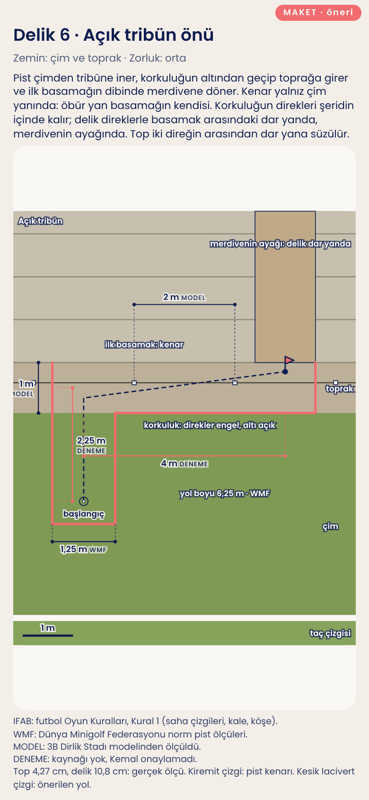 | 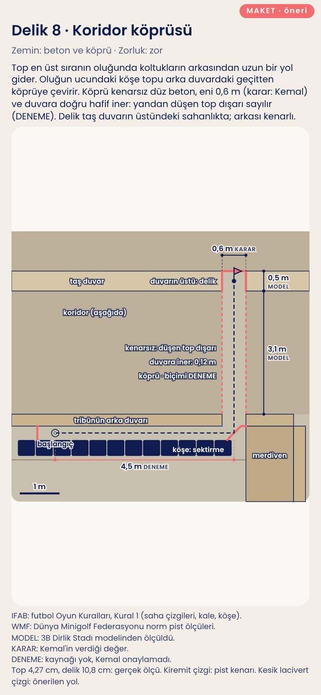 | 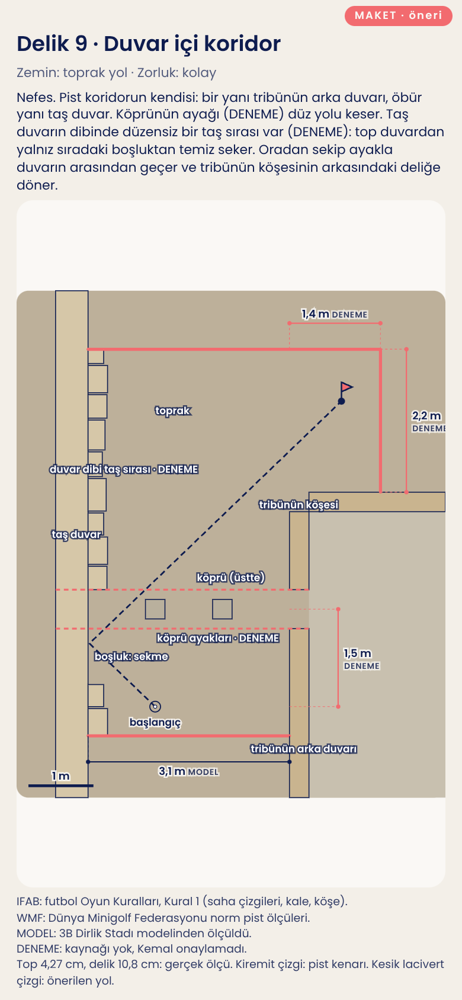 |
| 6 · Açık tribünün önü | 8 · Koridor köprüsü | 9 · Duvar içi koridor |

| | | | |
|---|---|---|---|
|  |  |  | 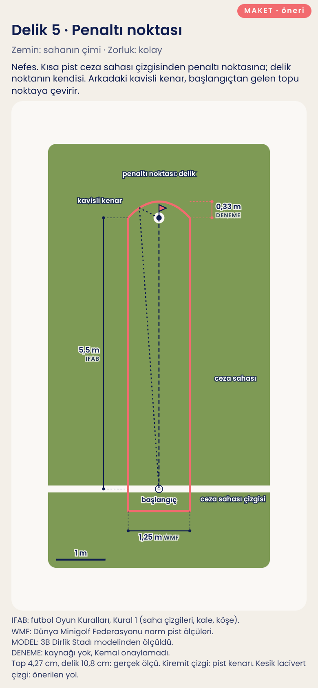 |
| 1 · Orta yuvarlak | 2 · Kenar çizgisi | 4 · Köşe | 5 · Penaltı noktası |
|  |  |  | 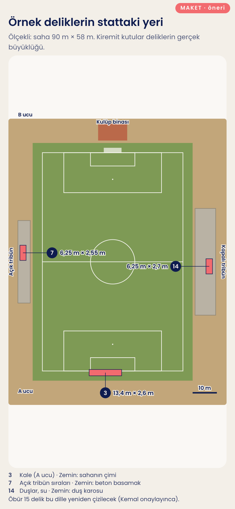 |
| 3 · Kale | 7 · Açık tribün sıraları | 14 · Duşlar | Stattaki yerleri (ölçekli) |

Modelle ilgili not: modelde toprak zemin ile çimin tabanı aynı yükseklikte olduğu için saha kenarında
titreme oluyordu; makette düzeltildi, modelin kendisinde de düzeltilmesi iyi olur (Kems Ajans).

### 4.9 Kalan 15 delik: adım planı (18 Kasım)

**Karar (Kemal, 18 Kasım):** dil 18 deliğe yayılır; kalan 15 delik aynı dille, adım adım, ayrı PR'larda gelir.

**Öneri** (sıra ve adım başına delik sayısı; Kemal değiştirebilir). Her adım tek PR: o deliklerin üstten
ölçülü şeması, delik ve atış maketi, belgedeki tarifi. Her adım bir öncekini Kemal gördükten sonra başlar.
Delikler yere göre toplandı; turun sırası (1–18) değişmez.

| Adım | Delikler | Yer | Zemin | Not |
|---|---|---|---|---|
| 1 | 1, 2, 4, 5 | Saha: orta yuvarlak, kenar çizgisi, köşe, penaltı noktası | çim | **Çizildi (18 Kasım; birleşti, PR #4).** Tarifleri 4.8'de. Eşyalar 19 Kasım'da gerçeğe yakın çizildi |
| 2 | 6, 8, 9 | Açık tribünün önü, koridor köprüsü, duvar içi koridor | çim ve toprak, beton basamak ve köprü, toprak yol | **Çizildi (19 Kasım; birleşti, PR #6).** Kemal'in aynı gün cevapları işlendi (taç, köprü, sulama, zorluk, banklar). Tarifleri 4.8'de |
| 3 | 10, 11 | Kulüp binası, ışık direği | ~~binanın önü~~ binanın sundurmasının altı (zemini modelden bakılacak), toprak yol | B ucu; kulüp binası açık tribün köşesinde (Kemal, 19 Kasım) |
| 4 | 12, 13, 15 | Oyuncu tüneli, soyunma odası, soyunma odası kapısı | beton ya da zift, karo | Bu yerler modelde yok; 14 gibi kodla çizilir. 15'in hareketli kapısı en sona kalır, önce durağan hâli |
| 5 | 16, 17, 18 | Kapalı tribün, bayrak direği, final (orta yuvarlak) | beton basamak ve koltuklar, toprak, çim | Hareketli engeller burada; en son |

Toplam 4 + 3 + 2 + 3 + 3 = 15 delik; adım 2'den sonra yeni dille 10 delik var, kalan 8 (adım 3–5). Her delikte: gerçek ölçü, yerin kendi zemini, kiremit ince kenar, yerin
şekli ve eşyasıyla kurulan bulmaca; kaynağı olmayan değer DENEME. 4.4'teki zorluk dalgası her adımda o
deliklere göre yeniden yazılır. 18 delik bitince 4.5 ve eski kartlı şema (4. bölümün eki) yenisiyle değişir.

## 5. Ses ve görsel dil

### 5.1 Ses

**Öneri** (Kemal onaylamadı):
- **Efektler:** vuruş, banttan sekme, deliğe girme, rampa ve basamak, kum, su, kapı ve hareketli
  engellerin hafif mekanik sesi. Az ve yumuşak.
- **Ortam:** boş, sakin stat: rüzgâr, uzaktan zeytinlik hışırtısı (künye "Doğa": zeytinlik). Maç
  olmayan gün; seyirci sesi yok. Tünel ve soyunma odasında ses biraz yankılı.
- **Müzik:** seyrek; ortam sesi önde (The Imperial Kemskoy'daki karara yakın).
- Efektler, ortam ve müzik ayrı kısılır.
- **Karar (Kemal, 19 Kasım):** sesler sonra. Dokunmatik titreşim de olur; seslerle birlikte, sonra gelir.
- Sesler yalnız ücretsiz ve ticari kullanıma açık kaynaklardan; her biri `docs/lisanslar.md`'ye, kaynağı Kemal'e sorularak.

### 5.2 Görsel dil

**Karar (Kemal, 16 Kasım):** İllüstratör 2–3 deneme hazırlar; Kemal seçer. Seçim bu belgeye yazılır.

**Öneri:**
- Denemeler Stadyum turunun bir deliği üzerinden yapılır (öneri: 1. delik ya da 7. delik), dikey
  ekran, eğik yukarıdan; temel 3B modelin yerleşimi korunur.
- Renkler marka kitinden: lacivert, krem, az kiremit; yazı tipi Poppins. Modelin kiremit çatısı ve
  çimi kendi renginde kalır.
- ~~Low-poly, mat yüzey (Dondurmacı Kızlar'daki tasarım dili örnek). Hangi dil olduğu: [Kemal].~~

**Karar (Kemal, 19 Kasım):** görsel dil **dokulu gerçekçi**: çim, beton, ahşap dokuları; gerçekçi ışık ve gölge;
gamzeli golf topu; gerçek ağ. Low-poly önerisinin yerine geçer. Doku kaynağı: Poly Haven ve ambientCG (CC0).
Oynanabilir prototipteki uygulaması: 6.4 "Görünüş". İllüstratör denemesi kararı (yukarıda) geçmiş olarak durur.

## 6. Teknik, kapsam ve ilk sürüm

### 6.1 Teknik

**Öneri:**
- Vite + React + TypeScript; 3B için Three.js ve React Three Fiber (Dondurmacı Kızlar gibi). İskelet
  bu öneriyle kuruldu (16 Kasım).
- Fizik: ~~hazır bir fizik kütüphanesi (ör. Rapier)~~ ilk delik denemesinde seçildi (19 Kasım): tek top için
  yazılmış küçük bir çözücü, hazır kütüphane yok (6.4).
- 3B Dirlik Stadı modeli (`dirlik-stadi.glb`) sahnenin temeli; pistler modelin üstüne ayrı parçalar
  olarak konur. **Karar (Kemal, 16 Kasım)**: model oyunda kullanılır (`docs/lisanslar.md`).
- Her delik ayrı bir veri dosyası (pist parçaları, engeller, başlangıç ve delik yeri); kod delik delik büyür.
- Telefonda akıcılık önce: az çokgen, az ışık, ölçülü gölge.
- Telefon uygulaması sonra; paketleme öbür oyunlardaki gibi Capacitor.
- Başka minigolf oyununun görseli, adı, sahası, deliği kopyalanmaz; yalnız tür örnektir.

### 6.2 İlk oynanabilir sürüm

**Öneri:**
- Stadyum turunun 1. deliği: tek parmak vuruş, nişan çizgisi, geri al, delik sonu.
- Sonra delikler sırayla, her biri Kemal denedikten sonra (4.6).
- Türkçe ve İngilizce metin dosyaları.
- Web deneme sürümü: Kemal ve yakın çevresi bağlantıyla dener; reklam ve satın alma yok.
- İlk sürümde değil: reklam, satın alma, çok oyunculu, mevsim ve saat değişimi, ikinci tur, pul ekranı.

### 6.3 Para modeli

**Karar (Kemal, 15 Kasım):** yalnız telefon uygulamasında; kart oyunu gibi: ipucu gibi yardımcılar
reklamla, birkaç delikte bir seyrek reklam, reklamsız paket. Sıklık ve fiyat [Kemal]. Web
denemesinde reklam ve satın alma yok.

### 6.4 Oynanabilir prototip (19 Kasım; öneri, Kemal telefonda deneyecek)

Adres: `?oyna=1` (yayında https://hkemal94.github.io/minigolf/?oyna=1). Kod `src/oyun/`; maketlere dokunmaz.
Delikler yeniden yazılmadı: yerleri ve ölçüleri maketin verisinden (`src/maket/ornekDelikler.ts`) okunur.
Sıra: 3 (kale), 1 (orta yuvarlak), 7 (tribün sıraları).

**Fizik yaklaşımı: kendi küçük çözücümüz** (`src/oyun/fizik.ts`), hazır kütüphane yok. Neden:
- Oyunda hareket eden tek şey bir top; dünya düz zemin, basamak, bordür, direk, koltuk gibi kutulardan oluşuyor.
  Bunun için genel bir fizik motoru (Rapier, cannon-es) gereğinden büyük: Rapier telefona yaklaşık 2 MB ek
  indirme getirir; ikisinde de 2 cm'lik hızlı topun ince bordürden geçmemesi ve düz zeminde parçaların birleştiği
  yerde zıplamaması için ayrıca ayar gerekir.
- Aynı vuruş her telefonda aynı sonucu verir (hesap adımı sabit: saniyede 480). Deneme botu da aynı kodu
  çalıştırıp oyundaki sonuçla karşılaştırıyor (fark 0).
- Hareketli engeller ve eğim gelince (rampa, dönen kol) çözücü yetmezse kütüphaneye geçilir; delik verisi
  aynı kalır, yalnız `fizik.ts` değişir.

**Top nasıl davranıyor** (gerçek ölçü: top 42,67 mm, delik 108 mm):
- Top gerçek bir küre: yerçekimiyle düşer (tribünde bir alt sıraya iner), zeminde yuvarlanıp yavaşlar, bordürden,
  direkten, huniden, koltuktan seker; kale ağı topu yumuşak durdurur.
- Delik gerçek bir oyuk (derinlik 10,16 cm): top kenarından döner; yavaşsa düşer, çok hızlıysa karşı kenara
  çarpıp atlar. Hesapta top deliğe yaklaşık 1,8 m/s'ye kadar düşüyor, 2,2 m/s'de atlıyor.
- Tribünde koltuklar gerçek boyunda: tam güçte vurulan top sırtlığın üstünden aşıp alt sıralara kaçabiliyor
  (dışarı sayılır). Deneme notu: bu istenir mi, yoksa güç sınırı mı düşsün.

**DENEME değerleri** (hepsi `src/oyun/ayarlar.ts`; Kemal onaylamadı):

| Ne | Değer | Not |
|---|---|---|
| Güç sınırı (en güçlü vuruşta topun hızı) | 8,5 m/s (19 Kasım; önce 5) | Kemal: "top çok yavaş". 3. delik tarifteki yolla gücün yaklaşık %61–69'unu istiyor (tek vuruşta deliğe giren hızlar 4,1–4,85 m/s); önce %90'dı. Bir hesap adımında top en çok 1,8 cm gider, duvardan geçemez |
| Gücün dolduğu çekme boyu · en kısa çekme (altı iptal) | 150 · 14 piksel | |
| Güç eğrisi (üs) | 1,5 | kısa vuruş daha ince ayarlanır |
| Topa dokunma payı | 44 piksel | |
| Çimde yavaşlama | 0,55 m/s² (değişmedi) | orta hızda golf yeşili: Stimpmeter topu 1,83 m/s ile bırakır, 10 fit (3,05 m) giderse 0,55 (İngilizce Vikipedi "Stimpmeter", 19 Kasım'da okundu); "10 fit" seçimi DENEME |
| Betonda yavaşlama | 0,4 m/s² | kaynağı yok |
| Sekme: bordür · direk · huni ve koltuk · ağ | 0,72 · 0,6 · 0,5 · 0,1 | çarpmadan sonra kalan hız oranı; kaynağı yok |
| Düşen topun zeminden sekmesi: çim · beton | 0,25 · 0,4 | kaynağı yok |
| Delik: kenardan sekme · tabandan sekme · derinlik | 0,3 · 0,15 · 0,1016 m | derinlik golf kuralındaki en az 4 inç; bu oturumda kaynaktan okunmadı |
| Duvara sürtünme | 0,12 | kaynağı yok |
| Kamera: yakınlık · en uzak · en yakın | 200 · 25 · 420 piksel/m | 200: ekranın eni yaklaşık 1,95 m (maketteki uzaklık; **Karar (Kemal, 19 Kasım)**, artık DENEME değil); en uzak 19 Kasım'da 55'ten 25'e (ekranın eni 7,1 m yerine 15,6 m) |
| Kamera eğimi: başta · en az · en çok | 52° · 20° · 80° | en az: yere yatmaz, yerin altına inmez; en çok: tam tepeden bakmaz |
| Tek parmakla çevirme · eğme hızı | 0,012 · 0,006 radyan/piksel | yaklaşık 520 piksel sağa sola sürükleme bir tam tur |
| Vuruştan sonra izleme: sıkılık · dönme | 12 · 1,2 (top 2 m/s'den yavaşken orantılı az) | kamera topun arkasına döner; oyuncu elle çevirirse o vuruş için bırakır |
| "Deliğe bak" dönüşünün yumuşaklığı | 8 | |
| Kolay mod (topun duracağı yer) başta | kapalı (normal mod) | **Karar (Kemal, 19 Kasım)**; ayar menüsünden açılır, telefonda hatırlanır (`OYUNCU.kolayMod`) |
| Kale filesinin göz aralığı · ip kalınlığı | 0,12 m · 9 mm | kaynağı yok; ip telefonda seçilsin diye gerçeğinden kalın |
| Kamera başlangıç yönü | maketteki bakış | topun arkasından, biraz yandan |
| Top dışarı çıkarsa | son vuruşun yerine döner, vuruş sayılır, +1 ceza vuruşu | **Karar (Kemal, 19 Kasım)**; artık DENEME değil (`KURAL.disariCeza`) |
| Bir vuruşun en uzun süresi | 30 sn | top sıkışırsa oyun kilitlenmesin diye |

Yerçekimi 9,81 m/s² (gerçek). Kale direği 2,44 m (IFAB). Huni boyu maketteki gibi 0,3 m (DENEME).

**Kontroller (19 Kasım, Kemal'in telefon denemesinden sonra; öneri):**
- **Kamera:** tek parmak topun üstünde vurur; tek parmak boşta sağa sola sürüklenince kamera topun çevresinde tam tur
  döner (sınırsız), yukarı aşağı sürüklenince eğilir (20°–80°). İki parmak yakınlaştırır ve çevirir. Vuruştan sonra
  kamera top durana kadar topu izler ve yavaşça topun arkasına döner. "Deliğe bak" düğmesi kamerayı tek dokunuşla topun
  arkasına çevirir; delik topun tam önünde kalır.
- **Güç:** sınır 5'ten 8,5 m/s'ye çıktı; çim yavaşlaması aynı. Güç çubuğunda %25, %50, %75 çentikleri.
- **Kolay mod** (küçük ayar menüsü, sağ alttaki düğme): çekerken topun duracağı yer halkayla gösterilir; aynı fizikle,
  sekmeler dahil hesaplanır (dışarı çıkacaksa halka kiremit). Kapalıyken gösterilmez.
- **Kale filesi:** modeldeki dolu file (cam gibi görünüp çimle titriyordu) oyunda çizilmez; yerine ince çizgilerden ağ:
  iki yan, arka ve üst file, fizikteki ağlarla aynı yerde.

**Görünüş: dokulu gerçekçi (19 Kasım; öneri, PR #11; karar 5.2):**
- **Dokular:** sahanın çimi (modelin iki tonlu biçme şeritleri korunur), toprak zemin, beton (tribün basamakları),
  taş duvar ve ahşap gerçek dokuyla çizilir. Kaynak yalnız Poly Haven ve ambientCG (CC0; `docs/lisanslar.md`).
  Stat modelinin dosyasına dokunulmaz: malzemeleri yüklenirken kodda değişir; doku modelin kendi rengine ayarlanır,
  yani renkler aynı kalır, yüzey dokulu olur. Modelde sahanın çevresinde ayrı bir çim yok (çevre toprak); eklenmedi.
- **Bordür:** kiremit rengi aynı; yüzeyi boyalı beton gibi hafif pürüzlü.
- **Top:** gamzeli beyaz golf topu; yuvarlanırken döner (yalnız görüntü). Gamzeler kodla hesaplanır.
- **Kale filesi:** çizgiler yerine ip dokulu gerçek ağ (arası boş); titremez, uzaktan ipler incelip solar.
- **Delik bayrağı:** donuk durmaz, hafif rüzgârda dalgalanır. Kutlama dalgası: aşağıda "Par, yıldız, kutlama, ortam".
- **Işık:** sakin gün ışığı (maçsız gün): tek güneş, yumuşak gölge, gökten ve yerden dolgu ışığı; topta hafif gök
  yansıması. Gölge veren tek ışık var. Önceki sürümde güneş deliğe değil stadın köşesine bakıyordu, gölgeler
  çoğu delikte görünmüyordu; düzeltildi.
- **Kalite düşürme:** oyun kare hızını ölçer; düşükse gölgeleri kapatır (o açılış için). Eşik DENEME.
- **Fizik değişmedi:** bu adımda yalnız görüntü değişti; `fizik.ts`, delik verisi ve vuruş ayarlarına dokunulmadı.

Görünüşün DENEME değerleri (`src/oyun/ayarlar.ts` → `GORUNUS`; Kemal onaylamadı):

| Ne | Değer | Not |
|---|---|---|
| Dokunun yerde kapladığı kenar: çim · toprak · beton · taş · ahşap | 1,4 · 2,07 · 2,0 · 2,0 · 1,5 m | kaynağın kendi ölçüsü (ambientCG ve Poly Haven sayfalarından) |
| Çim ve beton dokusunun kontrastı | 0,6 · 0,45 | lekeli görünmesin diye azaltıldı (`scripts/dokulari-hazirla.py`) |
| Kabartı gücü: çim · toprak · beton · taş · ahşap · bordür | 0,7 · 0,8 · 0,7 · 1,2 · 0,8 · 0,5 | |
| Güneş: yön (x, y, z) · güç | 22, 40, 26 · 2,8 | yaklaşık 50° yüksekte; renk sıcak beyaz |
| Dolgu ışığı gücü | 1,7 | gök açık mavi, yer toprak rengi |
| Gölge dokusunun kenarı | 2048 piksel | kutu deliğin tamamını kaplar |
| Gölgelerin kapandığı kare hızı | saniyede 30 karenin altı | 2 sn'lik iki ölçüm art arda düşükse; ilk 2 sn sayılmaz |
| Top: gamze sayısı · gamze gücü | 336 · 0,8 | gerçek toplardaki sayı kaynaktan okunmadı |
| Bayrak: dalga genliği · hızı · dalga sayısı | 1,4 cm · 3,2 · 1,3 | |
| Eğik bakışta doku netliği | en çok 4 | |

**Çizim yükü (bilgisayarda, telefon boyutunda 390 × 844, yazılımla çizen tarayıcıda; delik 3 · 1 · 7):**

| | Önce | Sonra (gölge açık) | Sonra (gölge kapalı) |
|---|---|---|---|
| Çizim çağrısı | 41 · 50 · 45 | 48 · 66 · 52 | 24 · 32 · 27 |
| Üçgen | 21 616 · 22 768 · 28 660 | 25 616 · 27 532 · 39 164 | 12 746 · 13 730 · 19 622 |
| Doku belleği (yaklaşık) | 16 MB (yalnız gölge dokusu) | 42 MB (dokular 26 + gölge 16) | 26 MB |
| Saniyedeki kare (yazılımla çizim) | 7,2 · 7,2 · 4,2 | 5,0 · 5,4 · 2,2 | 6,7 · 6,6 · 4,0 |
| İndirilen doku dosyaları | yok | 10 dosya, 0,77 MB | aynı |

Kare sayıları ekran kartı olmayan bir bilgisayarda ölçüldü; telefondaki hızı göstermez, yalnız önce ile sonrayı
karşılaştırır. Üçgen ve çağrı artışının çoğu gölgenin artık deliğin üstünde gerçekten çizilmesinden.
**Gerçek telefonda denenmedi; telefondaki kare hızı ölçülmedi.**

Görüntüler: `ekranlar/oyna-doku-1-delik-3.jpg` … `oyna-doku-7-oncesi-sonrasi.jpg`; önceki hâlleri
`galeri/eski/doku-oncesi/`.

**Par, yıldız, kutlama, ortam, rozetler (19 Kasım; öneri, PR #12; kararlar 3.1, 3.3, 8):**
- **Par ve yıldız:** her deliğin par'ı üstteki bilgide, delik sonu kartında ve tur sonundaki listede yazar. Delik
  bitince vuruş sayısına göre en çok üç yıldız verilir; tur sonunda delik delik yıldızlar ve toplamı görünür.
  "Kaybettin" yok: en kötü sonuç bir yıldız.
- **Kutlama:** top deliğe düşünce bayrak delikten kalkar, bir süre daha geniş dalgalanır; deliğin çevresinde iki ince
  halka açılıp kaybolur (çimde krem, betonda lacivert). Delik sonu kartı kutlamadan sonra açılır. Konfeti, ses,
  titreşim yok (ses ve titreşim sonra; 5.1).
- **Maçsız gün ortamı:** rüzgâr yavaşça artıp azalan bir esinti; delik bayrağının dalgası esintiyle büyür, duvarın
  dışındaki ağaçların (modeldeki zeytinler) yaprakları salınır, çimin üstünden hafif açılıp koyulan bantlar geçer.
  Deliğin üstünde iki küme hâlinde beş kuş döner (kanat çırpar, arada süzülür). Uzakta beş kişi: A ucunda kale
  çizgisinin gerisinde duran bir kişi, orta yuvarlağın içinde duran iki kişi, açık tribünün önünde korkuluğun yanında
  duran bir kişi, A ucunda duvar içindeki toprak yolda yürüyen bir kişi. Ad, yüz, hikâye yok; tür adı yok. İnsanlar
  pistlerin en az 2 m dışında; top onlara ulaşamaz, fizikte yoklar. Hepsi kodla çizilir (`src/oyun/Ortam.tsx`); dış
  model eklenmedi. **Karar (Kemal, 19 Kasım, sonra): insanlar bir müddet yok** ("bir müddet gerek yok"). Tek ayarla
  kapalı (`ORTAM.insanlarAcik: false`): hiç çizilmezler, çizim çağrısı da düşer (4 çağrı). Kod ve yerler duruyor;
  ileride açılınca aynen döner. Kuşlar, bayrak, ağaç ve çim esintisi aynen kalır.
- **Rozetler:** tur sonundaki delik listesinde, delik numarasının yanında küçük simgeler: tek vuruşta delik (kiremit
  daire içinde 1), par altı (aşağı ok), cezasız bitirme (onay işareti). Listenin altında tek satır açıklama. Rozetlere
  ad konmadı; pulun yerine geçmez (8. bölüm). **Karar (Kemal, 19 Kasım):** üçü kalır; adları sonra [Kemal].
- **Kalite düşürme:** kare hızı düşüp gölgeler kapanınca ortam da azalır: 2 kuş, 3 kişi (yürüyen kalkar); ağaç ve çim
  hareketi durur. Bayrak ve kutlama aynı kalır.
- **Fizik değişmedi:** `fizik.ts`, delik verisi ve vuruş ayarlarına dokunulmadı; bot üç deliği aynı vuruşlarla bitirdi.

Kemal'in kararı (19 Kasım; `src/oyun/ayarlar.ts` → `PUAN`, "Karar: Kemal, 19 Kasım 2026"):

| Ne | Değer | Not |
|---|---|---|
| Par: delik 3 · 1 · 7 | 3 · 2 · 4 | zorluk kelimesinden (4.8): kolay 2, orta 3, zor 4 |
| Yıldız | par ya da altı 3 · par + 1 vuruş 2 · daha fazlası 1 | en çok 3, bitmiş delikte en az 1 |
| Rozetler | tek vuruş · par altı · cezasız | üçü kalır; adları [Kemal]; "geri almadan bitirme" geri al gelince |
| Uzaktaki insanlar | kapalı (`ORTAM.insanlarAcik: false`) | "bir müddet gerek yok"; kod duruyor |

DENEME değerleri (`src/oyun/ayarlar.ts` → `KUTLAMA`, `ORTAM`; Kemal onaylamadı):

| Ne | Değer | Not |
|---|---|---|
| Kutlamanın süresi (kart bu kadar sonra açılır) | 1,7 sn | |
| Bayrağın kalkışı · süresi | 28 cm · 0,55 sn | |
| Kutlamada dalga genliği · sönmesi | olağanın 3,2 katı · 1,1 sn | |
| Halka: açıldığı çap · süre · ikincinin gecikmesi | 55 cm · 1,1 sn · 0,28 sn | |
| Esintinin bayrağa katkısı | genlik esintiyle en çok %25 büyür ya da küçülür | |
| Ağaç: tepedeki salınım | en çok 6 cm | yaprakların başladığı yükseklik (2,3 m) ve boyu (2,6 m) modelden ölçüldü |
| Çim esintisi: parlaklık · dalga boyu · hız | %7 · 9 m · 2,2 m/sn | |
| Kuş: sayı · kanat açıklığı · yükseklik · hız · dönüş yarıçapı | 5 · 32 cm · 5 ve 8 m · 5 m/sn · 12 ve 17 m | kaynağı yok |
| İnsan: sayı · boy · yürüme hızı | 5 · 1,7 m · 0,9 m/sn | kaynağı yok; yerler yukarıda; 19 Kasım'dan beri kapalı |
| Düşük kalitede kuş · insan | 2 · 3 | insanlar kapalıyken 0 |

**Çizim yükü (bilgisayarda, telefon boyutunda 390 × 844, piksel oranı 1, yazılımla çizen tarayıcıda; delik 3 · 1 · 7):**

| | Önce (ana dal, PR #11) | Sonra |
|---|---|---|
| Çizim çağrısı, gölge açık | 48 · 66 · 52 | 53 · 71 · 57 |
| Üçgen, gölge açık | 25 616 · 27 532 · 39 164 | 26 486 · 28 402 · 40 034 |
| Çizim çağrısı, gölge kapalı (ortam azaltılmış) | 24 · 32 · 27 | 29 · 37 · 32 |
| Üçgen, gölge kapalı | 12 746 · 13 730 · 19 622 | 13 262 · 14 246 · 20 138 |
| Doku belleği (yaklaşık) | 42 MB · gölge kapalı 26 MB | aynı (yeni doku yok) |
| Saniyedeki kare, gölge açık | 6,1 · 6,2 · 2,1 | 9,1 · 7,5 · 2,7 |
| Saniyedeki kare, gölge kapalı | 9,6 · 9,5 · 3,5 | 10,3 · 9,0 · 4,2 |
| İndirilen yeni dosya | yok | yok |

Ortam beş çizim çağrısı ekler (kuşların hepsi 1; insanlar 4: gövde, baş, bacak, yerdeki gölge) ve en çok 870 üçgen.
İnsanlar kapanınca (Kemal, 19 Kasım; PR #14) ortam yalnız 1 çağrı ekler. Ölçüm (aynı bilgisayar, delik 3 · 1 · 7,
başlangıç bakışı): çizim çağrısı gölge açık 53 · 71 · 57 → 49 · 67 · 53, gölge kapalı 29 · 37 · 32 → 25 · 33 · 28;
üçgen gölge açık 840, gölge kapalı 504 azaldı. Kuşlar aynı (5; düşük kalitede 2).
Ağaç ve çim hareketi yeni çizim getirmez. Kare sayıları ekran kartı olmayan bir bilgisayarda, art arda 6 saniyelik
ölçümlerle alındı (önce sonra, hemen ardından önce) ve çok oynak: aynı "önce" sürümü gün içinde 13,9 · 14,2 · 5,3 ve
8,6 · 8,1 · 2,8 de ölçüldü (gölge açık). Bu ölçümle önce ile sonra arasında güvenilir bir fark gösterilemedi; sayılar
telefondaki hızı göstermez.
**Gerçek telefonda denenmedi; telefondaki kare hızı ölçülmedi.**

Görüntüler: `galeri/eski/insan-oncesi/oyna-par-1-ortam.jpg` (delik 3, biraz uzaklaştırılmış ve eğilmiş bakış; insanlar kapanmadan önce), `oyna-par-2-kutlama.jpg`,
`oyna-par-3-delik-sonu.jpg`, `oyna-par-4-tur-sonu.jpg`, `oyna-par-5-kolaj.jpg`; delik sonu ve tur sonu kartlarının
önceki hâlleri `galeri/eski/par-oncesi/`.

**Engel şeffaflığı ve kamera (19 Kasım; öneri, PR #13; Kemal'in isteği):**
- **Engelin arkasındaki top:** top kameradan bakınca bir engelin arkasında kalırsa (tribünün taş duvarı, basamak,
  koltuk, kulüp binası, sundurma, kale direği, bordür, huni; stat modelinde zemin olmayan her şey) engel topun çevresinde
  yuvarlak, yumuşak kenarlı bir pencerede şeffaflaşır; top görünür ve çevresine ince bir halka çıkar (rengi ayar
  menüsünden; başta krem). Engel açılınca
  pencere yumuşakça kapanır. Zemin (çim, toprak, saha çizgisi), kale filesi (zaten ağ), top ve işaretler şeffaflaşmaz.
- **Neden bütün engel değil, pencere:** stat modeli malzemeye göre birleşik (bütün taş duvarlar tek parça, bütün
  basamaklar tek parça); engel tek tek soldurulursa bütün stadın duvarları birden solardı. Pencere yalnız topun
  önündeki ve topun üstündeki yüzeyi şeffaflaştırır; topun üstünde durduğu basamak şeffaflaşmaz.
- **Telefonda ucuz:** topun engelin arkasında olup olmadığına saniyede 10 kez bakılır (her karede değil); top da
  kamera da yerinde duruyorsa (nişan alırken) hiç bakılmaz. Malzeme kopyalanmaz; ek çizim yalnız halka (1 çağrı).
- **Kamera:** en uzak hâl 55'ten 25 piksel/m'ye indi (telefonun eninde 7,1 m yerine yaklaşık 15,6 m görünür).
  Kamera eğik yukarıdan dik izdüşümle bakar; "görüş açısı" ayrı bir ayar değil, görünen alanı bu sınır belirler.
  Başlangıç yakınlığı (200, maketteki uzaklık; Kemal 18 Kasım) değişmedi. Uzaklaşıp yere yaklaşınca ekranın alt
  ucundaki yer kesiliyordu (eski en uzak hâlde de 20°'de oluyordu); kamera o zaman kendi bakış çizgisinde geri çekilir,
  görüntü küçülmez. Saha dışındaki boşluk görünebilir; gökyüzü ve ada ayrı adım.
- **Fizik değişmedi:** `fizik.ts`, delik verisi ve vuruş ayarlarına dokunulmadı; bot aynı vuruşlarla (1, 1, 4) bitirdi.
- **Delik için de (Kemal, 19 Kasım; öneri, PR #14):** delik ve bayrağı kameradan bakınca bir engelin (taş duvar,
  basamak, koltuk, bina…) arkasında kalınca deliğin çevresinde aynı yumuşak pencere açılır; pencere delik ağzından
  yukarısını, bayrakla birlikte kapsar. Saydamlık, süre ve pencere boyu topunkiyle aynı; deliğin çevresine de aynı
  renkte halka çıkar. Top ve delik birlikte gizliyse iki pencere birden açıktır. Delik yerinden oynamadığı için ışın
  (üç ışın: delik ağzı, bayrağın ortası, ucu) yalnız kamera oynayınca atılır, en çok saniyede 10 kez. Malzeme
  kopyalanmaz; ek çizim yalnız deliğin halkası (pencere açıkken 1 çağrı). Engeller aynı (`seffaflik.ts`).
- **Halkanın rengi** (Kemal, 19 Kasım): ayar menüsünde krem, lacivert, kiremit; başta krem; hem topun hem deliğin halkası.
- Görüntüler (PR #14): `ekranlar/oyna-karar-1-ortam-insansiz.jpg`, `oyna-karar-2-ayarlar.jpg`, `oyna-karar-3-iptal.jpg`,
  `oyna-karar-4-delik-oncesi-sonrasi.jpg`, `oyna-karar-5-kolaj.jpg`. Bot (19 Kasım): hepsi tamam; delik 7'de duvarın
  gerisinden bakınca iki pencere birden açıldı, bakış dönünce deliğinki kapandı.

Kemal'in kararı (19 Kasım; `src/oyun/ayarlar.ts`, "Karar: Kemal, 19 Kasım 2026"):

| Ne | Değer | Not |
|---|---|---|
| Şeffaflaşan yerin opaklığı | 0,25 | böyle kalır (`SEFFAFLIK.opaklik`) |
| Kameranın başlangıç yakınlığı | 200 piksel/m | maketteki uzaklık, şimdiki gibi (`KAMERA.yakinlik`) |
| Halkanın rengi | krem · lacivert (#0E1C4F) · kiremit (#F26B6F); başta krem | ayar menüsünden seçilir, telefonda hatırlanır (`OYUNCU.halkaRengi`) |

DENEME değerleri (`src/oyun/ayarlar.ts` → `SEFFAFLIK` ve `KAMERA`; Kemal onaylamadı):

| Ne | Değer | Not |
|---|---|---|
| Açılma ve kapanma süresi | 0,3 sn | |
| Engelin arkasında mı diye bakma sıklığı | saniyede 10 | yerinde dururken bakılmaz |
| Pencerenin yarıçapı | 110 ekran pikseli | yakınlaşınca da uzaklaşınca da ekranda aynı boy |
| Halkanın opaklığı · boyu | 0,9 · top yarıçapının 1,9 katı | uzaklaşınca küçülmez |
| Kamera en uzak | 25 piksel/m | önce 55 |
| Uzaklaşınca kesilme payı | 10 m | yüksek duvarlar ekranın altında kesilmesin |

Çizim yükü (bilgisayarda, telefon boyutunda, yazılımla çizen tarayıcıda, gölge açık; delik 3 · 1 · 7): çizim çağrısı
önce ve sonra aynı (48 · 66 · 52); top engelin arkasındayken +1 (halka). Üçgen aynı, halkayla +64. Bir bakışın süresi
(iki ışın) bilgisayarda ortada 1,3 ms, en çok 5,4 ms. Saniyedeki kare yazılımla çizimde, dört ölçümün aralığı: önce
5,7–8,1 · 5,7–8,3 · 2,2–3,5; sonra 6,2–8,7 · 4,9–15,1 · 1,9–2,7. Makine o sırada başka işlerle yüklüydü, ölçümler çok
oynak; 7. delikte sonrası biraz düşük görünüyor ama aralıklar üst üste biniyor, kesin bir fark söylenemez.
**Gerçek telefonda denenmedi; telefondaki kare hızı ölçülmedi.**

Görüntüler: `ekranlar/oyna-seffaf-1-tas-duvar.jpg` … `oyna-seffaf-4-oncesi-sonrasi.jpg`; önceki hâlleri
`galeri/eski/seffaf-kamera-oncesi/`.

**Bu prototipte yok:** geri al, kaldığı yerden devam, ses, vuruş sınırı, zorluk yazısı, ana ekran, skor kartı
ekranı, pul. Nişan oku yalnız yönü ve gücü gösterir; sekmeyi yalnız kolay moddaki durma yeri halkası hesaba katar.

**Nasıl denendi:** bilgisayarda telefon boyutunda (390 × 844), dokunmatik olarak; bot gerçek parmak hareketiyle
üç deliği de deliğe soktu, sekmeyi, güç sınırını, kamerayı ve dışarı çıkıp geri dönmeyi doğruladı
(`scripts/oyna-bot.mjs`). Tarifteki yollar hesapta çalışıyor: 3. delikte yakın direği sıyırıp köşeden dönen top
deliğe 0,3 m kalıyor ya da giriyor; 1. delikte dış kenardan seken top deliğe 0,45 m kalıyor; 7. delikte oluk
boyunca vurulan top köşeden dönüp bir alt sıranın oluğuna iniyor. **Gerçek telefonda denenmedi**; akıcılık
ölçülmedi (çizim yükü hafif: karede 44 çizim, yaklaşık 28 bin üçgen).

Görüntüler: `ekranlar/oyna-1-delik-3-baslangic.png` … `oyna-6-delik-7-disari.png` (delik sonu ve tur sonu kartlarının o günkü
hâli `galeri/eski/par-oncesi/` altında).
Kontroller (19 Kasım): bot ayrıca tam tur çevirmeyi, eğmenin sınırlarını, izlemeyi, "Deliğe bak"ı, kolay mod halkasının
topun durduğu yerle aynı olduğunu (sapma 0) ve dışarı çıkan vuruşta sayacın 2 arttığını doğruladı. Tarifteki yolla 3. delik
tek vuruşta gücün %62–68'iyle deliğe giriyor (hesap). Görüntüler: `ekranlar/oyna-v2-1-baslangic.png` … `oyna-v2-9-disari-ceza.png`.

### 6.5 Öneri havuzu (19 Kasım raporundan)

**Öneri** (Kemal onaylamadı; karara bağlananlar ayrıca yazılı). Dışarıdan gelen rapordaki fikirler. ✓ = prototipte (#7, ana dalda) var; "1. PR'da" =
kamera ve güç PR'ında geliyor.

- Çekişin parmağın dokunduğu yerden ölçülmesi (dinamik çekme ölçeği).
- ~~Falso (topspin / backspin): köşede küçük top simgesiyle; etkisini gösteren nişan çizgisiyle birlikte (2. bölüm).~~
  **Karar (Kemal, 19 Kasım):** falso evet, sade ve tek elle; nişan oku ona göre değişir (2. bölüm). Nasıl seçildiği
  (ör. köşedeki küçük top simgesi) DENEME.
- Tek dokunuşla kuşbakışı ("Deliğe bak"ın yanında): 1. PR'da.
- Kamera duvara ve binaya girmesin (yaylı kol).
- Çekerken eğim ızgarası ve akış işaretleri (ayarlardan kapatılabilir).
- Engelin arkasında kalan top için röntgen gibi siluet.
- Havadaki topun altında dikey gölge.
- Top ince duvarlardan geçmesin (sürekli çarpışma denetimi). Prototipte hesap adımı sabit 1/480 sn; 5 m/s'de top adımda
  yaklaşık 1 cm gider. Güç artınca yeniden bakılır.
- Eğim gelince dikişsiz çarpışma yüzeyleri ve topun zemine oturtulması.
- Akıllı durma eşiği ✓.
- Gerçek çukur delik, kenardan dönüp atlama ✓.
- Sıkışan top: 3 sn sonra (DENEME) cezasız, en yakın düz yere. Bugün prototip topu ancak 30 sn sonra durduruyor.
- Anında yeniden başlat ✓ ("Deliği baştan", "Yeniden").
- Hayalet top (en iyi oyun).
- ~~Delik bazında rozetler (tek vuruş, geri alsız, riskli kestirme). Ortak ödül pul koleksiyonudur (Karar, 15 Kasım;
  8. bölüm); rozetler pulların yerine geçmeyen küçük işaretler olabilir.~~ **Karar (Kemal, 19 Kasım):** rozetler evet,
  küçük: delik listesinde küçük simgeler (tek vuruşta delik, geri almadan bitirme ve benzerleri); pulların yerine
  geçmez (8. bölüm).
- Delik arası kamera süzülmesi.
- ~~Dokunmatik titreşim (Kemal'e sorulacak).~~ **Karar (Kemal, 19 Kasım):** evet; seslerle birlikte, sonra (5.1).
- Yüzeye göre sesler (sesler sonra).

## 7. Açık sorular

Kemal'in kararını bekleyenler.

- ~~2. delik: taç çizgisi duvarsız sınır mı olacak?~~ Cevaplandı (Kemal, 19 Kasım): **(a)**, uç duvarsız, sınır taç
  çizgisinin kendisi. Çizgiyi geçen top dışarı sayılır (kuralın ayrıntısı 2. bölümde, DENEME). Seçilmeyenler: (b) uca
  alçak kenar, (c) delik çizgiden 1,5–2 m uzak. Çizim: `plan/delik-2-tac-secenekleri.png` (karar hâli).

  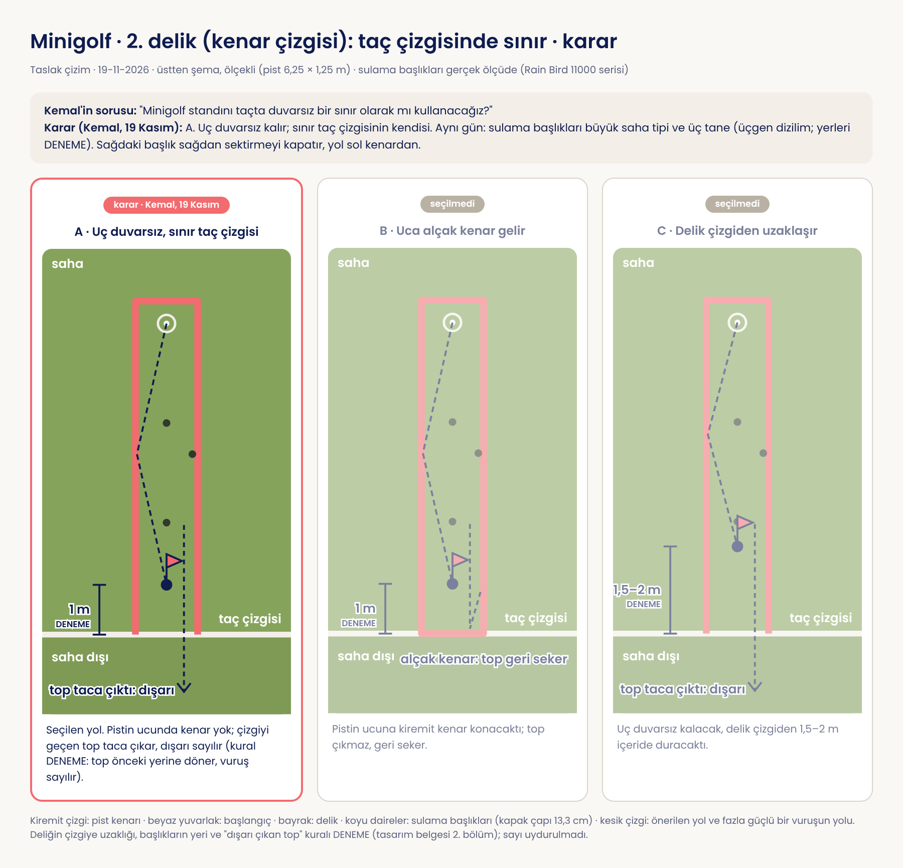
- ~~8. delik: köprünün biçimi~~ Cevaplandı (Kemal, 19 Kasım): kenarsız ve korkuluksuz düz beton, en 0,6 m. Kalınlığı
  ve koridordaki iki ayağı DENEME.
- ~~9. delik: duvar dibindeki taş sırası~~ Cevaplandı (Kemal, 19 Kasım): taş sırası yerine saha kenarı bankları.
- **Zorluk düzeltmesindeki yeni yerleşimler** (19 Kasım; 4.4, 4.8): huni kapısı (1), üç başlığın yeri (2), dar pist (4),
  direğin üstüne inen kol (6), uzun oluk (8), bankların ölçüsü ve yeri (9). Hepsi DENEME; uygun mu, Kemal'in kararı.
- ~~Huni, sulama başlığı, baraj mankeni kalsın mı?~~ Cevaplandı (Kemal, 19 Kasım): kalsın, gerçeğe yakın (4.8).
- ~~3B model eksikleri (çim basamağı, orta yuvarlak, yaylar, noktalar, köşe bayrakları)~~ Düzeltildi (19 Kasım; model).
- **Kalan 8 deliğin adım sırası** (4.9): öneri; Kemal değiştirebilir.
- **İki parmakla yakınlaştırma ve çevirmenin sınırları:** DENEME, ilk delik denemesinde. 19 Kasım: en uzak 25'e indi;
  engel şeffaflığının süresi (0,3 sn) ve penceresi (110 piksel) de DENEME (6.4). Opaklık (0,25), başlangıç yakınlığı
  (200) ve halka rengi seçimi karar (Kemal, 19 Kasım).
- ~~Örnek delikler (3, 7, 14) onay~~ Cevaplandı (Kemal, 18 Kasım): bu dil 18 deliğe yayılır (4.9).
- ~~Kameranın yakınlığı ve deliğin işareti~~ Cevaplandı (Kemal, 18 Kasım): maketteki uzaklık, ok ve uzaklık
  ve küçük plan; ayrıca iki parmakla yakınlaştırma ve çevirme (4.8).
- ~~Delik çapı~~ Cevaplandı (Kemal, 18 Kasım): 10,8 cm.
- ~~Top ve delik ne kadar büyük çizilsin?~~ Cevaplandı (Kemal, 18 Kasım): gerçek ölçü, kamera topu izler.
- ~~Bordürün rengi~~ Cevaplandı (Kemal, 18 Kasım): kiremit.
- ~~Tribünde oturma tahtaları~~ Cevaplandı (Kemal, 18 Kasım): tahta yerine tek tek koltuk, engel olarak.
- ~~**Vuruştan önce cezasız iptal** (19 Kasım): seçenekler (a) ceza yok, (b) her bırakış vuruş sayılır.~~ Cevaplandı
  (Kemal, 19 Kasım): **(a)**, cezasız; parmak topa geri getirilip bırakılır, ekranda kısa ipucu (2. bölüm).
- ~~**Geri al vuruşu sayıdan düşer mi?** DENEME; karar denemeden sonra (Kemal, 16 Kasım; 2. bölüm).~~ Cevaplandı
  (Kemal, 19 Kasım): +1 vuruş.
- ~~**Top dışarı kaçarsa:** öneri "vuruştan önceki yere döner, vuruş sayılır"; DENEME, karar denemeden sonra.~~
  Cevaplandı (Kemal, 19 Kasım): +1 ceza vuruşu, son vuruş yerine döner.
- **Vuruş sınırı:** web denemesinden sonra.
- **Nişan çizgisi sekmeyi göstersin mi?** (4. delik) Nişan yardımı karara bağlandı (Kemal, 19 Kasım; 2. bölüm: yön oku,
  güç çentikleri, kolay modda duracağı yer); sekme çizgisi bu kararda yok.
- ~~**Kolay modun açık ya da kapalı başlaması:** DENEME (2. bölüm).~~ Cevaplandı (Kemal, 19 Kasım): kapalı başlar,
  ayar menüsünden açılır.
- ~~**Par ve yıldız değerleri:** DENEME; Kemal oynadıktan sonra (3.3).~~ Cevaplandı (Kemal, 19 Kasım): şimdiki gibi;
  par 3 · 2 · 4 (delik 3 · 1 · 7), yıldız eşikleri par, par + 1 (3.3, 6.4).
- ~~**Rozetler:** hangi rozetler olsun~~ Cevaplandı (Kemal, 19 Kasım): üçü kalır (tek vuruş, par altı, cezasız).
  **Açık:** rozetlerin adları [Kemal] (8. bölüm).
- **Ortam:** kuşların sayısı (6.4; DENEME). ~~Uzaktaki insanların sayısı ve yerleri; CC0 modelle değiştirilsin mi?~~
  Kemal, 19 Kasım: insanlar bir müddet yok (kod duruyor); dönülünce bu soru yeniden açılır.
- **Delik ölçüsü, tur süresi, hızlar, eğimler:** DENEME, denemeden sonra.
- ~~**Görsel dil:** İllüstratör'ün 2–3 denemesinden hangisi.~~ Cevaplandı (Kemal, 19 Kasım): dokulu gerçekçi (5.2).
- **Oynanabilir prototipten (6.4), telefonda denedikten sonra:** güç sınırı ve çekme boyu elde nasıl; çim hızlı mı
  yavaş mı; ~~top dışarı çıkınca ek ceza olsun mu~~ (cevaplandı: +1, Kemal 19 Kasım); tribünde tam güçte top koltukların üstünden aşabilsin mi; kamera
  başta bu kadar yandan mı baksın.
- **Sonraki turların sırası** ve Imperial uzun turunun zamanı; turların zorluk sırası.
- **Öbür ayların turu:** Stadyum Ocak 2027'nin; öbür aylar [Kemal].
- Oyunun yayın adı, tur adları: [Kemal].
- ~~Stadyum turunun yerleri, engel türleri, zorluk, ortam~~ Cevaplandı (Kemal, 16 Kasım): 3. ve 4. bölüm.
- ~~Tünel ve soyunma odasının yeri~~ Cevaplandı (Kemal, 16 Kasım): kapalı tribünün altı; tünel oradan sahaya (4.2).
- ~~Köşe yapısı ne?~~ Cevaplandı (Kemal, 16 Kasım): kulüp binası, ad yok (4.2).
- ~~Modelin kaynağı ve lisansı~~ Cevaplandı (Kemal, 16 Kasım): oyunda kullanılır (`docs/lisanslar.md`).
- ~~Genel stat bölümleri engel olsun mu?~~ Cevaplandı (Kemal, 16 Kasım): evet; tribün sıraları, köprü, duşlar (3.2).
- ~~Tur orta yuvarlakta başlayıp bitsin mi?~~ Cevaplandı (Kemal, 16 Kasım): evet (4.3).
- ~~Oyuncunun karakteri~~ Cevaplandı (Kemal, 16 Kasım): oyuncu görünmez; yalnız top ve pist (1.3).
- ~~Ayın turu~~ Cevaplandı (Kemal, 16 Kasım): Stadyum, Ocak 2027; ileride Mart'a kayabilir (9. bölüm).

## 8. Ödül: pul koleksiyonu

**Karar (Kemal, 15 Kasım):** minigolfün ödül sistemi bütün oyunların ortak pul koleksiyonudur: her ay
bir pul, çeyrekte üç pul toplanınca büyük 4. pul ("3+1"), her pul ayrı tasarım ve yazısız, ortak
koleksiyon sayfası (Kems Ajans `docs/pul-koleksiyonu.md`). Ayın pulu o ayın görevi bitince gelir.

**Karar (Kemal, 19 Kasım): rozetler küçük.** Delik listesinde (skor kartı, 11. bölüm) her deliğin yanında küçük
simgeler: tek vuruşta delik, geri almadan bitirme ve benzerleri. Rozetler pul koleksiyonunun yerine geçmez; ödül
yine puldur. Hangi rozetlerin olacağı ve simgeleri DENEME. Prototipte (PR #12) üç rozet var: tek vuruşta delik,
par altı, cezasız bitirme; yalnız tur sonundaki delik listesinde, küçük simge olarak. **Karar (Kemal, 19 Kasım):** üçü
kalır; adları sonra. "Geri almadan bitirme" geri al
gelince eklenir. Rozetlere ad konmadı: ekranda yalnız ne oldukları yazar; adlar [Kemal].

**Öneri:** kod yapısı kart oyunundaki `src/pul/` klasörü örnek alınarak kurulur. Pulların tasarımı
İllüstratör'ün, onayı Kemal'in.

## 9. Ayın görevi

**Karar (Kemal, 16 Kasım):** ayın büyük görevi **ayın turunu baştan sona bitirmek**. Ayın pulu tur
bitince gelir. Ay takvim ayına bağlıdır; **geçen ayın turu sonradan bitirilebilir**. Turun içeriği
(hangi delikler) oyun yapılırken sorulur.

**Öneri:**
- Tur 18 deliğiyle bitince sayılır; vuruş sayısının önemi yok (cezasız ruh).
- Yarıda bırakılan tur ay bitse de kaldığı yerden sürer; bitince o ayın pulu gelir.
- **Karar (Kemal, 16 Kasım)**: Stadyum turu şimdilik **Ocak 2027**'nin ayın turu. Not: ileride Ocak'a başka bir şey
  alınırsa Mart'a kayabilir.
- Öbür ayların turu: [Kemal]. Turlar 18 delik olduğu için her ay yeni tur gerekmez; bir tur birden çok
  ay kullanılabilir ([Kemal]).

## 10. Sıra (öneri)

Her adım bir öncekinin onayıyla başlar; tarih yazılmaz.

1. **Stadyum delik planı** (Oyun Tasarımcısı): bu belge ve şema. Kemal onaylar ya da düzeltir.
2. **Tünel ve soyunma odası** modele eklenir (yeri karar: kapalı tribünün altı, Kemal 16 Kasım; 3B iş).
3. **İlk delik denemesi** (Oyun Geliştiricisi): 1. delik, fizik, vuruş, nişan çizgisi, delik sonu. Ölçüler DENEME.
4. **Görsel dil denemeleri** (İllüstratör, ayrı iş): 2–3 deneme; Kemal seçer.
5. Delikler sırayla (4.6), her biri Kemal denedikten sonra; hareketliler en son.
6. Ayın turu ve pul; sonra ikinci tur; telefon uygulaması.

## 11. Ekran maketleri (öneri)

**Karar (Kemal, 16 Kasım):** ekranlar önden görülür. Aşağıdakiler **maket**tir: oynanış değil, düğmeler
çalışmaz, top atılmaz. Her ekranın köşesinde "MAKET · öneri" yazar. Vuruşlar, ilerleme ve pul sayısı
boştur ("–"); ad yerine `[YER TUTUCU: …]` ya da `[Kemal]` durur. Ölçüler (pist, top, nişan çizgisi,
güç halkası) DENEME. Renkler marka kitinden, yazı Poppins; 3B stat, Kems Ajans'ın Dirlik Stadı modeli
(oyunda kullanımı Kemal'in 16 Kasım onayıyla). Ayın turu kutusunda "Ocak 2027" yazar (Kemal, 16 Kasım).

Uygulamada adresin sonuna `?maket=<ekran>` yazınca açılır (bilgisayarda ve telefonda); oyunun kendi
ekranına karışmaz. Görüntüler iPhone 13 boyutunda çekildi.

1. **Ana ekran** (`?maket=ana-ekran`): oyunun adı yer tutucu, 3B stat vitrini, tur kartı (Dirlik Stadı,
   18 delik, ilerleme boş), "Oyna", ayın turu ve pullar kutuları, alt menü (Oyna, Turlar, Pullar, Ayarlar).
2. **Tur seçimi** (`?maket=tur-secimi`): Stadyum turu kartı 3B statın küçük görüntüsüyle; sonraki turlar
   kilitli, yer tutucu (açılma kuralı [Kemal]).
3. **Delik ekranı** (`?maket=delik&no=1`–`9`, `14`): **18 Kasım'da yeniden yapıldı.**
   Yeni dille çizilen on delik (4.8). Üstteki numara şeridi on deliği gösterir; zemin yazısı sahnenin sol üst köşesinde. Kamera topun yanında; top ve delik gerçek ölçüde. Delik ekranda değilse kenarda ok ve uzaklığı,
   köşede deliğin tamamını gösteren küçük plan. Zemin yerin kendi zemini, kenar kiremit ince bordür.
4. **Atış ve nişan** (`?maket=atis&no=…`, aynı numaralar): kamera topa daha da yaklaşır; parmakla geri çekme
   göstergesi, kiremit kesik nişan çizgisi, topun çevresinde güç halkası. 2 ve 4'te atış ekranı ikinci
   vuruşun anıdır (top deliğin ya da dönüşün yakınında), yerin eşyası görünsün diye.
   6 ve 8'de de atış ekranı ikinci vuruşun anıdır (6: dar yanda, nişan dar yan boyunca; 6'da kamera sahadan bakar ki korkuluğun borusu topu örtmesin; 8: köprünün üstü); 9'da ilk vuruş (nişan iki bankın arasına).
   Ayrıca **üstten şema** (`?maket=sema&no=…`; `no=0` on deliğin stattaki yeri): ölçü çizgili.
5. **Skor kartı** (`?maket=skor-karti`): 18 deliğin listesi (plandaki yerleriyle), vuruşlar "–", DENEME.
6. **Tur sonu** (`?maket=tur-sonu`): toplam vuruş "–", ayın turu ilerlemesi (18 parça, boş), ayın pulu yer
   tutucusu ve 3+1 pul dizisi.

Kamera notu: örnek deliklerde kamera tam izometrik ve topu yakından izler; yakınlık maketteki gibi
(Kemal, 18 Kasım). Oyunda iki parmakla yakınlaştırılır ve çevrilir; makette bu hareket yok.
Eski 3. ve 4. maket (büyük krem pist) 18 Kasım'da kaldırıldı.

| | | |
|---|---|---|
|  |  |  |
| 1 · Ana ekran | 2 · Tur seçimi | 5 · Skor kartı |
| 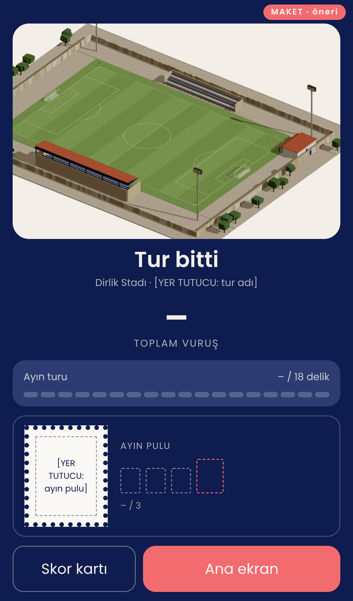 | | |
| 6 · Tur sonu | | |

Adım 2 (19 Kasım; açık tribünün önü, köprü, koridor): üstte delik ekranı, altta atış ekranı.

| 6 · Açık tribünün önü | 8 · Koridor köprüsü | 9 · Duvar içi koridor |
|---|---|---|
| 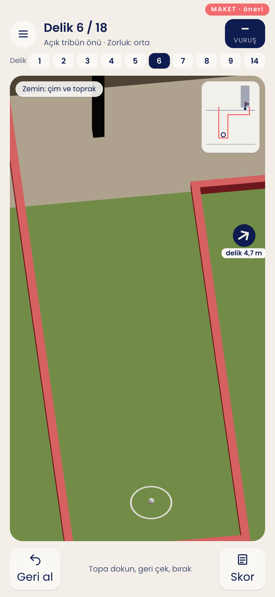 | 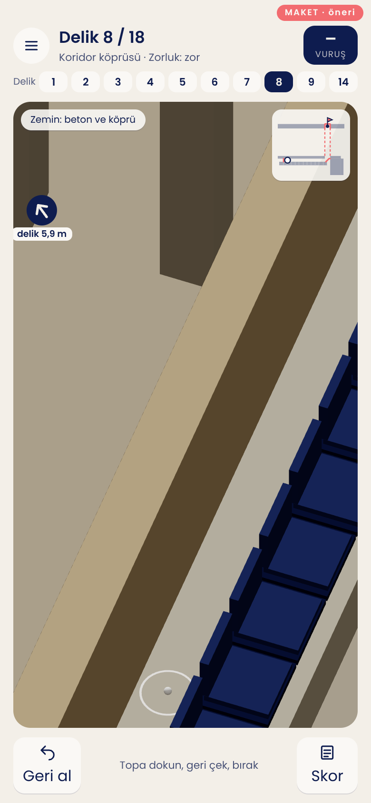 | 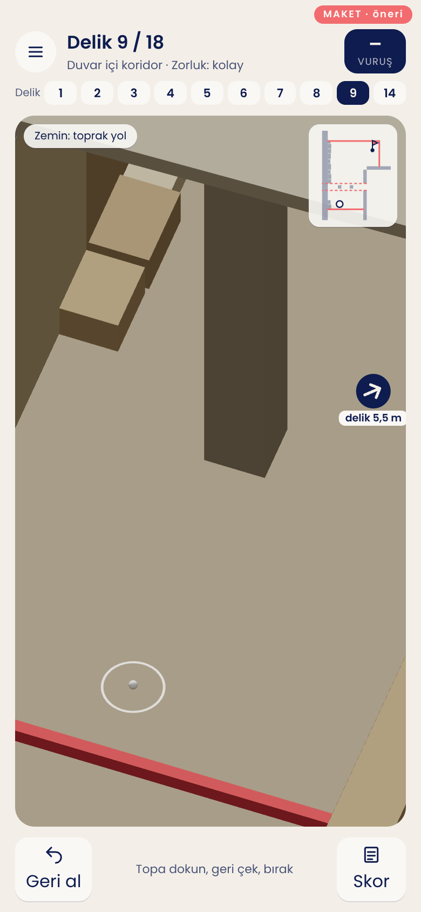 |
| 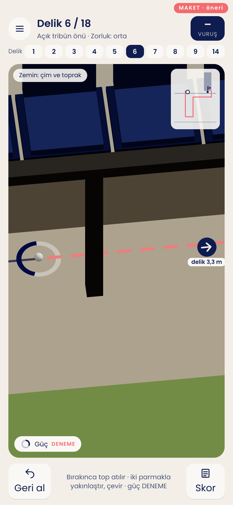 | 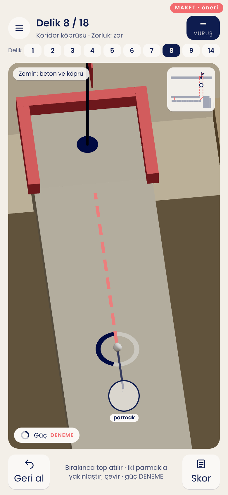 | 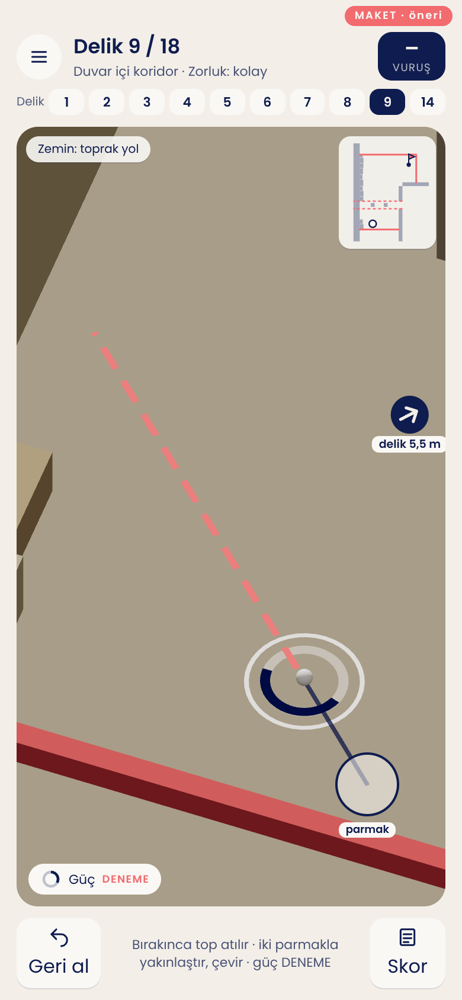 |

Adım 1 (18 Kasım; saha, çim; 19 Kasım'da eşyalar gerçeğe yakın ve yeni modelle yeniden alındı): üstte delik ekranı, altta atış ekranı.

| 1 · Orta yuvarlak | 2 · Kenar çizgisi | 4 · Köşe | 5 · Penaltı noktası |
|---|---|---|---|
| 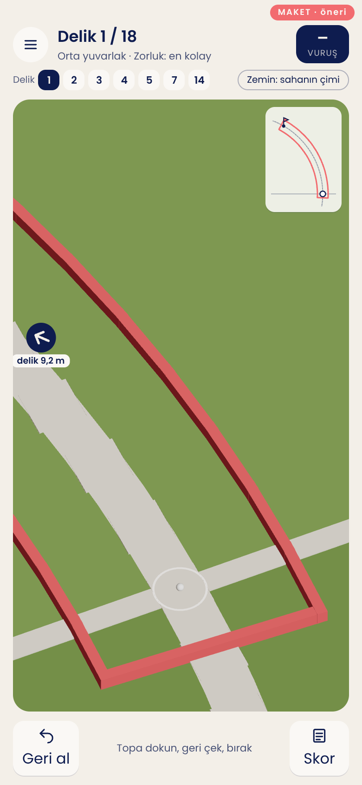 |  | 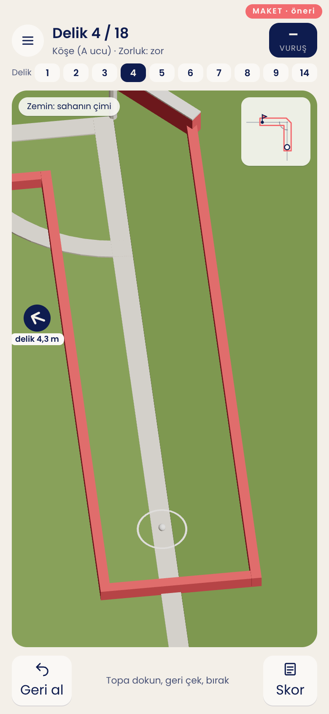 | 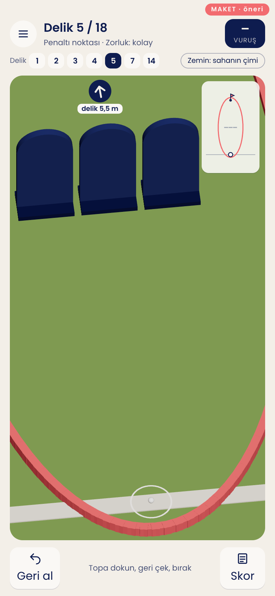 |
| 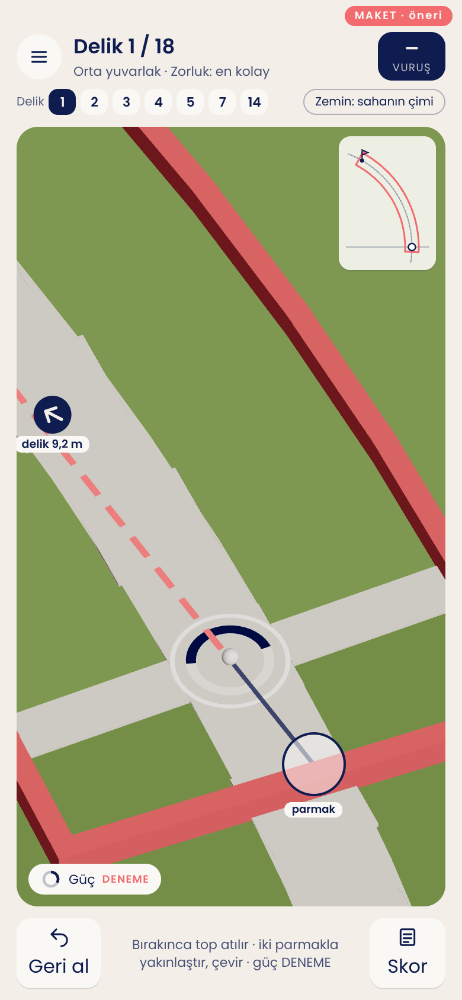 | 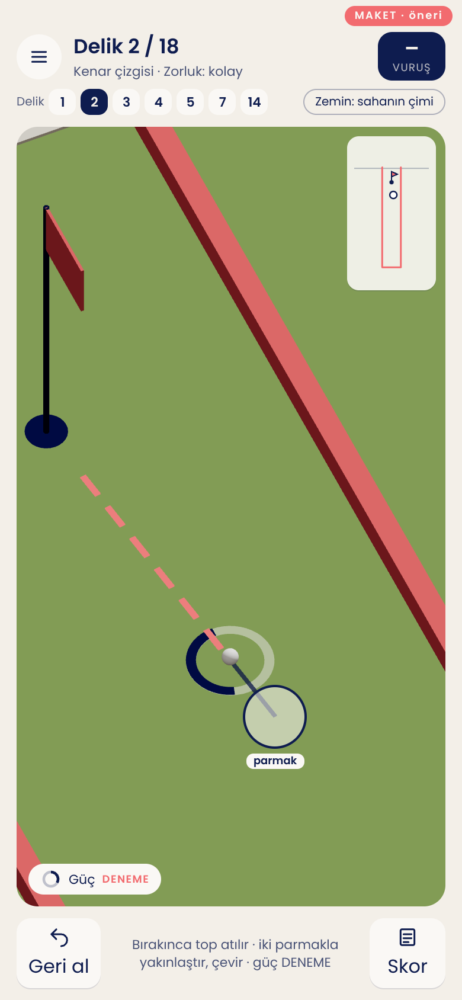 |  | 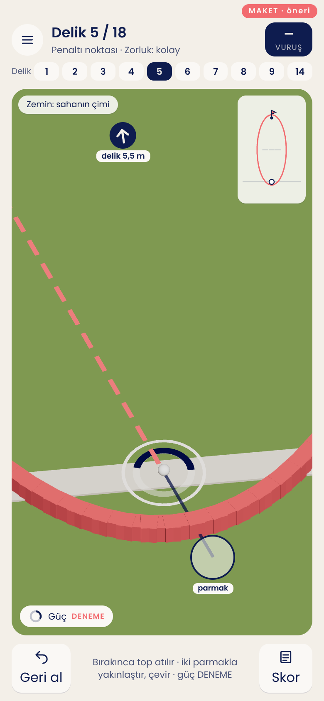 |

Örnek delikler (18 Kasım): üstte delik ekranı, altta atış ekranı.

| 3 · Kale | 7 · Açık tribün sıraları | 14 · Duşlar |
|---|---|---|
|  | 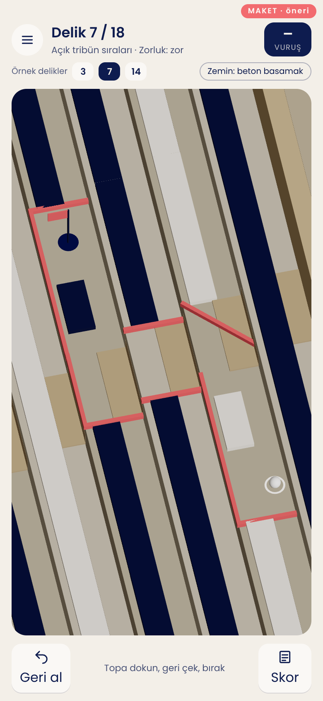 |  |
|  |  |  |
