# Minigolf · Tasarım belgesi

> **TASLAK.** Bu belge oyunun tek kaynağıdır. "Karar (Kemal, tarih)" yazanlar Kemal'in verdiği
> kararlardır; "Öneri" yazan her şey seçenektir, Kemal onaylamadı. Karar değişirse önce bu belge,
> sonra kod değişir. Ad, slogan, kurgu metni yok.

**Proje:** Minigolf (Kems Company). Çalışma adı: depo "minigolf", KKM'de "Mini Golf Duzada"
(Kemal'in yazdığı hâliyle; oyun içinde ve belgelerde yazım Düzada). Yayın adı: [Kemal].
**Depo:** `hkemal94/minigolf` · **Yol haritası:** `docs/yol-haritasi.md` · **Delik şeması:**
`docs/plan/stadyum-delik-plani.svg` (öneri; önizlemesi `docs/plan/plan-onizleme.png`, 4. bölümde).
**Ekran maketleri:** `docs/ekranlar/` (öneri; 11. bölüm).
**Yazan:** Oyun Tasarımcısı (Kems Ajans). Fikir belgesi 15 Kasım 2026; bu sürüm 16 Kasım 2026.
Onay Kemal'in.

**Okuma kuralı:** "[Kemal]" Kemal'in dolduracağı boş alandır. Delik ölçüsü, vuruş sınırı, süre, hız,
fiyat, reklam sıklığı gibi sayılar yazılmaz ("veri yok"). Denemek için konan onaysız değer "DENEME"
diye işaretlenir; bulunduğu yer web denemesidir, onaylayan Kemal'dir.

**Kaynaklar:** Kems Ajans `oneriler/minigolf-fikir-belgesi-15-11-2026.md` (Kemal'in 15 ve 16 Kasım
cevapları işli), Kemal'in 16 Kasım Stadyum soru turu cevapları ve plan üzerine verdiği 8 cevap (16 Kasım, kesin). Düzada bilgisi yalnız KKM'deki
`docs/03-duzada-kunyesi.md`'den. Stat kompleksinin yerleşimi Kemal'in beğendiği 3B Dirlik Stadı
modelinden (Kems Ajans `assetler/3b/binalar/dirlik-stadi.glb`, önizleme `dirlik-stadi-onizleme.jpg`).

**İlham:**
- 3B modelin önizlemesinden: bütün yerleşim alındı (saha, iki tribün, taş duvar, duvar içi toprak
  yol, ışık direkleri, kulüp binası, bayrak direği). Deliklerin yeri buna göre.
- Vikideki suluboya çizimden (KKM `public/viki/cizim-dirlik-stadi.jpg`): statın zeytinlik içinde,
  yukarıda durduğu ve denizin yalnız ufukta göründüğü hava alındı. Çizimde iki tribün aynı kenarda;
  plan 3B modele göre yapıldı, çizime göre değil.
- `assetler/ilham/stadyum/stadyum-01.jpg`'den: sahayı saran toprak yol ve sahanın kenarındaki alçak
  taş yapı fikri alındı (tribün altındaki soyunma odası fikri buradan; yeri Kemal'in 16 Kasım kararı). Görseldeki plaj ve birahane bu
  turda yok.
- Pinterest ve Behance'e bakılmadı. Bu belge oynanış ve yerleşim belgesi; görsel dil İllüstratör'ün işi (5. bölüm).

## Kararların geçmişi

En yeni üstte.

- **18 Kasım (Kemal, örneklerin ikinci hâline bakınca; kesin):**
  1. Deliğin yeri: kenarda ok ve uzaklık, köşede küçük plan (maketteki gibi).
  2. Kamera: maketteki uzaklık (delik ekranında yaklaşık 1,8 m, atışta yaklaşık 1 m yer görünür); ayrıca
     oyuncu **iki parmakla yakınlaştırıp uzaklaştırabilir ve açıyı çevirebilir**.
  3. **Delik çapı 10,8 cm.**
  4. **Bu dil 18 deliğe yayılır.** Kalan 15 delik aynı dille adım adım, ayrı PR'larda gelir (4.9).
- **18 Kasım (Kemal, örnek deliklere bakınca; kesin):**
  1. Dil 18 deliğe **henüz yayılmaz** ("duşlarda falan top ve delik yine çok büyük"). Yalnız üç örnek
     delik düzeltilir; Kemal yeniden bakar. (Aynı gün ikinci bakışta yayılma kararı çıktı; üstteki madde.)
  2. **Top ve delik gerçek ölçüde**; 4 kat büyütme kalktı. **Kamera topu yakından izler**; delik tek
     ekrana sığmazsa kamera kayar ya da yaklaşır, deliğin yeri işaretle gösterilir (4.8). Bu, 15 Kasım'daki
     "her delik tek ekranda" kararının yerine geçer (2. bölüm).
  3. **Pist kenarı kiremit** (ince bordür).
  4. Tribünde oturma tahtası yerine **tek tek tribün koltukları**; koltuklar engel olarak kullanılır.
     Model dosyasına dokunulmaz; koltuklar kodla çizilir.
- **18 Kasım (Kemal, maketlere bakınca; kesin):**
  1. **Ölçek:** pistler gerçek boyutlarda olur; gerçek minigolf pisti ölçüsünde ve statla oranlı (kale,
     penaltı noktası, tribün basamağı yanında doğru büyüklükte). Eski maketteki pist sahaya göre çok büyüktü.
  2. **Özgün delik:** her delik daha zorlu ve o yere özgü; jenerik düz pist yok. Yerin şekli, eğimi ve
     eşyası deliğin bulmacasını kurar.
  3. **Zemin:** pistin zemini mekânın kendi zeminidir (sahada çim, tribünde beton basamak, tünelde beton
     ya da zift, soyunma odası ve duşlarda karo, kulüp binasında ahşap ya da karo, yolda taş). Ayrı halı
     pist görünmez; sınır ince bir kenarla (yükseltilmiş ince bordür) belli olur.
  4. **Sıra:** önce 2–3 delik bu dille örnek çizilir; Kemal onaylayınca 18'e yayılır. Örnekler: 4.8.
     Öbür 15 delik (4.5) eski dildedir, **yeniden çizilecek**.

- **16 Kasım (Kemal'in plan cevapları, kesin):**
  1. Tünel ve soyunma odası (duşlarıyla) kapalı tribünün altında; tünel oradan sahaya açılır.
     Modelde yok, eklenecek; yeri karar (4.2, 4.5).
  2. Köşedeki kiremit çatılı yapı **kulüp binası**dır (Dirlik Spor Kulübü'nün binası; ad yok).
     10. delik kulüp binasının önünde ve saçağının altında (4.2, 4.5).
  3. 3B Dirlik Stadı modeli oyunda kullanılır (Kems Ajans yaptı; `docs/lisanslar.md`).
  4. Tribün sıraları, köprü, duşlar engel olarak kullanılır (3.2).
  5. Tur orta yuvarlakta başlar ve orada biter (4.3).
  6. Geri alınan vuruşun sayıdan düşüp düşmeyeceği denemeden sonra; o zamana kadar DENEME (2. bölüm).
  7. Oyuncu görünmez; ekranda yalnız top ve pist (1.3).
  8. Stadyum turu şimdilik **Ocak 2027**'nin ayın turu. İleride Ocak'a başka bir şey alınırsa Mart'a
     kayabilir (9. bölüm).
- **16 Kasım (Kemal: "ekranları önden görmek istiyorum"):** oyun yapılmadan önce ekranların maketi
  hazırlanır. Maketler öneridir, oynanış değildir (11. bölüm).
- **16 Kasım (Stadyum soru turu, kesin):** Turlar lokasyona göre, her tur 18 delik. İlk tur yalnız
  stat kompleksi. Her statta olan genel eşya ve bölümler kullanılabilir, ad yok. Pist gerçek
  minigolf pisti. Bütün engel türleri var, hareketliler en son. Zorluk dalgalı. Tur süresi, ortam ve
  görsel dil önerilenle. "Top dışarı kaçarsa" açık, DENEME.
- **16 Kasım:** Bütün ada değil; önce basit bir yer (Stadyum). Plan çizilir, delik delik denenir.
  Imperial'deki uzun tur sonra. Ayın görevi: ayın turunu bitirmek; takvim ayı; geçen ayın turu
  sonradan bitirilebilir.
- **15 Kasım:** Fikir belgesinin 7 sorusu cevaplandı (kamera, ekran yönü, Düzada bağı, vuruş
  sınırı, delikler, yardımcılar, para modeli). Ödül: ortak pul koleksiyonu.

## 1. Öz ve oyuncu

### 1.1 Oyun bir cümlede

Düzada'nın yerlerine kurulmuş gerçek minigolf pistlerinde, topu tek parmakla çekip bırakarak deliğe
sokulan, sakin ve cezasız bir telefon minigolf oyunu.

**Karar (Kemal, 15 Kasım):** telefon önce, dikey, tek elle. Web deneme sürümü önce, telefon
uygulaması sonra.

### 1.2 Ruhu

**Karar (Kemal, 15 Kasım):** turlar Düzada'nın yerlerinde geçer; oyuncu bir yerin farklı
bölümlerinde adım adım ilerler, sanki oralara gerçek minigolf parkurları kurulmuş gibi.

**Öneri:**
- Sakin ve cezasız: süre yok, kaybetme yok, "oyun bitti" yok. Vuruş yalnız sayılır.
- Her delik küçük bir bulmaca: açıyı ve gücü oyuncu kendi hızında dener.
- Ödülün yarısı yerin kendisi: oyuncu adanın bir köşesini maket gibi gezer. Delik ne kadar yerin
  eşyasıyla kurulursa o kadar "Düzada"dır.
- Ekran dolu ve kompakt: boş delik kalmaz, ekrana yayılmaz (öbür oyunlardan taşınan tercih).

### 1.3 Oyuncu

**Karar (Kemal, 16 Kasım)**: oyuncu görünmez; ekranda yalnız top ve pist (yer, pistin çevresinde dekor). Oyuncunun bir
karakteri, adı, yüzü yok.

## 2. Oynanış: kamera ve kontrol

**Karar (Kemal, 15 Kasım):**
- Kamera eğik yukarıdan 3B (izometrik); ~~her delik tek ekranda~~. **Karar (Kemal, 18 Kasım):** top ve
  delik gerçek ölçüde olduğu için kamera topu yakından izler; delik tek ekrana sığmazsa kamera kayar ya
  da yaklaşır, deliğin yeri işaretle gösterilir (4.8). Oyuncu iki parmakla yakınlaştırıp uzaklaştırabilir
  ve açıyı çevirebilir.
- Ekran **dikey**, oyun **tek elle** oynanır.
- Yardımcılar: **nişan çizgisi**, **geri al vuruş**, **kaldığı yerden devam**.
- Delik başına vuruş sınırı: sonra; web denemesinden sonra Kemal karar verir.

**Öneri:**
- **Çek-bırak vuruş:** oyuncu topa dokunur, başparmağını geri çeker (ne kadar çekerse o kadar
  güçlü), bırakınca top atılır. Çekerken topun önünde ince bir nişan çizgisi çıkar. Güç-çekme oranı DENEME.
- Nişan çizgisi yalnız yönü gösterir; sekmeyi gösterip göstermeyeceği DENEME (yardımın boyu Kemal'in).
- **Geri al:** son vuruştan önceki yere döner. Vuruş sayısından düşüp düşmeyeceği: DENEME; **Karar (Kemal, 16 Kasım)**,
  karar denemeden sonra.
- **Kaldığı yerden devam:** oyun kapanınca tur ve delik hatırlanır; açılınca aynı delikte, aynı vuruş sayısıyla.
- **Kamera:** **Karar (Kemal, 18 Kasım):** topu yakından izler; iki parmakla yakınlaştırma, uzaklaştırma
  ve açıyı çevirme var (tek elle oynamak için gerekmez, isteğe bağlı). Sınırları (en yakın, en uzak) DENEME.
- **Top dışarı kaçarsa** (pistten, köprüden, suya): vuruştan önceki yere döner, o vuruş sayılır, ek ceza yok.
  Durum: açık, DENEME (Kemal, 16 Kasım).
- **Delik sonu:** kısa sonuç (vuruş sayısı), "sonraki delik" ve "yeniden".
- **Tur sonu:** 18 deliğin vuruşları; ceza yok, "kaybettin" yok.

## 3. Turlar, delikler, engeller, zorluk

### 3.1 Tur ve delik düzeni

**Karar (Kemal, 16 Kasım):**
- Turlar mahalleye göre değil **lokasyona** göre. Her lokasyon bir tur, **her tur 18 delik**. Aynı
  mahallede başka bir lokasyon ayrı bir 18 delikli tur olabilir.
- **İlk tur yalnız stat kompleksi** (Dirlik Stadı). Birahane, plaj, zeytinlik, sokak bu turda yok.
  **Karar (Kemal, 16 Kasım)**: statın köşesindeki kiremit çatılı yapı kulüp binasıdır; tur yalnız önünden ve saçağının
  altından geçer (10. delik), içine girmez.
- Pist gerçek bir minigolf pistidir; yerin eşyası pistin çevresinde ve engel olarak durur.
  **Karar (Kemal, 18 Kasım):** pist gerçek boyutlardadır ve zemini yerin kendi zeminidir; ayrı halı
  yok, sınır ince bordür (4.8).
- Künyede ayrıca yazmayan ama **her statta olan genel eşya ve bölümler** kullanılabilir (kale, köşe
  bayrağı, tünel, soyunma odası, tribün sıraları gibi). Ad yok.
- Ortam: maç olmayan, sakin bir gün.
- Imperial'deki uzun tur sonra; otelin planları (The Imperial Kemskoy deposu ve künye; otel 1954
  yapımı) kullanılır, plan dışı yer uydurulmaz.

**Öneri:**
- **Tur süresi:** 18 kısa delik; her delik tek ekranda biter. Turun toplam süresi DENEME. Tek oturuşta
  bitebilsin; yarıda bırakılırsa kaldığı yerden devam.
- **Tur başında ve sonunda** turun kuşbakışı planı görünür (18 deliğin yeri; Stadyum için şemadaki gibi).
- **Sonraki tur adayları** (yalnız künyede adı ya da tarifi geçen yerler; her biri ayrı 18 delik):
  Deniz Feneri ve Fener Burnu; Liman ve mendirek; Dondurmacı Kızlar; The Imperial Kemsköy ve Sahil
  Merdiveni (uzun tur); Kemsköy Caddesi; Sade Meyhane; Merkez Meydanı; Küçükçetmi Çiftliği; Kuzey Plajı
  ve Taraftar Birahanesi; Ada Tepesi (antik duvarlar Kemal'e sorulmadan kullanılmaz); Sahil Yolu.
  Kullanılmaması önerilen: ibadet ve mezar yerleri. Sırası [Kemal].
- Her yerin planından önce künyede ve vikide yeri, rakımı, çevresi yeniden okunur; varsa ortak 3B model temel alınır.

### 3.2 Engeller

**Karar (Kemal, 16 Kasım):** engellerin hepsi var: yerin eşyaları; klasik engeller (tünel, rampa,
köprü); su ve kum tuzakları; hareketli engeller. **Hareketli engeller en son deliklerde.**

**Karar (Kemal, 16 Kasım)**: tribün sıraları, köprü ve duşlar engel olarak kullanılır; statın genel eşyası yalnız
çevrede durmaz, engel de olur.

**Öneri:**
- **Yerin eşyası önce gelir.** Bir delikte engel gerekiyorsa önce o yerde zaten olan şeye bakılır
  (direk, sıra, basamak, duvar); klasik engel ancak yerin eşyası yetmezse.
- **Bir delik, bir yeni şey.** Yeni engel türü bir delikte tek başına tanıtılır; sonraki deliklerde
  öncekilerle karışır.
- **Klasik engeller yerin kılığına girer:** rampa tribün önünde, köprü koridorun üstünde, tünel oyuncu
  tünelinde. Yel değirmeni gibi yere yabancı süs yok.
- **Su ve kum:** kum topu yavaşlatır; su "dışarı kaçma" sayılır (2. bölüm, DENEME).
- **Hareketli engeller** (açılıp kapanan kapı, kayan blok, dönen kol): yavaş, düzenli, tahmin
  edilir; oyuncu bekleyip zamanlayabilir. Hızlar DENEME.
- Engeller basit biçimli: top ayaklara, ince parçalara takılmaz.

### 3.3 Zorluk eğrisi

**Karar (Kemal, 16 Kasım):** zorluk delikten deliğe ve turdan tura **değişken**; düz artmaz.

**Öneri:**
- **Dalga:** iki-üç delik zorlaşır, ardından bir **nefes deliği** gelir (kısa, kolay, yeni şey
  öğretmez; tek vuruşla bitme sevinci). Turun sonu en zor; final turun başladığı yere döner.
- **Zorluğu artıranlar:** dar geçit, sekme gereği, eğim ve basamak, tuzak, birden çok engel,
  zamanlama. Zorluğu azaltanlar: geniş pist, kısa mesafe, tek engel.
- **Turdan tura:** her tur kendi dalgasını taşır; ikinci tur birincinin sonundan başlamaz. Bir tur
  baştan sona "daha kolay" ya da "daha zor" olabilir (ör. Stadyum yumuşak bir ilk tur, Imperial uzun
  ve zor bir tur). Turların zorluk sırası [Kemal].
- Zorluk kelimeyle yazılır (en kolay, kolay, orta, zor, en zor); "par" ya da sayı yok, denemeden sonra Kemal.
- Stadyum turunun dalgası 4.4'te.

## 4. Stadyum turu (Dirlik Stadı, 18 delik)

### 4.1 Yer (künye)

- **Dirlik Stadı:** künye "Ada hayatı · 2" (iki tribünlü), "Ada hayatı · 3" (1980'ler; devlet yaptı,
  eski toprak sahanın yerine). Yukarıda, denize yakın değil; deniz en çok ufukta görünür (Kems Ajans
  ortak kuralları, "Dirlik Stadı'nın yeri"). Haritada `bina_stad_tribun`.
- **Stadyum Mahallesi:** künye "Mahalleler", "Ada hayatı · 4". Bu turda yalnız statın içi.
- Bu turda deniz, kıyı ve plaj yok. Deniz yalnız arka planda, ufukta.

### Delik şeması (4. bölümün eki)

Kuşbakışı düzen ve 18 deliğin kartları (öneri, ölçeksiz; ad ve sayı yok). **18 Kasım:** 3, 7 ve 14
yeni dille örnek çizildi, ardından adım 1'de 1, 2, 4 ve 5 (4.8, 4.9); yedisi şemada kiremit çerçeveyle
işaretli, gerçek ölçüleri yanlarında. Kalan 11 kart eski dildedir, "yeniden çizilecek" diye işaretli. Asıl dosya
`plan/stadyum-delik-plani.svg`, aşağıdaki önizlemesi `plan/plan-onizleme.png`.

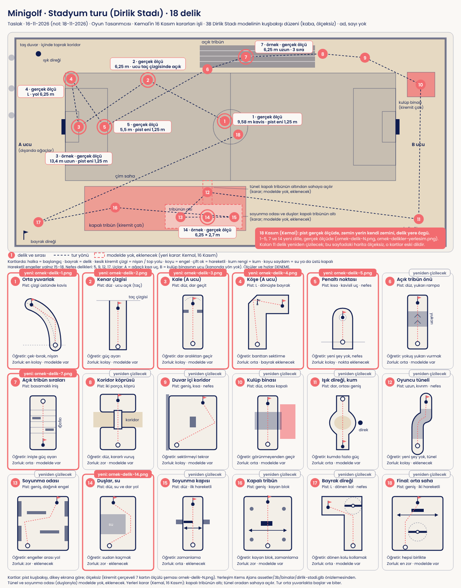

### 4.2 Temel: 3B model

**Öneri:** tur, Kemal'in beğendiği 3B Dirlik Stadı modelinin üstüne kurulur; delikler modelin gerçek
parçalarına oturur. Modelin önizlemesinde görülenler:

- **Çim saha:** dikdörtgen; orta yuvarlak, orta çizgi, iki ceza sahası, iki kale.
- **Kapalı tribün:** bir uzun kenarda, kiremit renkli çatılı; altında kapalı bir hacim (tribün altı),
  çatıyı taşıyan direkler.
- **Açık tribün:** karşı uzun kenarda, çatısız, birkaç sıra.
- **Taş duvar:** bütün kompleksi saran alçak duvar.
- **Duvar içi toprak yol:** duvarla saha arasında, sahayı saran koridor.
- **Işık direkleri:** önizlemede iki çapraz köşede görünüyor (öbür iki köşe önizlemede yok ya da görünmüyor).
- **Kulüp binası:** sahanın bir kısa ucunda, açık tribün tarafına yakın, kiremit çatılı küçük yapı.
  **Karar (Kemal, 16 Kasım)**: Dirlik Spor Kulübü'nün binası; ad yok.
- **Bayrak direği:** kompleksin bir köşesinde, duvarın dibinde.
- **Ağaçlar:** duvarın dışında, bir kısa uçta (dekor; pist yok).

Bu belgede uçlar şöyle anılır: **A ucu** = duvar dışında ağaçların olduğu kısa uç; **B ucu** = köşe
binasının olduğu kısa uç. Kapalı tribün A ucuna yakın durur; açık tribün ortaya ve B ucuna yakın.
Kanonda yön (kuzey, güney) yok; ad yok.

**Modelde olmayanlar (eklenecek):**
- **Soyunma odası (duşlarıyla):** **Karar (Kemal, 16 Kasım)**: kapalı tribünün altındaki kapalı hacmin içinde.
- **Oyuncu tüneli:** **Karar (Kemal, 16 Kasım)**: soyunma odasından, kapalı tribünün altından sahaya açılır. Ağzının
  tam yeri öneri: kapalı tribünün ortasına yakın, saha kenarında (şemadaki gibi).
- **Saha eşyası:** köşe bayrakları ve penaltı noktası önizlemede seçilmiyor; her sahada olan eşya
  olarak eklenir.
- Model: **Karar (Kemal, 16 Kasım)**: oyunda kullanılır; kaynağı `docs/lisanslar.md`'de (Kems Ajans yaptı).

### 4.3 Turun akışı

**Karar (Kemal, 16 Kasım)**: tur orta yuvarlakta başlar ve orada biter.

**Öneri** (aradaki yol): tur orta yuvarlaktan A ucunu dolaşır, açık tribüne çıkar, duvar içi koridordan B
ucuna geçer, kapalı tribünün altına (tünel, soyunma odası) iner, kapalı tribünün sıralarından ve A
ucundaki bayrak direğinden geçip orta yuvarlakta biter.

- Saha, A ucu: 1–5
- Açık tribün ve koridor: 6–9
- B ucu (kulüp binası, ışık direği): 10–11
- Kapalı tribünün altı (tünel, soyunma odası): 12–15
- Kapalı tribün, A ucu köşesi, final: 16–18

Kullanılmayan parça: B ucundaki ceza sahası ve kale (yedek; Kemal isterse bir delik oraya taşınabilir).

### 4.4 Zorluk dalgası ve yeni şeyler

**Öneri:**
- Dalga: 1 en kolay · 2 kolay · 3 kolay · 4 orta · **5 kolay (nefes)** · 6 orta · 7 orta · 8 zor ·
  **9 kolay (nefes)** · 10 orta · 11 orta · **12 kolay (nefes)** · 13 zor · 14 zor · 15 orta (ilk
  hareketli) · 16 zor · **17 orta (nefes)** · 18 en zor.
- **Adım 1 sonrası ilk beş delik (öneri):** 1 en kolay (kavisli kenara yaslanma) · 2 kolay (güç ayarı; açık
  uç) · 3 orta (dar açı ve köşeden sektirme; 4.8) · 4 orta (direğin çevresinden sektirme) · **5 kolay (nefes)**.
  İki delik ısınma, iki delik zorlaşma, ardından nefes. 3'ün eski hâli kolaydı; yeni hâli orta olduğu için
  1 ve 2 kolay tutuldu.
- Yeni engel türlerinin ilk geldiği delik: dar geçit (3), bant sektirme (4), rampa (6), basamak (7),
  köprü (8), kapalı bölüm (10), kum (11), tünel (12), dağınık engel (13), su (14), hareketli: kapı (15),
  kayan blok (16), dönen kol (17).

### 4.5 Delikler

> **18 Kasım (Kemal):** bu bölümdeki delikler eski dildedir (jenerik pist, ölçeksiz). 1, 2, 3, 4, 5, 7 ve
> 14'ün yeni hâli 4.8'de (geçerli olan odur); kalan 11 delik aynı dille **yeniden çizilecek** (karar;
> adımlar 4.9'da).

Her delik aynı sırayla: yer (modelin hangi parçası) · standın yerleşimi · pist biçimi · engeller ·
zorluk · öğretir · deneme notu. Hepsi **Öneri**.

**1 · Orta yuvarlak**
- Yer: çim saha, orta yuvarlak (modelde var).
- Standın yerleşimi: pist orta çizgiye dik, orta yuvarlağın üstünden geçer; iki tribün iki yanda dekor.
- Pist: düz, kısa.
- Engeller: yok. Saha çizgileri yalnız çizgi.
- Zorluk: en kolay.
- Öğretir: çek-bırak ve nişan çizgisi.
- Deneme notu: delik dikey ekranda tek bakışta sığıyor mu; başparmakla çekmek rahat mı; geri al
  çalışıyor mu. Kamera açısı, güç-çekme oranı: DENEME.

**2 · Kenar çizgisi**
- Yer: çim saha, açık tribün tarafındaki kenar çizgisi, A yarısı (modelde var).
- Standın yerleşimi: pist kenar çizgisine paralel; bir yanında saha, öbür yanında toprak koridor.
- Pist: uzun, düz.
- Engeller: yok; yalnız kenar bantları.
- Zorluk: kolay.
- Öğretir: güç ayarı.
- Deneme notu: uzun pist tek ekrana sığıyor mu (sığmazsa kısalır, tek ekran kuralı önde).

**3 · Kale (A ucu)**
- Yer: A ucundaki ceza sahası ve kale (modelde var).
- Standın yerleşimi: pist ceza sahasından kaleye; delik kalenin içinde.
- Pist: düz, sonunda dar geçit.
- Engeller: iki kale direği (geçit), kale ağı (deliğin arkasında yumuşak duvar, topu sektirmeden durdurur).
- Zorluk: kolay.
- Öğretir: dar aralıktan geçirmek.
- Deneme notu: direkten sekme doğal mı; ağ yumuşak durduruyor mu. Geçit genişliği: DENEME.

**4 · Köşe (A ucu)**
- Yer: A ucunda, açık tribün tarafındaki saha köşesi (köşe bayrağı eklenecek).
- Standın yerleşimi: pist kenar çizgisi boyunca gider, köşede döner.
- Pist: L.
- Engeller: köşe bayrağı direği, dönüşün köşesinde (kestirmeyi kapatır).
- Zorluk: orta.
- Öğretir: banttan sektirme.
- Deneme notu: bant topu tahmin edilir açıyla veriyor mu; nişan çizgisi sekmeyi göstersin mi (DENEME, karar Kemal'in).

**5 · Penaltı noktası (nefes)**
- Yer: A ucundaki ceza sahası, penaltı noktası (eklenecek küçük işaret).
- Standın yerleşimi: kısa pist penaltı noktasından kaleye doğru.
- Pist: kısa, düz.
- Engeller: yok.
- Zorluk: kolay.
- Öğretir: yeni şey yok; tek vuruşla bitirme, nefes.
- Deneme notu: fazla mı kolay, sıkıcı mı.

**6 · Açık tribün önü, rampa**
- Yer: açık tribünün önü, sahayla ilk sıra arası (modelde var).
- Standın yerleşimi: pist sahadan başlar, rampayla tribünün ilk sırasının hizasına çıkar.
- Pist: düz, ortada yukarı rampa.
- Engeller: rampa (klasik); tribünün önü pistin bir kenarı.
- Zorluk: orta.
- Öğretir: yokuş yukarı vurmak; az güç topu geri getirir.
- Deneme notu: izometrik açıda rampa "yukarı" okunuyor mu; top geri kayıp başlangıca dönüyor mu. Eğim: DENEME.

**7 · Açık tribün sıraları**
- Yer: açık tribünün sıraları (modelde var).
- Standın yerleşimi: pist üst sıradan aşağı, sıraların üstüne kurulmuş.
- Pist: basamaklı iniş.
- Engeller: sıralar (basamak); iki sırada oturak parçası pistin bir yanını kapatır.
- Zorluk: orta.
- Öğretir: inişte gücü azaltmak.
- Deneme notu: basamak yüksekliği izometrik açıda görünüyor mu; top basamakta takılıyor mu. Basamak
  sayısı modelin sıra sayısına bağlı; yükseklik DENEME.

**8 · Koridor köprüsü**
- Yer: açık tribünün B ucuna yakın ucu ve arkasındaki duvar içi toprak koridor (modelde var).
- Standın yerleşimi: pistin bir parçası tribünün ucunda, öbür parçası koridorun karşı yanında; arada
  koridor boşluğu, üstünde dar köprü.
- Pist: iki parça, ortada köprü.
- Engeller: köprü (klasik). Köprüden düşen top dışarı kaçmış sayılır (DENEME).
- Zorluk: zor.
- Öğretir: düz ve kararlı vuruş.
- Deneme notu: köprü tek elle vurulabilir genişlikte mi; düşmek kızdırıyor mu. Genişlik: DENEME.

**9 · Duvar içi koridor (nefes)**
- Yer: açık tribün tarafında, B ucuna doğru giden toprak koridor (modelde var).
- Standın yerleşimi: pist koridor boyunca; bir yanı taş duvar, öbür yanı saha.
- Pist: geniş, kısa.
- Engeller: ortada tek sade blok; duvar bant gibi.
- Zorluk: kolay.
- Öğretir: yeni şey yok; sektirmenin rahat tekrarı.
- Deneme notu: duvarın arkasında ufuk ve zeytinlik görünüyor mu, ekranı kalabalık yapıyor mu.

**10 · Kulüp binası**
- Yer: B ucundaki kiremit çatılı kulüp binası (modelde var). **Karar (Kemal, 16 Kasım)**: delik binanın önünde ve
  saçağının altında.
- Standın yerleşimi: pist binanın önünden geçer; bir bölümü saçağın altında.
- Pist: düz, ortası üstü kapalı.
- Engeller: saçak (pistin bir bölümü üstü kapalı, top kısa bir an görünmez); binanın duvarı bant.
- Zorluk: orta.
- Öğretir: görünmeyen bölümden geçirmek.
- Deneme notu: kapalı bölümde top saydam mı görünsün, hiç mi görünmesin: DENEME.

**11 · Işık direği, kum**
- Yer: B ucunda, kapalı tribün tarafındaki köşe; ışık direğinin dibi, toprak koridor (modelde var).
- Standın yerleşimi: dar pist koridor boyunca; direk pistin kenarında.
- Pist: dar, ortası genişleyen.
- Engeller: direğin dibinde kum tuzağı (klasik; toprak yolun kumu), topu yavaşlatır; direğin gövdesi.
- Zorluk: orta.
- Öğretir: kumda fazla güç gerekir.
- Deneme notu: kum ekranda ayırt ediliyor mu; kumdan çıkış adil mi. Yavaşlatma: DENEME.

**12 · Oyuncu tüneli (nefes)**
- Yer: oyuncu tüneli (**modelde yok, eklenecek**). **Karar (Kemal, 16 Kasım)**: kapalı tribünün altından sahaya açılır.
- Standın yerleşimi: pist tünelin içinde, saha kenarından tribün altına.
- Pist: uzun, tek hafif kıvrım; tünel duvarları bant.
- Engeller: tünelin kendisi (klasik).
- Zorluk: kolay.
- Öğretir: yeni şey yok; sahadan içeri geçişin anı.
- Deneme notu: tünel içi okunur mu (ışık); tavan pisti kapatıyorsa saydam olsun mu: DENEME.

**13 · Soyunma odası**
- Yer: soyunma odası (**modelde yok, eklenecek**). **Karar (Kemal, 16 Kasım)**: kapalı tribünün altı.
- Standın yerleşimi: pist odanın zemininde; duvar boyunca dolaplar, ortada banklar.
- Pist: geniş, dağınık engelli.
- Engeller: banklar (ortada), dolaplar (kenarda, bant gibi).
- Zorluk: zor.
- Öğretir: birden çok engel arasından yol bulmak.
- Deneme notu: bank ayakları topu takmamalı; delik bankın arkasında görünmez olmamalı.

**14 · Duşlar, su**
- Yer: soyunma odasının duş bölümü, kapalı tribünün altı (**modelde yok, eklenecek**).
- Standın yerleşimi: pist duş bölümünün zemininde.
- Pist: düz; ortasında su birikintisi, bir yanında dar kuru yol.
- Engeller: su tuzağı (klasik); suya düşen top dışarı kaçmış sayılır (DENEME).
- Zorluk: zor.
- Öğretir: sudan kaçmak; dar ve güvenli yolu seçmek.
- Deneme notu: su açıkça "girme" diyor mu; kuru yolun genişliği: DENEME.

**15 · Soyunma odası kapısı (ilk hareketli)**
- Yer: soyunma odasının tünele açılan kapısı (**modelde yok, eklenecek**).
- Standın yerleşimi: pist kapının iki yanında; kapıdan geçer.
- Pist: düz.
- Engeller: açılıp kapanan kapı (hareketli; yavaş, tek).
- Zorluk: orta.
- Öğretir: zamanlama.
- Deneme notu: kapının hızı ve açık kalma süresi: DENEME; oyuncu bekleyebildiğini anlıyor mu.

**16 · Kapalı tribün**
- Yer: kapalı tribünün sıraları, çatının altı (modelde var).
- Standın yerleşimi: geniş pist sıralar boyunca, çatı direklerinin arasında.
- Pist: geniş, düz.
- Engeller: çatıyı taşıyan direkler (yerin eşyası); ortada sağa sola kayan blok (hareketli, klasik).
- Zorluk: zor.
- Öğretir: kayan engeli direklerin arasından zamanlamak.
- Deneme notu: çatı pisti kapatıyor mu (kapatıyorsa saydam: DENEME); bloğun hızı: DENEME.

**17 · Bayrak direği (nefes)**
- Yer: A ucunda, kapalı tribün tarafındaki kompleks köşesi; duvarın dibindeki bayrak direği (modelde var).
- Standın yerleşimi: L pist köşeyi döner; bayrak direği dönüşte.
- Pist: L.
- Engeller: bayrak direğinin dibinde yavaş dönen kol (hareketli, klasik).
- Zorluk: orta.
- Öğretir: dönen engelde boşluğu kollamak; finalden önce nefes.
- Deneme notu: kolun hızı: DENEME; kol bandın sekmesini bozuyor mu.

**18 · Final: orta yuvarlak**
- Yer: çim saha, orta yuvarlak; tur başladığı yerde biter (modelde var).
- Standın yerleşimi: pist orta yuvarlağın üstünde, 1. delikten geniş.
- Pist: geniş, iki bölümlü.
- Engeller: ortada dönen kol, deliğin önünde kayan blok (iki hareketli birlikte).
- Zorluk: en zor.
- Öğretir: öncekilerin hepsi; iki zamanlamayı sıraya koymak.
- Deneme notu: iki hareketli birlikte haksız mı geliyor; geri al burada ne kadar kullanılıyor (veri
  yok, denemede bakılır).

### 4.6 Oda oda deneme sırası

**Karar (Kemal, 16 Kasım):** plan çizilir, delik delik (oda oda) adım adım denenir.

**Öneri:**
- Web denemesine önce yalnız 1. delik çıkar; çek-bırak, nişan çizgisi, geri al ve kamera orada oturur.
- Kemal "tamam" deyince bir sonraki delik eklenir; her delik bir öncekinin üstüne, tek tek.
- Yeni engel türünün ilk geldiği delikte durulur, o tür ayrıca denenir: 3, 4, 6, 7, 8, 10, 11, 12,
  13, 14, 15, 16, 17.
- Her delikte aynı üç soru: tek ekranda mı, tek elle mi, yeni şey anlaşılıyor mu.
- "Kaldığı yerden devam" 5. delikten sonra denenir.
- 12–15 (tünel, soyunma odası) için önce bu bölümlerin modele eklenmesi gerekir (yeri karar: kapalı
  tribünün altı, Kemal 16 Kasım); eklenmeden bu deliklere geçilmez. O sırada 16–18 öne alınmaz (hareketliler en son).
- 18 delik bitince bir kez baştan sona oynanır: dalga hissediliyor mu, tur süresi uygun mu (DENEME).
- Vuruş sınırı ve "top dışarı kaçarsa" kuralı bu denemelerden sonra Kemal'in kararı.

### 4.7 Bu turda gerekecek parçalar

**Öneri** (görsel üretimi değil, liste; ad ve marka yok):
- Modelden: saha, iki tribün, taş duvar, toprak koridor, ışık direkleri, kulüp binası, bayrak direği.
- Eklenecek yerler (kapalı tribünün altında): oyuncu tüneli, soyunma odası (dolaplar, banklar), duş
  bölümü, kapı.
- Eklenecek saha eşyası: köşe bayrakları, penaltı noktası, kale ağı (modelde kalelerin ağı seçilmiyor).
- Pist parçaları: ince bordür (halı yok; zemin yerin kendi zemini, Kemal 18 Kasım), rampa, köprü, kum, su, kayan blok, dönen kol, delik ve bayrak, top.

### 4.8 Örnek delikler: yeni dil (18 Kasım)

**Karar (Kemal, 18 Kasım):** gerçek ölçü, mekânın kendi zemini, yere özgü ve daha zorlu delik; önce
örnekler. Kemal üç örneği gördü ve **bu dilin 18 deliğe yayılmasına karar verdi**; kalan 15 delik 4.9'daki
adımlarla gelir. Üç deliğin içindeki DENEME değerleri denemede yeniden bakılır.
Hareketli engel yok (en sona).

**Ölçüler ve kaynakları** (kodda `src/maket/olculer.ts`; birim metre):

| Ne | Ölçü | Kaynak |
|---|---|---|
| Kale: direklerin iç yüzleri arası; üst direğin yerden yüksekliği | 7,32 · 2,44 | IFAB Oyun Kuralları, Kural 1 |
| Kale sahası (direkten yana ve içeri) · ceza sahası · penaltı noktası | 5,5 · 16,5 · 11 | IFAB, Kural 1 |
| Direk ve çizgi genişliği en çok · orta yuvarlak yarıçapı · köşe bayrağı en az | 0,12 · 9,15 · 1,5 | IFAB, Kural 1 |
| Saha: taç çizgisi 90–120, kale çizgisi 45–90 (modelde 90 × 58) | 90 × 58 | IFAB, Kural 1; 3B model |
| Beton norm minigolf pisti (boy × en) | 12 × 1,25 | ÖBGV kural kitabı 2.3 "Minigolf (Concrete)" (WMF-2.4) |
| Minyatür (eternit) norm pist (boy × en) | 6,25 × 0,90 | Almanca Vikipedi "Bahnengolf" (ÖBGV ve WMF kural kitaplarına dayanır) |
| Keçe norm pist (boy; en 0,90) | 9–18 | aynı |
| Başlangıç işareti (beton pist): daire çapı | 0,30 | ÖBGV kural kitabı 2.3 |
| Minigolf topu çapı (aralık) | 0,037–0,043 | Almanca Vikipedi "Minigolf" |
| **Top (oyunda)** | 0,04267 | Golf topu en küçük çap 1,680 inç; R&A ve USGA Ekipman Kuralları (İngilizce Vikipedi "Golf ball") |
| **Delik (oyunda)** | 0,108 | Karar: Kemal, 18 Kasım (golf deliğinin çapıyla aynı, 4,25 inç) |
| Köşe yayı: köşe bayrağından, sahanın içine çeyrek daire | 1 | IFAB, Kural 1 |
| Saha çizgisinin eni (IFAB en çok 0,12) · sahanın çiminin çevre çimden yüksekliği | 0,14 · 0,04 | 3B model |
| Tribün basamağı: derinlik · yükseklik; oturma tahtası eni | 0,85 · 0,42 · 0,40 | 3B Dirlik Stadı modelinden ölçüldü |
| Açık tribünün taş merdiveni: en | 1,2 | 3B model |

Kaynak notları: IFAB sayfası (theifab.com, Kural 1) ve ÖBGV kural kitabı 2.3 (oebgv.at) 18 Kasım'da
okundu. WMF'nin kendi sitesi açılamadı; minyatür ve keçe pist sayıları Almanca Vikipedi'den, birincil
kaynaktan doğrulanmadı. Tribün basamağı için dış standart doğrulanamadı; ölçü modelin kendisinden (model IFAB
ölçüleriyle, metreyle çizilmiş). Kaynağı olmayan her değer DENEME: bordür (yükseklik 0,08, en 0,06),
bayrak boyu, koltuk eni ve aralığı, duş odasının eni ve bölmeleri, karo,
birikinti, kamera yakınlığı. Adım 1'de eklenen DENEME değerleri: başlangıcın (0,45) ve deliğin (0,3) arkasındaki
pay, 1. delikte yayın açısı (60°), 2. delikte deliğin taç çizgisine uzaklığı (1) ve pistin taç çizgisi
boyunca yeri, 4. delikte iki kolun bölüşümü ve eğik kenar (0,8), köşe bayrağı direğinin kalınlığı ve bayrağın
ölçüsü, penaltı noktasının çapı (0,22; IFAB çap vermez), 5. delikte kavisli kenarın derinliği (0,33).

**Ortak dil:**
- Pistin eni ve boyu gerçek minigolf pistinden: boy 5,5–13,4 m; en 1,25 m (sahadaki beş delik), tribünde
  koltukların arkasındaki oluk (0,35 m), duşta odanın kendisi.
- Zemin çizilmez; yerin zemini neyse o. Sınır ince, yükseltilmiş bordür. **Karar (Kemal, 18 Kasım):**
  pist kenarı kiremit.
- **Karar (Kemal, 18 Kasım): top ve delik gerçek ölçüde.** Top 4,27 cm (golf topunun en küçük çapı
  42,67 mm; R&A ve USGA Ekipman Kuralları). **Delik 10,8 cm (Karar: Kemal, 18 Kasım)**; golf deliğinin
  çapıyla aynı.
- **Karar (Kemal, 18 Kasım): kamera topu yakından izler.** Delik ekranında kamera topun yanındadır
  (ekranın eni yaklaşık 1,8 m yer gösterir); atışta daha da yaklaşır (yaklaşık 1 m). Top ilerledikçe kamera
  onunla kayar. **Oyuncu iki parmakla yakınlaştırıp uzaklaştırabilir ve açıyı çevirebilir**; sınırları
  DENEME. Makette bu hareket yok (sabit bir an); ilk delik denemesinde gelir.
- **Karar (Kemal, 18 Kasım): deliğin yeri.** Delik ekranda değilse kenarda deliğe bakan bir ok ve uzaklığı
  çıkar; köşede deliğin tamamını gösteren küçük plan durur (topun ve deliğin yeri). Delik ekrana girince
  ok kalkar, bayrak görünür.

**3 · Kale (A ucu)** · zemin: sahanın çimi · zorluk: orta (öneri; eskisi kolay)
- Yer: A ucundaki kale ve kale çizgisi (modelde var). Pist kale çizgisinin üstünde: kale sahası
  çizgisinin kale çizgisiyle birleştiği yerden (IFAB: direkten 5,5 m) uzak direğe.
- Ölçü: 13,4 m uzun (5,5 + 7,32 + pay), pist eni 1,25 m (beton norm pist); kalenin içi 7,32 × 2 m.
- Bulmaca: top kale çizgisi boyunca gider. Yakın direk pistin tam ortasında durur; top onu saha yanından
  sıyırmalı (dar açı). Direğin arkasına kaçan top yan ağda kalır (çıkmaz). Uzak direkteki 45° köşe topu
  sektirip kalenin içine çevirir; delik ağın içinde, uzak direğin dibinde. Kalenin içinde sınır ağın kendisi.
- Deneme notu: direği sıyırma açısı adil mi; ağ topu yumuşak durduruyor mu.

**7 · Açık tribün sıraları** · zemin: beton basamak · zorluk: zor (öneri; eskisi orta)
- Yer: açık tribünün 5., 4. ve 3. sıraları, ortadaki taş merdivenin doğusu (modelde var). **Karar (Kemal,
  18 Kasım):** oturma tahtası yerine tek tek koltuk; koltuklar engel. Makette modelin tahtaları bu bölgede
  çizilmez, yerlerine koltuklar kodla çizilir (model dosyası değişmedi).
- Ölçü: 6,25 m uzun (minyatür norm pist boyu). Pist, koltukların arkasında bir üst basamağın dibinde kalan
  oluk: 0,35 m (model). İki basamak iniş (2 × 0,42 m). Koltuk eni 0,43 m, aralığı 0,45 m (DENEME).
- Bulmaca: top 5. sıranın oluğunda koltukların arkasından gider. Sıradaki bir koltuk boş; boşluğun
  önündeki 45° köşe topu aradan öne çevirir, top bir basamak düşüp 4. sıranın oluğuna iner. 4. sırada
  aynı şey bir kez daha (boş koltuk başka yerde), top 3. sıraya düşer; delik 3. sıranın oluğunda. Koltuklar
  duvar gibidir: top aralarından geçemez, yalnız boş koltuktan geçer.
- Deneme notu: düşen top alt sıranın oluğunda duruyor mu; köşe doğru güçte topu yoluna devam ettiriyor mu.

**14 · Duşlar** · zemin: duşun karosu · zorluk: zor
- Yer: soyunma odasının duş bölümü, kapalı tribünün altı (**modelde yok, eklenecek**; makette oda kodla
  çizildi, içi görünsün diye duvarlar kesik).
- Ölçü: oda 6,25 m uzun (minyatür norm pist boyu); en 2,7 m, bölmeler 1,7 m, geçitler 1 m (DENEME).
- Bulmaca: üç duş bölmesi iki duvardan sırayla çıkar; top aralarından zikzak geçer (duvardan sektirerek
  daha az vuruş). Zemin süzgece doğru hafif eğimli (eğim DENEME); delik süzgecin kendisi. Açık duşun
  altındaki birikintiye giren top dışarı sayılır (DENEME).
- Deneme notu: eğim topu süzgece adil taşıyor mu; birikinti açıkça "girme" diyor mu.
- 18 Kasım: Kemal "duşlarda top ve delik yine çok büyük" dedi; top ve delik gerçek ölçüye indi.

**Adım 1 (18 Kasım; öneri, Kemal görmedi): 1, 2, 4, 5.** Yer saha, zemin sahanın çimi; pist eni dördünde
1,25 m (beton norm pist). Saha çizgileri modelden; modelde olmayan köşe yayı, köşe bayrağı ve penaltı noktası
IFAB ölçüsüyle kodla çizildi (4.7'deki "eklenecek saha eşyası"; model dosyası değişmedi). Hareketli engel yok.

**1 · Orta yuvarlak** · zemin: sahanın çimi · zorluk: en kolay
- Yer: orta yuvarlağın çizgisi (IFAB: yarıçap 9,15 m; modelde var). Tur burada başlar (Kemal, 16 Kasım).
  Başlangıç orta çizginin yuvarlağı açık tribün yanında kestiği yerde; pist çizginin üstünde A ucuna doğru kıvrılır.
- Ölçü: çizgi boyunca 9,58 m (yuvarlağın 60°'lik yayı; açı DENEME, boy keçe norm pistin 9–18 m aralığında).
- Bulmaca: pist düz değil, yuvarlağın kavsi. Top dış kenara bir kez yaslanır ve kavisle deliğe döner; ileri
  doğru vurmak yeter. Delik çizginin üstünde, yayın sonunda.
- Öğretir: çek-bırak ve nişan çizgisi.
- Deneme notu: kavisli kenar topu tahmin edilir biçimde taşıyor mu; 9,58 m ilk delik için uzun mu (kısalırsa açı küçülür).

**2 · Kenar çizgisi** · zemin: sahanın çimi · zorluk: kolay
- Yer: açık tribün yanındaki taç çizgisi, A yarısı (modelde var). Pist çizgiye dik: sahanın içinden taç çizgisine iner.
- Ölçü: 6,25 m (minyatür norm pist boyu). Delik çizgiden 1 m içeride (DENEME). Pistin çizgi boyunca yeri DENEME
  (A yarısının ortası).
- Bulmaca: pistin ucu açık; sınır taç çizgisinin kendisi. Çizgiyi geçen top taca çıkar (dışarı sayılır; kural
  2. bölümde, DENEME). Delik çizginin hemen önünde: yön kolay, iş güçte.
- Öğretir: güç ayarı.
- Deneme notu: taca çıkmak ikinci delikte kızdırıyor mu (kızdırıyorsa delik çizgiden uzaklaşır ya da uca alçak kenar gelir).
- Eski tarifte pist çizgiye paraleldi; açık uç için dik çevrildi.

**4 · Köşe (A ucu)** · zemin: sahanın çimi · zorluk: orta
- Yer: A ucunda, açık tribün yanındaki saha köşesi (modelde var); köşe bayrağı ve köşe yayı eklendi (IFAB: direk
  en az 1,5 m, yay 1 m).
- Ölçü: L pist; bir kol taç çizgisinin, öbürü kale çizgisinin üstünde. Yolun toplamı 6,25 m (minyatür norm pist
  boyu); kollar eşit, 3,13 m (bölüşüm DENEME). Dış köşede 45° eğik kenar (0,8 m, DENEME).
- Bulmaca: köşe bayrağının direği dönüşün tam ortasında durur; çizginin üstünden düz giden top direğe çarpar. Top
  direğin dışından dolanmalı, eğik kenardan sekip kale çizgisi boyunca dönmeli. Delik kale çizgisinin üstünde.
- Öğretir: banttan sektirme.
- Deneme notu: direğin çevresindeki aralık adil mi; nişan çizgisi sekmeyi göstersin mi (DENEME, karar Kemal'in).

**5 · Penaltı noktası (nefes)** · zemin: sahanın çimi · zorluk: kolay
- Yer: A ucundaki ceza sahası; ceza sahası çizgisinden penaltı noktasına (IFAB: 16,5 ve 11 m). Nokta eklendi.
- Ölçü: 5,5 m (16,5 − 11). Deliğin arkasındaki kavisli kenar 0,33 m derin (DENEME).
- Bulmaca: delik penaltı noktasının kendisi. Arkadaki kenar kavisli (elips; odakları başlangıç ve delik):
  başlangıçtan çıkıp bu kenara değen top noktaya döner. Yeni şey öğretmez; tek vuruşla bitme sevinci.
- Deneme notu: kavis topu gerçekten deliğe getiriyor mu (hız fazlaysa top delikten atlar mı); fazla mı kolay.

Makette görülen ve modelin kendisinde düzeltilmesi iyi olacak iki şey (Kems Ajans): sahanın çimi çevredeki
çimden 4 cm yüksek, taç ve kale çizgisinin üstünden geçen pistte basamak oluyor (1, 2, 4, 5 maketinde çevre çim
sahanın düzeyine getirildi; 3. delik maketinde düzeltilmedi, aynı basamak orada da var); orta yuvarlak kesik
parçalarla çizilmiş, yakından kare kare görünüyor (makette üstüne düz çizgi çizildi). Modelde köşe yayı, penaltı
yayı, penaltı noktası ve orta nokta da yok.

Üstten şemalar (ölçü çizgili) ve yedi deliğin stattaki yeri (ölçekli):

| | | | |
|---|---|---|---|
| 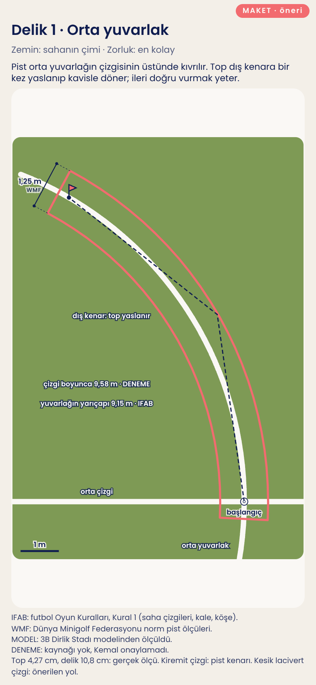 | 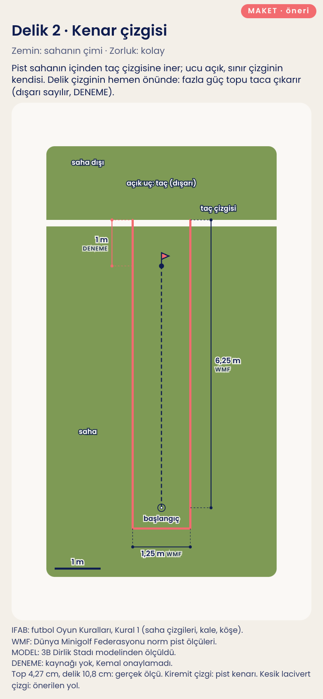 | 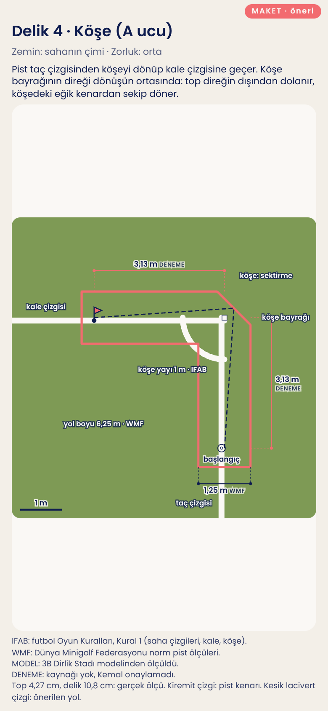 |  |
| 1 · Orta yuvarlak | 2 · Kenar çizgisi | 4 · Köşe | 5 · Penaltı noktası |
| 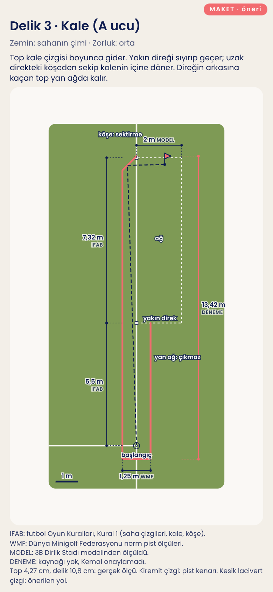 | 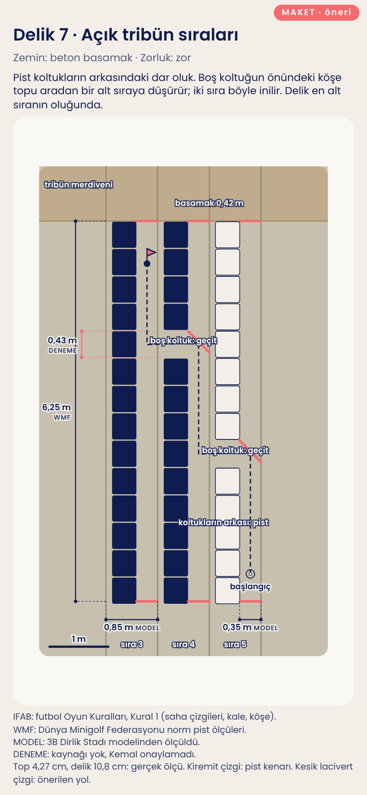 | 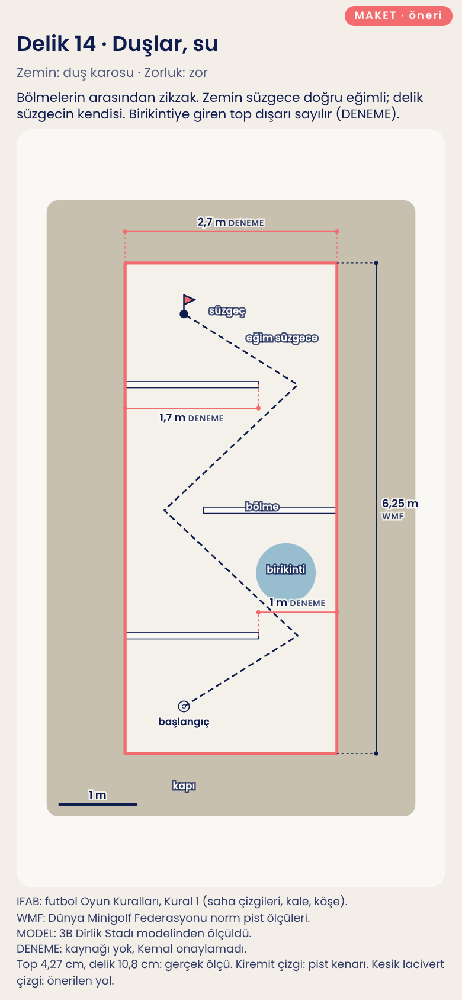 |  |
| 3 · Kale | 7 · Açık tribün sıraları | 14 · Duşlar | Stattaki yerleri (ölçekli) |

Modelle ilgili not: modelde toprak zemin ile çimin tabanı aynı yükseklikte olduğu için saha kenarında
titreme oluyordu; makette düzeltildi, modelin kendisinde de düzeltilmesi iyi olur (Kems Ajans).

### 4.9 Kalan 15 delik: adım planı (18 Kasım)

**Karar (Kemal, 18 Kasım):** dil 18 deliğe yayılır; kalan 15 delik aynı dille, adım adım, ayrı PR'larda gelir.

**Öneri** (sıra ve adım başına delik sayısı; Kemal değiştirebilir). Her adım tek PR: o deliklerin üstten
ölçülü şeması, delik ve atış maketi, belgedeki tarifi. Her adım bir öncekini Kemal gördükten sonra başlar.
Delikler yere göre toplandı; turun sırası (1–18) değişmez.

| Adım | Delikler | Yer | Zemin | Not |
|---|---|---|---|---|
| 1 | 1, 2, 4, 5 | Saha: orta yuvarlak, kenar çizgisi, köşe, penaltı noktası | çim | **Çizildi (18 Kasım, öneri; Kemal görmedi).** Tarifleri 4.8'de |
| 2 | 6, 8, 9 | Açık tribünün önü, koridor köprüsü, duvar içi koridor | beton, toprak yol, taş duvar | 7. delikle komşu |
| 3 | 10, 11 | Kulüp binası, ışık direği | binanın önü (zemini modelden bakılacak), toprak yol | B ucu |
| 4 | 12, 13, 15 | Oyuncu tüneli, soyunma odası, soyunma odası kapısı | beton ya da zift, karo | Bu yerler modelde yok; 14 gibi kodla çizilir. 15'in hareketli kapısı en sona kalır, önce durağan hâli |
| 5 | 16, 17, 18 | Kapalı tribün, bayrak direği, final (orta yuvarlak) | beton basamak ve koltuklar, toprak, çim | Hareketli engeller burada; en son |

Toplam 4 + 3 + 2 + 3 + 3 = 15 delik; adım 1'den sonra yeni dille 7 delik var, kalan 11 (adım 2–5). Her delikte: gerçek ölçü, yerin kendi zemini, kiremit ince kenar, yerin
şekli ve eşyasıyla kurulan bulmaca; kaynağı olmayan değer DENEME. 4.4'teki zorluk dalgası her adımda o
deliklere göre yeniden yazılır. 18 delik bitince 4.5 ve eski kartlı şema (4. bölümün eki) yenisiyle değişir.

## 5. Ses ve görsel dil

### 5.1 Ses

**Öneri** (Kemal onaylamadı):
- **Efektler:** vuruş, banttan sekme, deliğe girme, rampa ve basamak, kum, su, kapı ve hareketli
  engellerin hafif mekanik sesi. Az ve yumuşak.
- **Ortam:** boş, sakin stat: rüzgâr, uzaktan zeytinlik hışırtısı (künye "Doğa": zeytinlik). Maç
  olmayan gün; seyirci sesi yok. Tünel ve soyunma odasında ses biraz yankılı.
- **Müzik:** seyrek; ortam sesi önde (The Imperial Kemskoy'daki karara yakın).
- Efektler, ortam ve müzik ayrı kısılır.
- Sesler yalnız ücretsiz ve ticari kullanıma açık kaynaklardan; her biri `docs/lisanslar.md`'ye, kaynağı Kemal'e sorularak.

### 5.2 Görsel dil

**Karar (Kemal, 16 Kasım):** İllüstratör 2–3 deneme hazırlar; Kemal seçer. Seçim bu belgeye yazılır.

**Öneri:**
- Denemeler Stadyum turunun bir deliği üzerinden yapılır (öneri: 1. delik ya da 7. delik), dikey
  ekran, eğik yukarıdan; temel 3B modelin yerleşimi korunur.
- Renkler marka kitinden: lacivert, krem, az kiremit; yazı tipi Poppins. Modelin kiremit çatısı ve
  çimi kendi renginde kalır.
- Low-poly, mat yüzey (Dondurmacı Kızlar'daki tasarım dili örnek). Hangi dil olduğu: [Kemal].

## 6. Teknik, kapsam ve ilk sürüm

### 6.1 Teknik

**Öneri:**
- Vite + React + TypeScript; 3B için Three.js ve React Three Fiber (Dondurmacı Kızlar gibi). İskelet
  bu öneriyle kuruldu (16 Kasım).
- Fizik: hazır bir fizik kütüphanesi (ör. Rapier); Oyun Geliştiricisi ilk delik denemesinde seçer.
- 3B Dirlik Stadı modeli (`dirlik-stadi.glb`) sahnenin temeli; pistler modelin üstüne ayrı parçalar
  olarak konur. **Karar (Kemal, 16 Kasım)**: model oyunda kullanılır (`docs/lisanslar.md`).
- Her delik ayrı bir veri dosyası (pist parçaları, engeller, başlangıç ve delik yeri); kod delik delik büyür.
- Telefonda akıcılık önce: az çokgen, az ışık, ölçülü gölge.
- Telefon uygulaması sonra; paketleme öbür oyunlardaki gibi Capacitor.
- Başka minigolf oyununun görseli, adı, sahası, deliği kopyalanmaz; yalnız tür örnektir.

### 6.2 İlk oynanabilir sürüm

**Öneri:**
- Stadyum turunun 1. deliği: tek parmak vuruş, nişan çizgisi, geri al, delik sonu.
- Sonra delikler sırayla, her biri Kemal denedikten sonra (4.6).
- Türkçe ve İngilizce metin dosyaları.
- Web deneme sürümü: Kemal ve yakın çevresi bağlantıyla dener; reklam ve satın alma yok.
- İlk sürümde değil: reklam, satın alma, çok oyunculu, mevsim ve saat değişimi, ikinci tur, pul ekranı.

### 6.3 Para modeli

**Karar (Kemal, 15 Kasım):** yalnız telefon uygulamasında; kart oyunu gibi: ipucu gibi yardımcılar
reklamla, birkaç delikte bir seyrek reklam, reklamsız paket. Sıklık ve fiyat [Kemal]. Web
denemesinde reklam ve satın alma yok.

## 7. Açık sorular

Kemal'in kararını bekleyenler.

- **Kalan 15 deliğin adım sırası** (4.9): öneri; Kemal değiştirebilir.
- **İki parmakla yakınlaştırma ve çevirmenin sınırları:** DENEME, ilk delik denemesinde.
- ~~Örnek delikler (3, 7, 14) onay~~ Cevaplandı (Kemal, 18 Kasım): bu dil 18 deliğe yayılır (4.9).
- ~~Kameranın yakınlığı ve deliğin işareti~~ Cevaplandı (Kemal, 18 Kasım): maketteki uzaklık, ok ve uzaklık
  ve küçük plan; ayrıca iki parmakla yakınlaştırma ve çevirme (4.8).
- ~~Delik çapı~~ Cevaplandı (Kemal, 18 Kasım): 10,8 cm.
- ~~Top ve delik ne kadar büyük çizilsin?~~ Cevaplandı (Kemal, 18 Kasım): gerçek ölçü, kamera topu izler.
- ~~Bordürün rengi~~ Cevaplandı (Kemal, 18 Kasım): kiremit.
- ~~Tribünde oturma tahtaları~~ Cevaplandı (Kemal, 18 Kasım): tahta yerine tek tek koltuk, engel olarak.
- **Geri al vuruşu sayıdan düşer mi?** DENEME; karar denemeden sonra (Kemal, 16 Kasım; 2. bölüm).
- **Top dışarı kaçarsa:** öneri "vuruştan önceki yere döner, vuruş sayılır"; DENEME, karar denemeden sonra.
- **Vuruş sınırı:** web denemesinden sonra.
- **Nişan çizgisi sekmeyi göstersin mi?** (4. delik)
- **Delik ölçüsü, tur süresi, hızlar, eğimler:** DENEME, denemeden sonra.
- **Görsel dil:** İllüstratör'ün 2–3 denemesinden hangisi.
- **Sonraki turların sırası** ve Imperial uzun turunun zamanı; turların zorluk sırası.
- **Öbür ayların turu:** Stadyum Ocak 2027'nin; öbür aylar [Kemal].
- Oyunun yayın adı, tur adları: [Kemal].
- ~~Stadyum turunun yerleri, engel türleri, zorluk, ortam~~ Cevaplandı (Kemal, 16 Kasım): 3. ve 4. bölüm.
- ~~Tünel ve soyunma odasının yeri~~ Cevaplandı (Kemal, 16 Kasım): kapalı tribünün altı; tünel oradan sahaya (4.2).
- ~~Köşe yapısı ne?~~ Cevaplandı (Kemal, 16 Kasım): kulüp binası, ad yok (4.2).
- ~~Modelin kaynağı ve lisansı~~ Cevaplandı (Kemal, 16 Kasım): oyunda kullanılır (`docs/lisanslar.md`).
- ~~Genel stat bölümleri engel olsun mu?~~ Cevaplandı (Kemal, 16 Kasım): evet; tribün sıraları, köprü, duşlar (3.2).
- ~~Tur orta yuvarlakta başlayıp bitsin mi?~~ Cevaplandı (Kemal, 16 Kasım): evet (4.3).
- ~~Oyuncunun karakteri~~ Cevaplandı (Kemal, 16 Kasım): oyuncu görünmez; yalnız top ve pist (1.3).
- ~~Ayın turu~~ Cevaplandı (Kemal, 16 Kasım): Stadyum, Ocak 2027; ileride Mart'a kayabilir (9. bölüm).

## 8. Ödül: pul koleksiyonu

**Karar (Kemal, 15 Kasım):** minigolfün ödül sistemi bütün oyunların ortak pul koleksiyonudur: her ay
bir pul, çeyrekte üç pul toplanınca büyük 4. pul ("3+1"), her pul ayrı tasarım ve yazısız, ortak
koleksiyon sayfası (Kems Ajans `docs/pul-koleksiyonu.md`). Ayın pulu o ayın görevi bitince gelir.

**Öneri:** kod yapısı kart oyunundaki `src/pul/` klasörü örnek alınarak kurulur. Pulların tasarımı
İllüstratör'ün, onayı Kemal'in.

## 9. Ayın görevi

**Karar (Kemal, 16 Kasım):** ayın büyük görevi **ayın turunu baştan sona bitirmek**. Ayın pulu tur
bitince gelir. Ay takvim ayına bağlıdır; **geçen ayın turu sonradan bitirilebilir**. Turun içeriği
(hangi delikler) oyun yapılırken sorulur.

**Öneri:**
- Tur 18 deliğiyle bitince sayılır; vuruş sayısının önemi yok (cezasız ruh).
- Yarıda bırakılan tur ay bitse de kaldığı yerden sürer; bitince o ayın pulu gelir.
- **Karar (Kemal, 16 Kasım)**: Stadyum turu şimdilik **Ocak 2027**'nin ayın turu. Not: ileride Ocak'a başka bir şey
  alınırsa Mart'a kayabilir.
- Öbür ayların turu: [Kemal]. Turlar 18 delik olduğu için her ay yeni tur gerekmez; bir tur birden çok
  ay kullanılabilir ([Kemal]).

## 10. Sıra (öneri)

Her adım bir öncekinin onayıyla başlar; tarih yazılmaz.

1. **Stadyum delik planı** (Oyun Tasarımcısı): bu belge ve şema. Kemal onaylar ya da düzeltir.
2. **Tünel ve soyunma odası** modele eklenir (yeri karar: kapalı tribünün altı, Kemal 16 Kasım; 3B iş).
3. **İlk delik denemesi** (Oyun Geliştiricisi): 1. delik, fizik, vuruş, nişan çizgisi, delik sonu. Ölçüler DENEME.
4. **Görsel dil denemeleri** (İllüstratör, ayrı iş): 2–3 deneme; Kemal seçer.
5. Delikler sırayla (4.6), her biri Kemal denedikten sonra; hareketliler en son.
6. Ayın turu ve pul; sonra ikinci tur; telefon uygulaması.

## 11. Ekran maketleri (öneri)

**Karar (Kemal, 16 Kasım):** ekranlar önden görülür. Aşağıdakiler **maket**tir: oynanış değil, düğmeler
çalışmaz, top atılmaz. Her ekranın köşesinde "MAKET · öneri" yazar. Vuruşlar, ilerleme ve pul sayısı
boştur ("–"); ad yerine `[YER TUTUCU: …]` ya da `[Kemal]` durur. Ölçüler (pist, top, nişan çizgisi,
güç halkası) DENEME. Renkler marka kitinden, yazı Poppins; 3B stat, Kems Ajans'ın Dirlik Stadı modeli
(oyunda kullanımı Kemal'in 16 Kasım onayıyla). Ayın turu kutusunda "Ocak 2027" yazar (Kemal, 16 Kasım).

Uygulamada adresin sonuna `?maket=<ekran>` yazınca açılır (bilgisayarda ve telefonda); oyunun kendi
ekranına karışmaz. Görüntüler iPhone 13 boyutunda çekildi.

1. **Ana ekran** (`?maket=ana-ekran`): oyunun adı yer tutucu, 3B stat vitrini, tur kartı (Dirlik Stadı,
   18 delik, ilerleme boş), "Oyna", ayın turu ve pullar kutuları, alt menü (Oyna, Turlar, Pullar, Ayarlar).
2. **Tur seçimi** (`?maket=tur-secimi`): Stadyum turu kartı 3B statın küçük görüntüsüyle; sonraki turlar
   kilitli, yer tutucu (açılma kuralı [Kemal]).
3. **Delik ekranı** (`?maket=delik&no=1`, `2`, `3`, `4`, `5`, `7`, `14`): **18 Kasım'da yeniden yapıldı.**
   Yeni dille çizilen yedi delik (4.8). Kamera topun yanında; top ve delik gerçek ölçüde. Delik ekranda değilse kenarda ok ve uzaklığı,
   köşede deliğin tamamını gösteren küçük plan. Zemin yerin kendi zemini, kenar kiremit ince bordür.
4. **Atış ve nişan** (`?maket=atis&no=…`, aynı numaralar): kamera topa daha da yaklaşır; parmakla geri çekme
   göstergesi, kiremit kesik nişan çizgisi, topun çevresinde güç halkası. 2, 4 ve 5'te atış ekranı ikinci
   vuruşun anıdır (top deliğin ya da dönüşün yakınında), yerin eşyası görünsün diye.
   Ayrıca **üstten şema** (`?maket=sema&no=…`; `no=0` yedi deliğin stattaki yeri): ölçü çizgili.
5. **Skor kartı** (`?maket=skor-karti`): 18 deliğin listesi (plandaki yerleriyle), vuruşlar "–", DENEME.
6. **Tur sonu** (`?maket=tur-sonu`): toplam vuruş "–", ayın turu ilerlemesi (18 parça, boş), ayın pulu yer
   tutucusu ve 3+1 pul dizisi.

Kamera notu: örnek deliklerde kamera tam izometrik ve topu yakından izler; yakınlık maketteki gibi
(Kemal, 18 Kasım). Oyunda iki parmakla yakınlaştırılır ve çevrilir; makette bu hareket yok.
Eski 3. ve 4. maket (büyük krem pist) 18 Kasım'da kaldırıldı.

| | | |
|---|---|---|
| 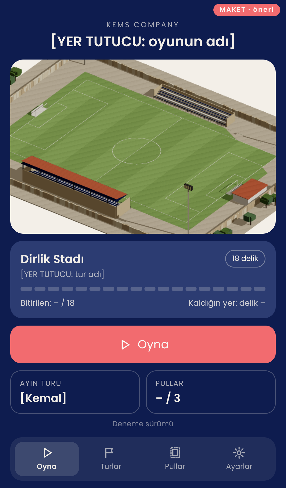 | 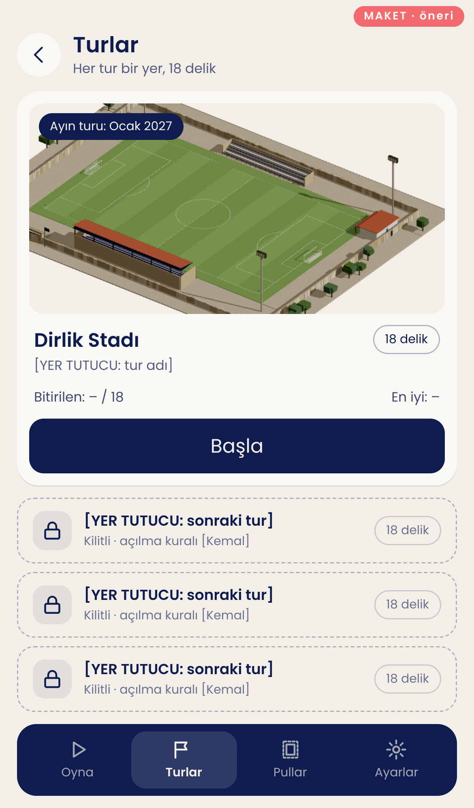 | 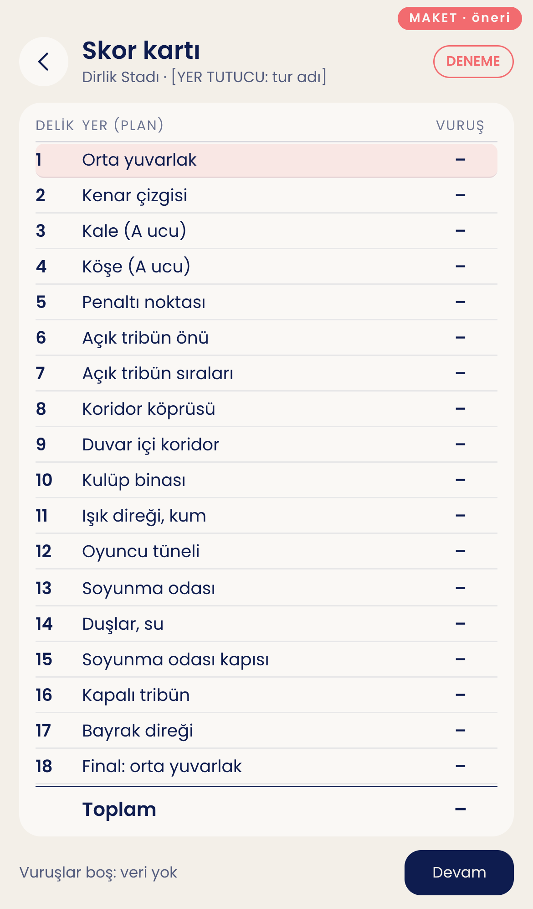 |
| 1 · Ana ekran | 2 · Tur seçimi | 5 · Skor kartı |
|  | | |
| 6 · Tur sonu | | |

Adım 1 (18 Kasım; saha, çim): üstte delik ekranı, altta atış ekranı.

| 1 · Orta yuvarlak | 2 · Kenar çizgisi | 4 · Köşe | 5 · Penaltı noktası |
|---|---|---|---|
|  | 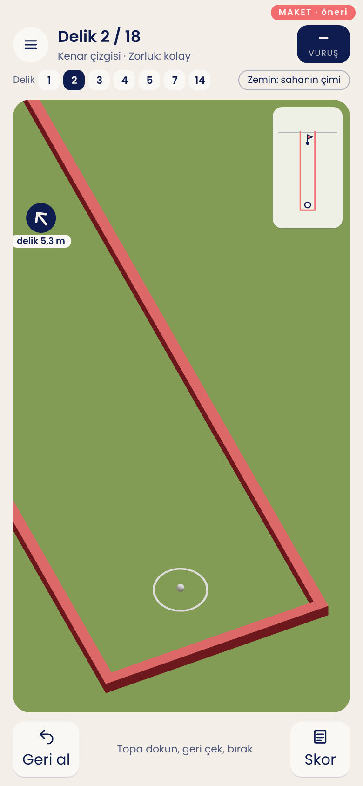 |  |  |
|  |  | 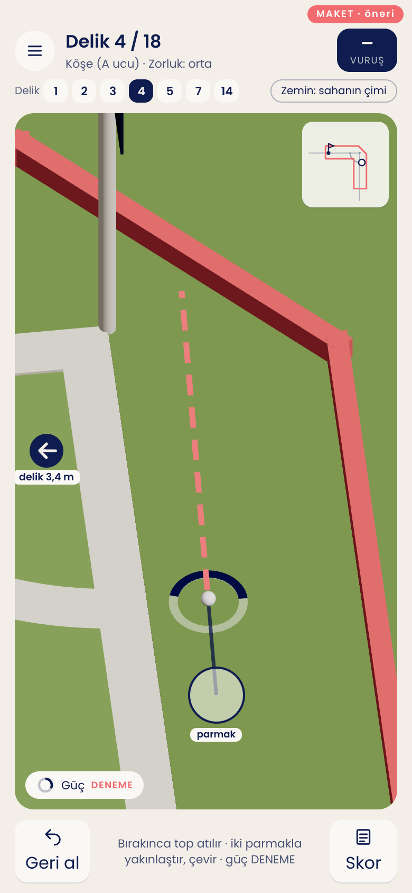 |  |

Örnek delikler (18 Kasım): üstte delik ekranı, altta atış ekranı.

| 3 · Kale | 7 · Açık tribün sıraları | 14 · Duşlar |
|---|---|---|
| 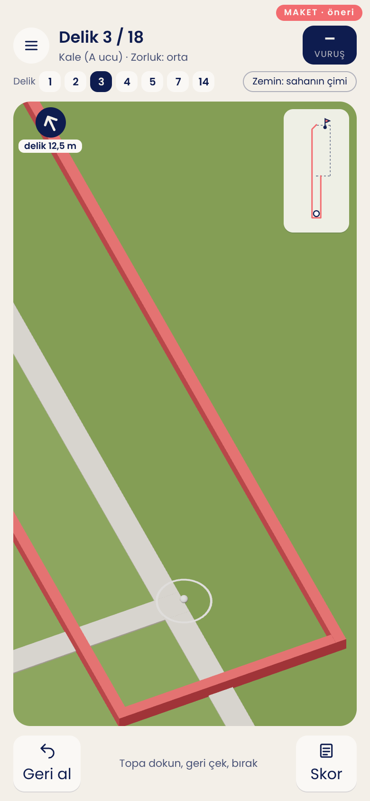 |  | 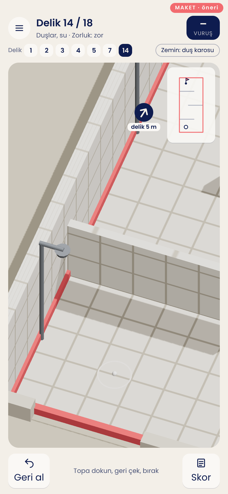 |
| 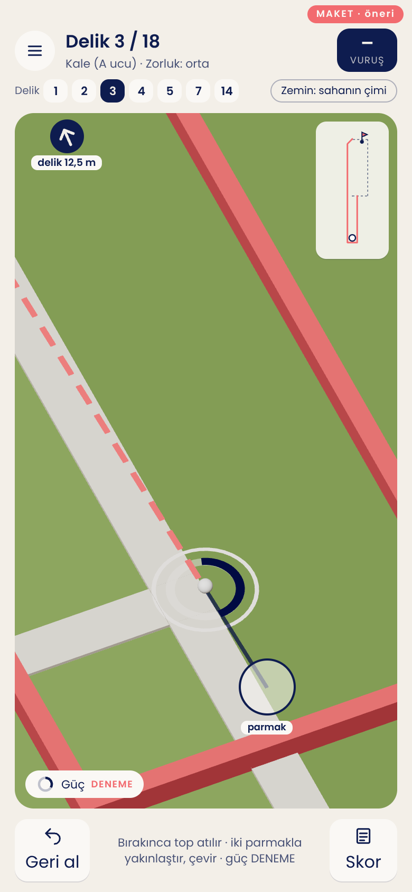 | 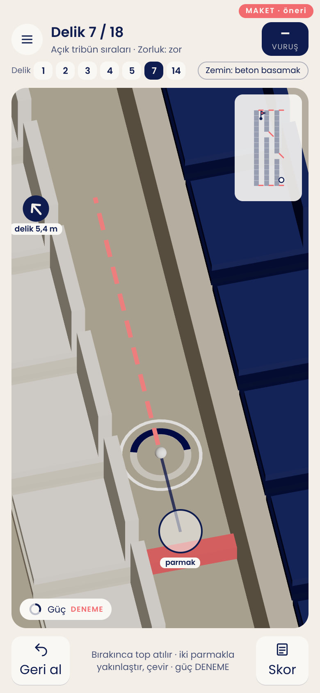 | 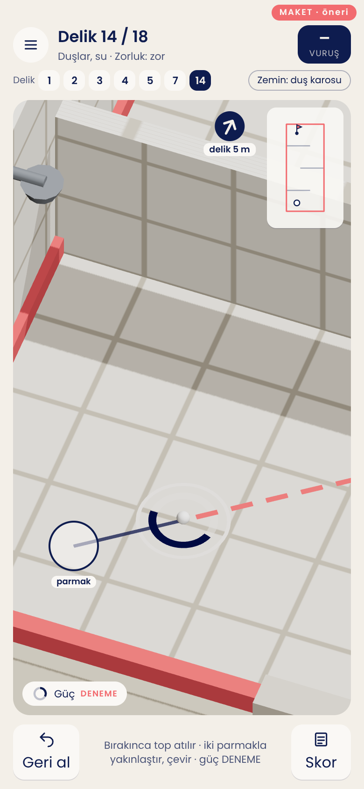 |
